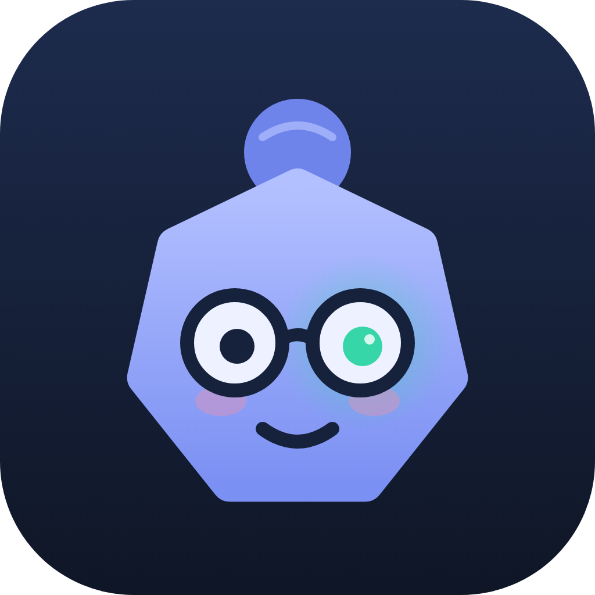
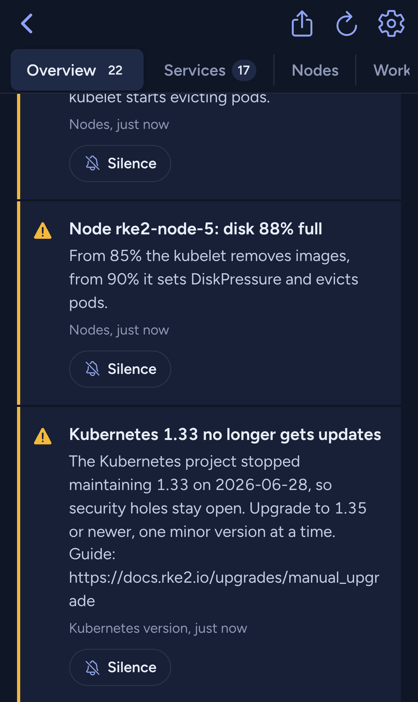
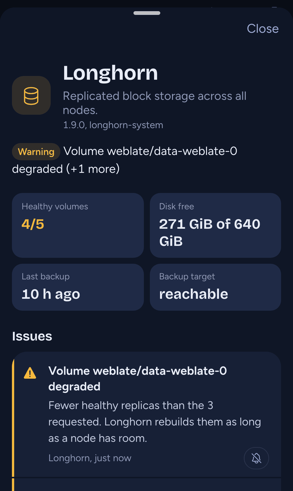

<p align="center"></p>

# Kubernanny

**Is my cluster okay, and if not, what exactly is wrong?**

[Website and docs](https://kubernanny.app) · [Live demo](https://demo.kubernanny.app) · iOS · Android · web · English and German · free and open source

Kubernanny answers that one question for self-hosted Kubernetes. A small agent in your cluster recognises what you run (Longhorn, Argo CD, cert-manager, CloudNativePG, Prometheus, Loki, kured and [about 70 more](docs/COMPONENTS.md)), checks each of them the way you would by hand, and shows each cluster's light in the nanny's eye. Below it: only what is broken right now, why, and the one action that usually fixes it.

<table>
<tr>
<td width="25%"></td>
<td width="25%"></td>
<td width="25%"></td>
<td width="25%"></td>
</tr>
</table>


It is not another cluster browser: kubenav, k9s and Lens are great for exploring resources. Kubernanny is for the moment your phone buzzes at 04:10, or the glance before you go to bed. [All screenshots](docs/SCREENSHOTS.md).

## Try it in ten seconds

Open the [demo](https://demo.kubernanny.app): the real app against a recorded cluster, with outages, warnings and an all-green state to switch between. The app itself has the same demo on its first screen, so you can look around before installing anything.

Or run the agent's demo cluster yourself:

```sh
docker run --rm -p 8080:8080 -e DEMO=broken ghcr.io/kubernanny/agent
```

Open the link the container prints. `DEMO=warning` and `DEMO=healthy` show the other states.

## Install

```sh
helm install kubernanny oci://ghcr.io/kubernanny/charts/kubernanny -n kubernanny --create-namespace
kubectl -n kubernanny logs deploy/kubernanny
```

The log shows a QR code. Scan it in the app or with your phone's camera, or open the link in a browser: that's the whole setup. The log carries only a one-time pairing code and the agent's public key; each device makes its own key pair, and every call is end-to-end encrypted, so it works the same over a VPN, the LAN or plain HTTP ([docs/PROTOCOL.md](docs/PROTOCOL.md)).


**From anywhere, without opening a port:** `relay.enabled: true`. The agent dials out to a relay that passes sealed messages along and can read none of them ([docs/RELAY.md](docs/RELAY.md)).

Other ways: `kubectl apply -f https://raw.githubusercontent.com/kubernanny/kubernanny/v0.3.0/deploy/install.yaml`, or an Argo CD Application pointing at `deploy/helm/kubernanny`. No ingress? `kubectl -n kubernanny port-forward svc/kubernanny 8080:80`: the agent serves the full web UI itself. [docs/CONFIGURATION.md](docs/CONFIGURATION.md).

## What it checks

| | |
|---|---|
| **Nodes** | NotReady (planned kured reboots are a warning, not an alarm), pressure, RAM ≥ 90 %, root disk ≥ 85 % |
| **etcd** | members, quorum, WAL fsync, leader changes |
| **Workloads** | CrashLoopBackOff and friends with logs of the crashed run, pods pending, stuck rollouts, failed CronJobs |
| **Volumes** | pending or lost PVCs, volumes ≥ 85 % full |
| **Longhorn** | degraded and faulted volumes, nodes, free disk |
| **cert-manager** | certificates not ready or expiring, issuers |
| **Argo CD** | degraded apps with the broken resource, out of sync (manual vs. automated explained), failed syncs |
| **CloudNativePG** | instances, WAL archiving, backup age |
| **Prometheus · Alertmanager** | targets down, your own firing alerts |
| **Grafana · Loki · kured · Velero · Flux · External Secrets · System Upgrade Controller · metrics-server** | their own health |
| **Kubernetes itself** | API server certificate, your Kubernetes minor against its end of support, deprecated APIs still in use before an upgrade removes them |
| **Uptime · Gatus · Uptime Kuma** | your own endpoint monitors, failing ones listed |
| **Security** | privileged containers, host access, root, missing memory limits, untagged images (hints); known vulnerabilities: built in (OSV.dev, off by default) only for the Kubernetes version and 13 recognised components, not your own images; **every image, your own included, when [Trivy Operator](docs/SECURITY-CHECKS.md#trivy-operator-trivy) runs in the cluster** (Kubernanny reads its reports, nothing leaves the cluster) |
| **Your own components** | anything you name in `customComponents`, matched by image |
| **Everything else it recognises** | workload health, version, URL |

Every threshold and issue: [docs/CHECKS.md](docs/CHECKS.md) and [docs/SECURITY-CHECKS.md](docs/SECURITY-CHECKS.md).

Plus the last seven days at a glance, backups across CloudNativePG, Longhorn, etcd and Velero (including what has none), home-screen widgets on iOS and Android, a plain-text status report to share in a forum, and the details for checking a cluster yourself: nodes, workloads, volumes, ingresses with their certificates, events and up to seven days of history.

## Actions, safely

Only on an open problem, and only what that problem needs: sync an Argo CD app, restart a crash-looping workload, start an overdue backup, uncordon a forgotten node and a few more, some of them off until you name them in `actions.enabled`. The agent takes the target from its own check, never from the request, and admission policies hold each permission to exactly what its action sends; a stolen phone can fix what is broken right now and nothing else. `rbac.allowActions=false` makes the agent strictly read-only. Every action: [docs/CHECKS.md](docs/CHECKS.md#actions); the security model: [docs/SECURITY.md](docs/SECURITY.md).

## You decide what it looks at

Every check and every action can be switched off, in Helm (`checks.disabled: [argocd]`, `actions.disabled: [restart]`) or in the app. Switched off in Helm, the permission goes too: the chart's RBAC is generated from what each module reads. What runs, reads, stores and connects to: [docs/IN-CLUSTER.md](docs/IN-CLUSTER.md); every permission and which value removes it: [docs/PERMISSIONS.md](docs/PERMISSIONS.md).

## Notifications

Straight to the Kubernanny app (sealed per phone, with a warning when the agent itself goes silent), or ntfy, Discord, Slack, Gotify or any JSON webhook. A problem is sent once it has lasted five minutes, again if it turns critical, and when it is resolved: [docs/NOTIFICATIONS.md](docs/NOTIFICATIONS.md).

## How it works


No account, no telemetry, nothing to sign up for. What leaves your cluster is what you switch on: notifications, the relay's sealed messages and pushes, and, off by default, version lookups at OSV.dev and the container registries. Every connection and what protects it: [docs/COMMUNICATION.md](docs/COMMUNICATION.md); the full list of outbound connections: [docs/IN-CLUSTER.md](docs/IN-CLUSTER.md).

## Documentation

Also at [kubernanny.app/docs](https://kubernanny.app/docs).

| | |
|---|---|
| **Use it** | [Components](docs/COMPONENTS.md) · [Checks](docs/CHECKS.md) · [Security checks and updates](docs/SECURITY-CHECKS.md) · [Notifications](docs/NOTIFICATIONS.md) · [Screenshots](docs/SCREENSHOTS.md) |
| **Run it** | [What runs in your cluster](docs/IN-CLUSTER.md) · [Permissions](docs/PERMISSIONS.md) · [Configuration](docs/CONFIGURATION.md) · [Remote access (relay)](docs/RELAY.md) |
| **Review it** | [Security model](docs/SECURITY.md) · [Communication](docs/COMMUNICATION.md) · [Protocol](docs/PROTOCOL.md) · [Decisions](docs/decisions/README.md) |
| **Change it** | [Architecture](docs/ARCHITECTURE.md) · [HTTP API](docs/API.md) · [Development](docs/DEVELOPMENT.md) · [Design](docs/DESIGN.md) · [Roadmap](docs/ROADMAP.md) · [Changelog](CHANGELOG.md) |

## Repository

```
agent/     the agent (Node, plain node:http): discovery, checks, actions, notifications, API, demo cluster
app/       Angular + Ionic + Capacitor app (iOS, Android, web); its web build ships inside the agent image
protocol/  the end-to-end protocol shared by agent, app and relay
relay/     the optional relay: Node (NestJS) and a Cloudflare Worker
deploy/    Helm chart, plain manifests, relay deployment
docs/      documentation, screenshots and diagrams; published at kubernanny.app/docs
website/   kubernanny.app: landing page and docs, prerendered (Analog/Angular)
e2e/       Playwright tests against the web demo and a running agent
fastlane/  App Store and Google Play releases (docs/RELEASING.md)
branding/  icon and logo
scripts/   screenshots, store screenshots, the diagram, the admission policy test
```

Contributions welcome, especially new components and checks: [CONTRIBUTING.md](CONTRIBUTING.md).

## Free, for good

No paid tier and no features held back. If Kubernanny saves you a night, you can support it with a donation; that's all.

## Licence

[Apache-2.0](LICENSE)

Made by Nico Lueg ([nicolueg.com](https://nicolueg.com)).
