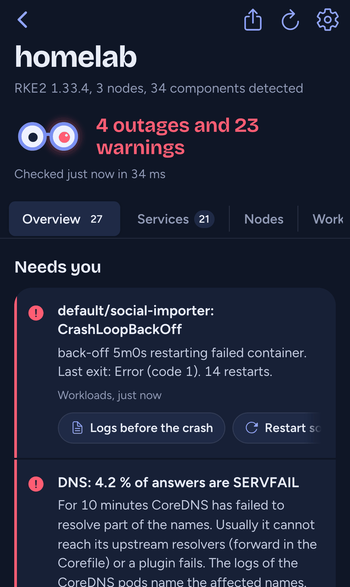
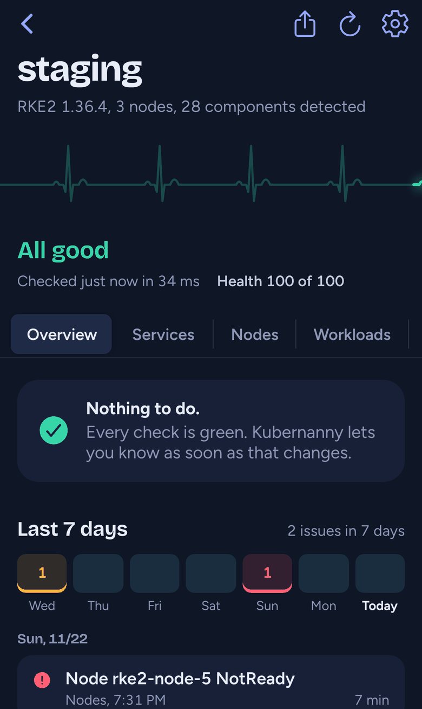
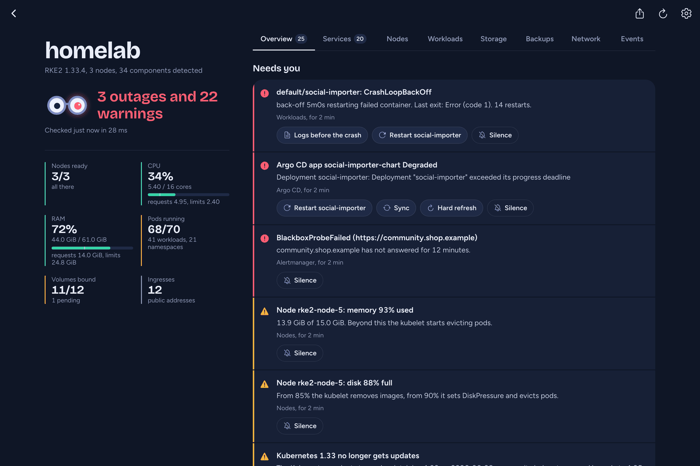
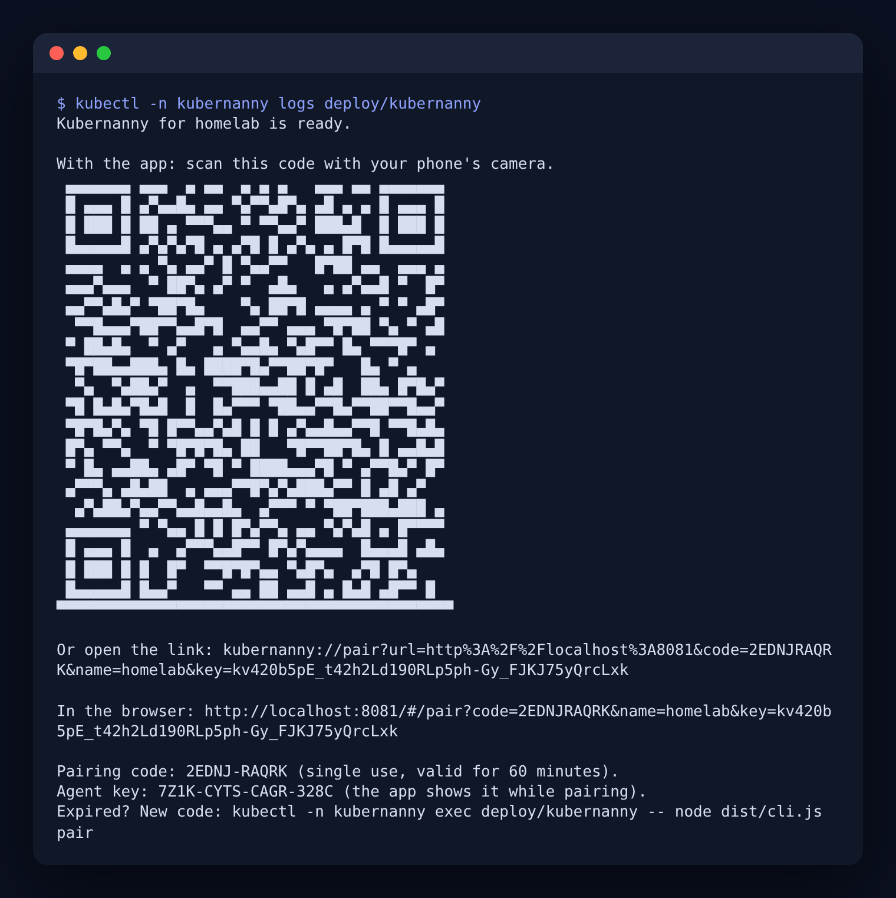
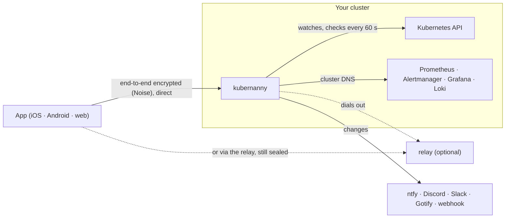
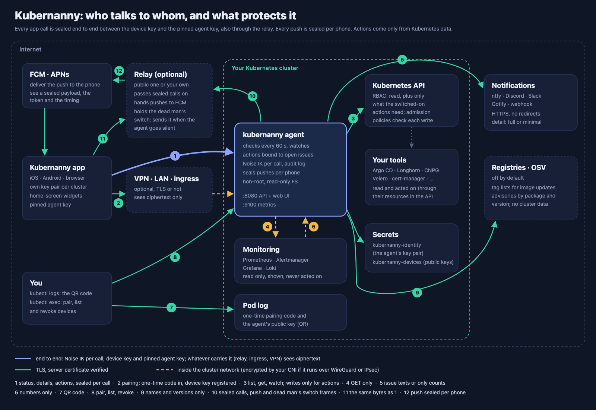

<p align="center"></p>

# Kubernanny

**Is my cluster okay, and if not, what exactly is wrong?**

[Website and docs](https://kubernanny.app) · [Live demo](https://demo.kubernanny.app) · iOS · Android · web · English and German · free and open source

Kubernanny answers that one question for self-hosted Kubernetes. A small agent in your cluster recognises what you run (Longhorn, Argo CD, cert-manager, CloudNativePG, Prometheus, Loki, kured and [about 70 more](docs/COMPONENTS.md)), checks each of them the way you would by hand, and shows each cluster's light in the nanny's eye. Below it: only what is broken right now, why, and the one action that usually fixes it.

<table>
<tr>
<td width="25%"></td>
<td width="25%"></td>
<td width="25%"></td>
<td width="25%"></td>
</tr>
</table>



It is not another cluster browser: kubenav, k9s and Lens are great for exploring resources. Kubernanny is for the moment your phone buzzes at 04:10, or the glance before you go to bed. [All screenshots](docs/SCREENSHOTS.md).

## Try it in ten seconds

Open the [demo](https://demo.kubernanny.app): the real app against a recorded cluster, with outages, warnings and an all-green state to switch between. The app itself has the same demo on its first screen, so you can look around before installing anything.

Or run the agent's demo cluster yourself:

```sh
docker run --rm -p 8080:8080 -e DEMO=broken ghcr.io/kubernanny/agent
```

Open the link the container prints. `DEMO=warning` and `DEMO=healthy` show the other states.

## Install

```sh
helm install kubernanny oci://ghcr.io/kubernanny/charts/kubernanny -n kubernanny --create-namespace
kubectl -n kubernanny logs deploy/kubernanny
```

The log shows a QR code. Scan it in the app ("Scan QR code") or with your phone's camera, or open the link in a browser. That's the whole setup. The log only carries a one-time pairing code (valid for an hour) and the agent's public key. Each device creates its own key pair, which never leaves it, and every call is end-to-end encrypted between device and agent, so it works the same over a VPN, the LAN or plain HTTP: [docs/PROTOCOL.md](docs/PROTOCOL.md).



**From anywhere, without opening a port:** switch on the relay (`relay.enabled: true`). The agent then dials out to a relay that only passes sealed messages along and can read none of them; your phone falls back to it whenever the cluster is not reachable directly. Run your own or use the public one: [docs/RELAY.md](docs/RELAY.md).

Other ways: `kubectl apply -f deploy/install.yaml`, or an Argo CD Application pointing at `deploy/helm/kubernanny`. No ingress? `kubectl -n kubernanny port-forward svc/kubernanny 8080:80` and open http://localhost:8080: the agent serves the full web UI itself. Configuration: [docs/CONFIGURATION.md](docs/CONFIGURATION.md).

## What it checks

| | |
|---|---|
| **Nodes** | NotReady (planned kured reboots are a warning, not an alarm), pressure, RAM ≥ 90 %, root disk ≥ 85 % |
| **etcd** | members, quorum, WAL fsync, leader changes |
| **Workloads** | CrashLoopBackOff and friends with logs of the crashed run, pods pending, stuck rollouts, failed CronJobs |
| **Volumes** | pending or lost PVCs, volumes ≥ 85 % full |
| **Longhorn** | degraded and faulted volumes, nodes, free disk |
| **cert-manager** | certificates not ready or expiring, issuers |
| **Argo CD** | degraded apps with the broken resource, out of sync (manual vs. automated explained), failed syncs |
| **CloudNativePG** | instances, WAL archiving, backup age |
| **Prometheus · Alertmanager** | targets down, your own firing alerts |
| **Grafana · Loki · kured · Velero · Flux · External Secrets · System Upgrade Controller · metrics-server** | their own health |
| **Kubernetes itself** | API server certificate, your Kubernetes minor against its end of support, deprecated APIs still in use before an upgrade removes them |
| **Uptime · Gatus · Uptime Kuma** | your own endpoint monitors, failing ones listed |
| **Security** | privileged containers, host access, root, missing memory limits, untagged images (hints); known vulnerabilities: built in (OSV.dev, off by default) only for the Kubernetes version and 13 recognised components, not your own images; **every image, your own included, when [Trivy Operator](docs/SECURITY-CHECKS.md#trivy-operator-trivy) runs in the cluster** (Kubernanny reads its reports, nothing leaves the cluster) |
| **Your own components** | anything you name in `customComponents`, matched by image |
| **Everything else it recognises** | workload health, version, URL |

Every threshold and issue: [docs/CHECKS.md](docs/CHECKS.md) and [docs/SECURITY-CHECKS.md](docs/SECURITY-CHECKS.md).

Plus the last seven days at a glance (every incident with start and duration), a backups tab across CloudNativePG, Longhorn, etcd snapshots and Velero (including what has no backup at all), a plain-text status report to share when you ask for help in a forum (no ids, addresses or keys), home-screen widgets on iOS and Android with each cluster's light (switchable off per cluster or altogether), and the details for checking a cluster yourself: per-node CPU, RAM and disk (used vs. requested), OS and kernel; every workload with pods, restarts and usage; volumes with fill level; every ingress host with its certificate; Kubernetes warning events; CPU, RAM, network, restarts, etcd and API server latency over up to seven days.

## Actions, safely

Only on an open problem, and only what that problem needs. Ten are on by default: **sync** and **hard refresh** an Argo CD app, **restart** a workload (after the logs on a crash loop, not at all after an OOMKill; first when a ConfigMap it reads changed since it started, with the opt-in `config-change-hint`), **back up now** (CloudNativePG, Longhorn, Velero), **reconcile now** (Flux, External Secrets, Infisical) or **renew** a cert-manager certificate, **uncordon** a node someone forgot, **clean up** evicted and failed pods, and read the **logs**. Five are off until you name them in `actions.enabled`, because their permission reaches further: **run a failed job again**, **force-delete** a pod stuck on a dead node, **stop** an Argo CD sync that hangs, **grow** a full volume, and **roll back** a manual-sync Argo CD app to an earlier deployment ([docs/CHECKS.md](docs/CHECKS.md#actions)). The app never says what to change, only which problem and which action; the agent takes the target from its own check, and admission policies hold each permission to exactly what its action sends. A stolen phone can fix what is broken right now and nothing else (and is revoked with one tap); it deletes nothing but finished pods. `rbac.allowActions=false` makes the agent strictly read-only. [docs/SECURITY.md](docs/SECURITY.md)

## You decide what it looks at

Every check and every action can be switched off, in Helm (`checks.disabled: [argocd]`, `actions.disabled: [restart]`) or in the app. Switched off in Helm, the permissions go too: the chart's RBAC is generated from what each module declares it reads, so an agent told to leave Argo CD alone cannot read an Argo CD Application. What the agent runs, reads, stores and connects to, and how to verify each with `kubectl auth can-i`: [docs/IN-CLUSTER.md](docs/IN-CLUSTER.md). Every permission, why it is needed, exactly what each write action changes, and which Helm value removes what: [docs/PERMISSIONS.md](docs/PERMISSIONS.md).

## Notifications

Straight to the Kubernanny app (sealed per device: the relay and Google cannot read it), or ntfy, Discord, Slack, Gotify or any JSON webhook. A problem is sent once it has lasted five minutes (rollouts and planned reboots heal before), again if it turns critical, and once more when it is resolved. Known problems can be silenced for an hour up to a week, and an optional weekly digest sums up the week. [docs/NOTIFICATIONS.md](docs/NOTIFICATIONS.md)

## How it works



No account, no telemetry, nothing to sign up for. Nothing leaves your network except the notifications you configure (and, if you switch them on, the relay's sealed messages and component versions to OSV.dev). Every connection and what protects it: [docs/COMMUNICATION.md](docs/COMMUNICATION.md).



## Documentation

| | |
|---|---|
| [In the cluster](docs/IN-CLUSTER.md) | what runs in your cluster: processes, ports, permissions, connections, stored data, how to verify |
| [Permissions](docs/PERMISSIONS.md) | every permission (generated from the code): write access at a glance, reads per module and why, which switch removes what |
| [Relay](docs/RELAY.md) | reaching the cluster without a VPN, what the relay sees and cannot see, running your own |
| [Architecture](docs/ARCHITECTURE.md) | components, the run loop, modules, data flow, design decisions |
| [Checks](docs/CHECKS.md) | every issue, threshold and action |
| [Security checks](docs/SECURITY-CHECKS.md) | the posture hints and the vulnerability lookup, what it sends |
| [Components](docs/COMPONENTS.md) | the ~75 recognised components |
| [Configuration](docs/CONFIGURATION.md) | Helm values and environment variables |
| [Communication](docs/COMMUNICATION.md) | every connection, what protects it, residual risks |
| [Protocol](docs/PROTOCOL.md) | the end-to-end protocol between app and agent, with test vectors |
| [Decisions](docs/decisions/README.md) | why Noise, why device keys, why the internal socket, direct and relay |
| [Security](docs/SECURITY.md) | RBAC, threat model, devices and rotation |
| [Notifications](docs/NOTIFICATIONS.md) | channels, timing, formats |
| [API](docs/API.md) | the agent's HTTP API and metrics |
| [Development](docs/DEVELOPMENT.md) | running locally, tests, adding components and checks |
| [Releasing](docs/RELEASING.md) | the iOS and Android apps: native projects, store setup, `npm run release` |
| [Design](docs/DESIGN.md) | principles, tokens, type, charts, copy |
| [Screenshots](docs/SCREENSHOTS.md) | every screen |
| [Roadmap](docs/ROADMAP.md) | what comes next |

## Repository

```
agent/     the agent (Node, plain node:http): discovery, checks, actions, notifications, API, demo cluster
app/       Angular + Ionic + Capacitor app (iOS, Android, web); its web build ships inside the agent image
protocol/  the end-to-end protocol shared by agent, app and relay
relay/     the optional relay: Node (NestJS) and a Cloudflare Worker
deploy/    Helm chart, plain manifests, relay deployment
docs/      documentation and screenshots; also published at kubernanny.app/docs
website/   kubernanny.app: landing page and docs, prerendered (Analog/Angular), Cloudflare Pages
e2e/       Playwright tests against the web demo and a running agent
fastlane/  App Store and Google Play releases (docs/RELEASING.md)
branding/  icon and logo
scripts/   screenshot automation
```

Contributions welcome, especially new components and checks: [CONTRIBUTING.md](CONTRIBUTING.md).

## Free, for good

No paid tier and no features held back. If Kubernanny saves you a night, you can support it with a donation; that's all.

## Licence

[Apache-2.0](LICENSE)

Made by Nico Lueg ([nicolueg.com](https://nicolueg.com)).
