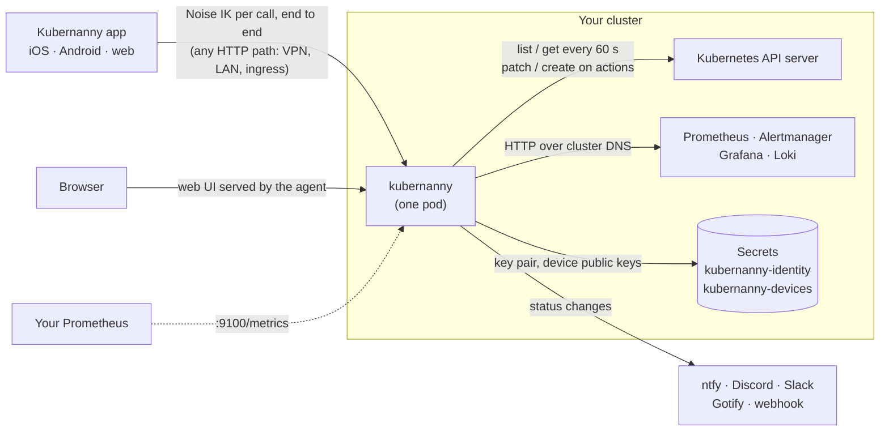
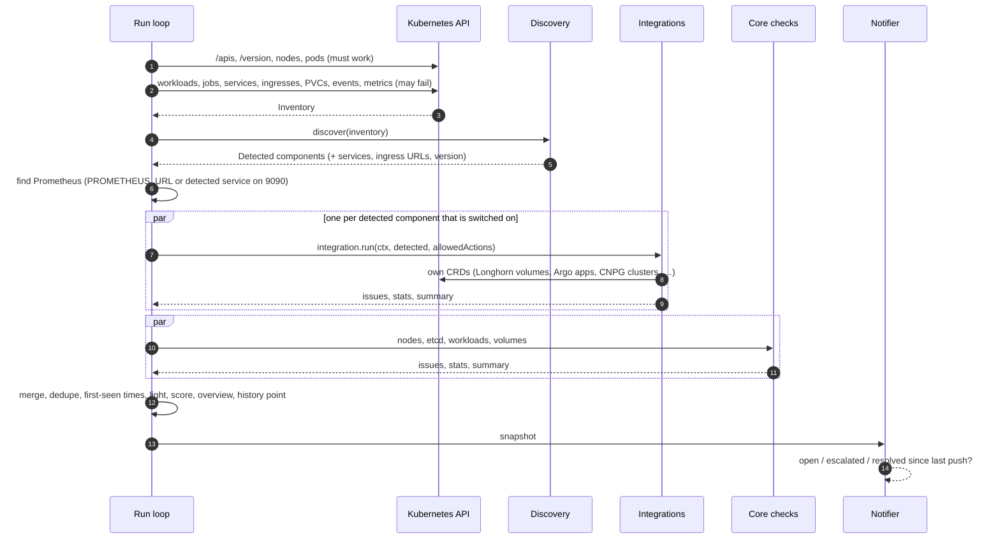
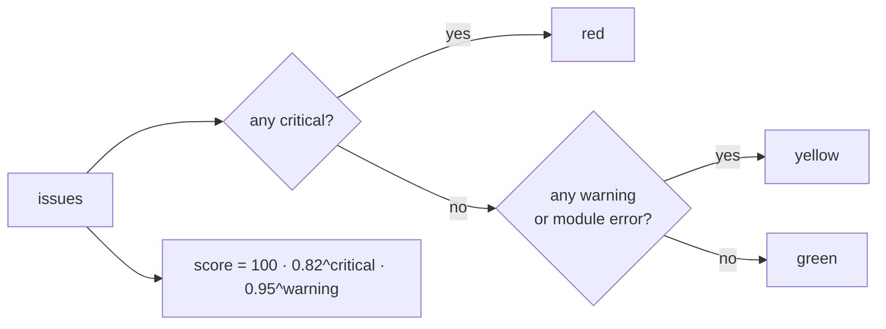
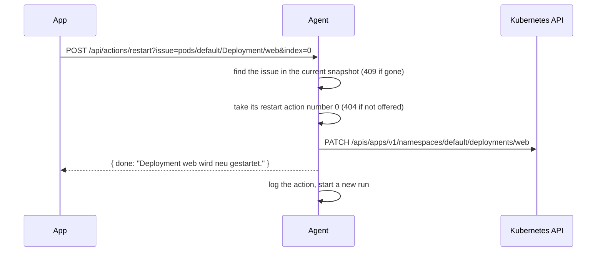
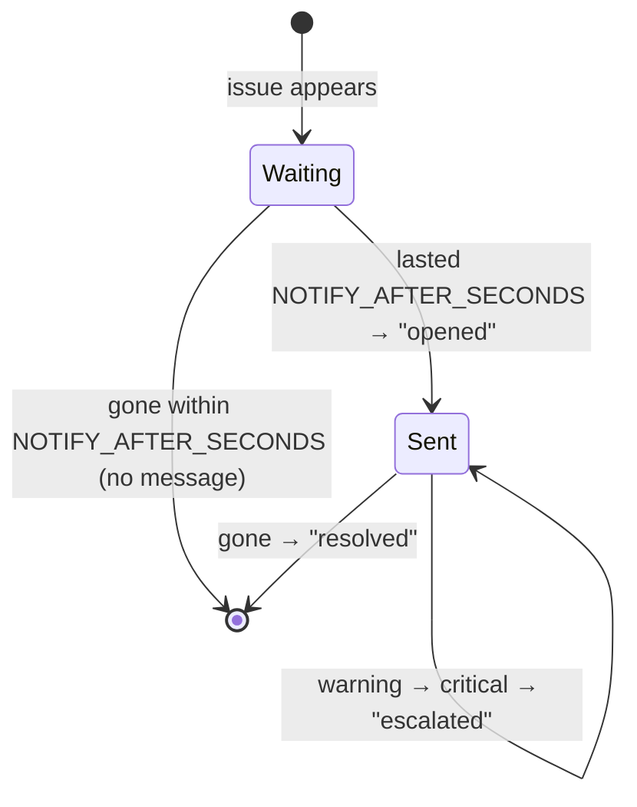
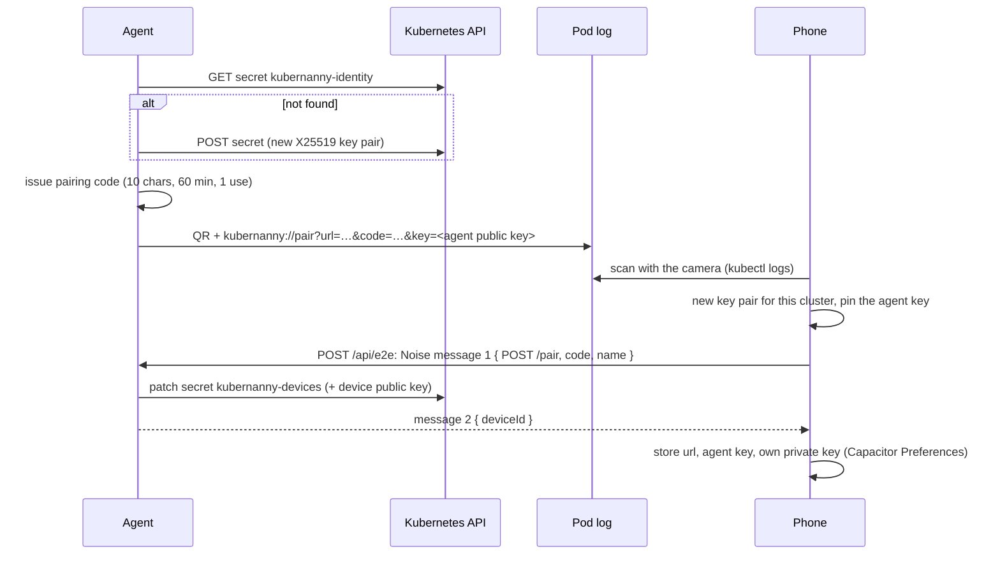
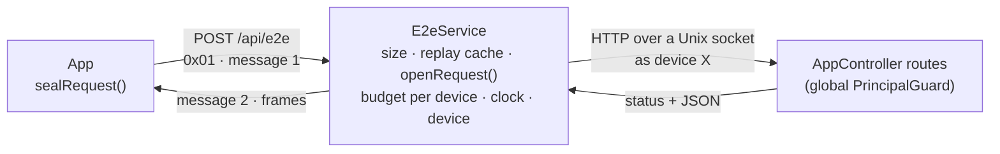
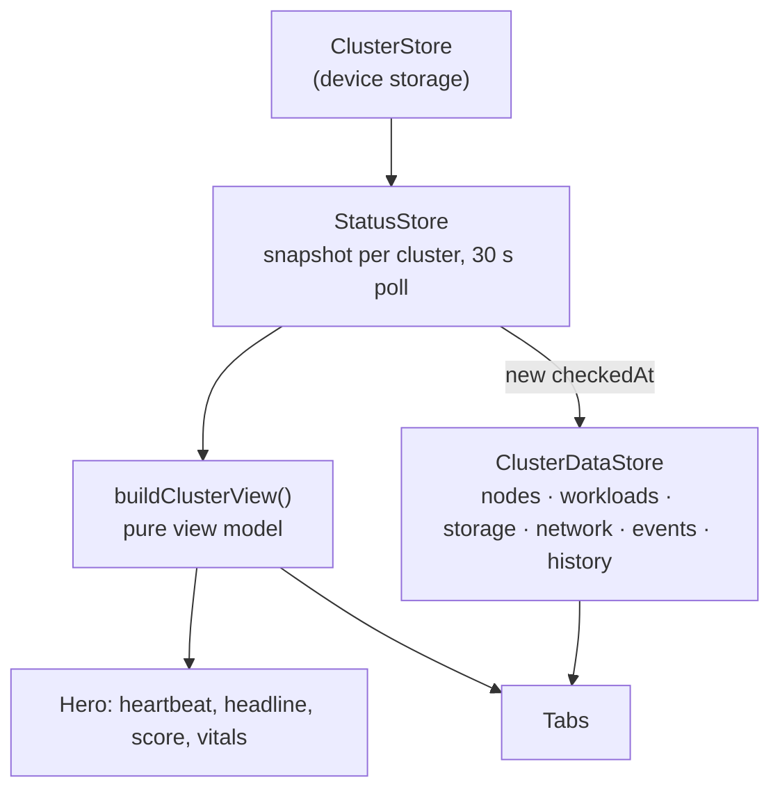
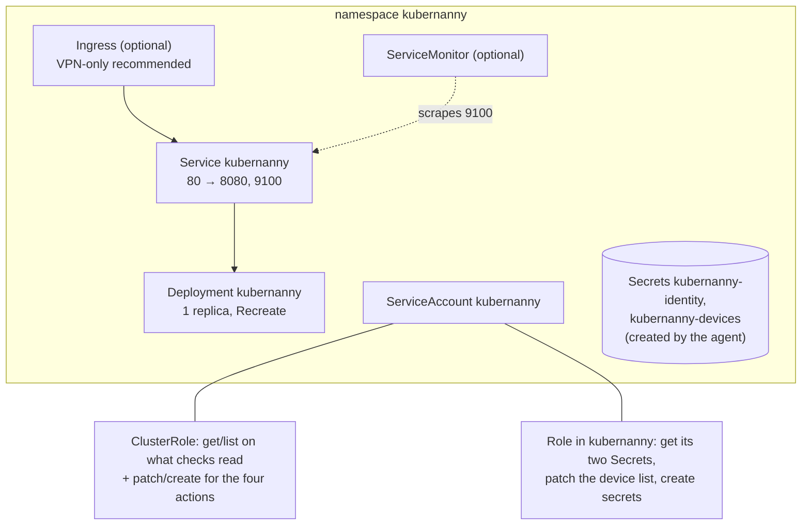

# Architecture

Kubernanny has three parts and no backend of its own:

- **The agent** runs as one pod in the cluster it watches. It reads the Kubernetes API once a minute, recognises what runs there, checks it, keeps the result in memory, and serves it over HTTP together with the web UI. It also sends notifications.
- **The app** (iOS, Android, web) talks only to agents. Every cluster is an agent URL, the agent's pinned public key and this device's own key pair, stored on the device.
- **The protocol** (`protocol/`) is shared by both: every call is one end-to-end encrypted Noise handshake between device key and agent key ([PROTOCOL.md](PROTOCOL.md)).

<p>  </p>

*What the app shows: the heartbeat and issues, the last seven days, the backups.*



Nothing leaves your network except the notifications you configure. There is no account, no telemetry and no server operated by us.

## Contents

1. [The agent](#the-agent)
   - [One run](#one-run)
   - [Inventory](#inventory)
   - [Discovery](#discovery)
   - [Modules](#modules)
   - [From issues to a light and a score](#from-issues-to-a-light-and-a-score)
   - [Detail views and history](#detail-views-and-history)
   - [Actions](#actions)
   - [Notifications](#notifications)
   - [Keys, pairing and the end-to-end channel](#keys-pairing-and-the-end-to-end-channel)
   - [HTTP surface](#http-surface)
   - [Demo mode](#demo-mode)
2. [The app](#the-app)
3. [Deployment](#deployment)
4. [Design decisions](#design-decisions)

---

## The agent

NestJS 12 on Node 24, no Kubernetes client library: a thin `fetch` wrapper (`src/kube/kube-client.ts`) is all it needs, and it never falls behind a Kubernetes release.

```
agent/src
├── main.ts                 bootstrap: /api prefix, CORS, static web UI, metrics port, pairing banner
├── cli.ts                  admin commands inside the pod (pair, devices, revoke) over the internal socket
├── app.controller.ts       the HTTP API
├── config.ts               every environment variable, validated at start
├── kube/                   fetch wrapper: ServiceAccount token, list/get/patch/create, 404 = "not installed"
├── inventory/              one read of the cluster per run (nodes, pods, workloads, …, metrics)
├── discovery/              catalog of ~75 components, matching by image, service and ingress lookup
├── checks/                 pure functions: Kubernetes objects in, issues out (nodes, pods, etcd, Longhorn, …)
├── modules/
│   ├── module.ts           the base classes: CheckModule, CoreCheck, Integration
│   ├── core/               core checks, one file each: nodes, etcd, API server, workloads, PDBs, HPAs, volumes
│   ├── kubernetes-support/ end-of-life table of Kubernetes minors and the check against it
│   ├── integrations/       one Integration subclass per tool (Longhorn, Argo CD, CNPG, Prometheus, Gatus, Uptime Kuma, …)
│   └── service-proxy.ts    HTTP to in-cluster services; Prometheus query client
├── status/                 the run loop (status.service), running modules and merging issues (run-modules), snapshot types, light and score (snapshot)
├── views/                  nodes, workloads, storage, network, events, backups, incidents, history for the detail tabs
├── incidents/              the episode log: incident history (GET /incidents) and the weekly report's data
├── actions/                the four actions, bound to open issues
├── notify/                 when to notify, and the body for ntfy, Discord, Slack, Gotify, JSON
├── settings/               what runs: module, action and notification switches (Helm + app)
├── rbac/                   the permissions each module and action needs; feeds the chart
├── auth/                   agent key pair, paired device keys, the guard for internal calls
├── e2e/                    POST /api/e2e (Noise, replay cache, rate limit), the internal Unix socket
├── pairing/                one-time pairing codes, QR banner
├── i18n/                   texts in English and German: catalogs, Text values, rendering per request (decisions/0006)
├── relay/                  RELAY_URL: the outbound WebSocket to the relay, calls into E2eService (docs/RELAY.md)
├── metrics/                Prometheus text format for kubernanny_* metrics
└── demo/                   a made-up cluster in three scenarios (DEMO=broken|warning|healthy)
```

### One run

`StatusService` runs every `CHECK_INTERVAL_SECONDS` (60) and on `POST /api/status/refresh`. Concurrent triggers share one run.



A module that throws does not stop the run: it is reported with status `error` and its message, and the light can no longer be green (a check that could not run is not "all fine"). If the core reads fail (API unreachable, RBAC missing), the previous snapshot is kept and marked with `error`.

### Inventory

`gatherInventory()` reads everything the modules and detail views need in one pass, in parallel: nodes and pods are required, the rest is optional (a missing or forbidden list becomes empty). On a homelab cluster a run takes 20 to 60 ms of API time; the response is a few MB at most.

Metrics come from `metrics.k8s.io` (metrics-server) when the group exists: per node and per pod CPU and memory. Quantities are parsed once (`parseQuantity`, binary and decimal suffixes).

### Discovery

`discover()` walks every Deployment, StatefulSet and DaemonSet and matches its container images against the catalog (`discovery/catalog.ts`, about 75 entries, [list](COMPONENTS.md)). Image matching was chosen over labels or Helm release names because it is the one thing every installation method keeps: a Bitnami chart, an operator and a hand-written manifest all run the same image.

For each match it records:

- **workloads** with ready/desired replicas,
- **services** whose selector matches the workload's pod template labels,
- **links**: every ingress host routing to one of those services (`https://` when the host is in the ingress's TLS section),
- **version**: the image tag, without a leading `v`.

The first catalog entry that matches wins, so specific entries (Argo CD Image Updater) come before broad ones.

### Modules

Everything Kubernanny reports comes from a module. A module produces `issues` (what is broken), `stats` (numbers shown on its detail sheet) and a one-line `summary`.

| Kind | Where | Runs when |
|---|---|---|
| Core check (`CoreCheck`) | `modules/core/`, `modules/kubernetes-support/`, `security/`, `vulnerabilities/` | switched on: `nodes`, `etcd`, `apiserver`, `kubernetes-support`, `pods` (workloads), `pdb`, `hpa`, `volumes`, `security`, `vulnerabilities` (off by default) |
| Integration (`Integration`) | `modules/integrations/<id>.ts` | its component was detected, and it is switched on |
| Workload health | `status/run-modules.ts` | for every detected component without an integration |

Both base classes extend `CheckModule`, which declares `reads` (the API resources it lists) and `actions` (the action types its issues may offer). Those declarations are what the rest relies on: the chart's RBAC is generated from `reads`, actions outside `actions` or switched off are stripped, and the switches address modules by `id`.

### Switches

What runs is decided in two layers (`settings/settings.service.ts`):

1. **The deployment** (Helm `checks.disabled`, `actions.disabled`, `rbac.allowActions`; env `DISABLED_MODULES`, `DISABLED_ACTIONS`). This is the security boundary: the chart also leaves out the RBAC of a disabled module (its reads and the permissions of the actions only it offers) and of disabled actions, so with `checks.disabled: [argocd]` the agent could neither read nor patch Argo CD even if it tried.
2. **The app**, within those limits: any paired device switches modules, action types and notifications off and on (`GET/POST /settings`). Stored in the ConfigMap `kubernanny-settings`, logged with the device. A change starts a new run at once.

Most of the logic lives in pure functions in `checks/` and the `evaluate*` functions next to each check (`evaluateNodes`, `evaluatePods`, `evaluateCnpg`, `evaluateJobs`, …): Kubernetes objects in, issues out, no I/O. They carry almost all of the unit tests. The complete list of checks, thresholds and the actions they offer is in [CHECKS.md](CHECKS.md).

**Issue ids are stable** across runs (`pods/default/Deployment/web`, `cnpg/default/pg/backup`): the agent uses them to remember since when an issue exists and whether it was already notified, and the app uses them to name the issue when it runs an action.

**Deduplication**: three crashing replicas are one issue, not three. A Deployment whose crashing pods already have an issue gets no second "0/3 ready" issue. Workload issues are also attached to the component they belong to, so the Argo CD sheet shows a crashing `argocd-repo-server`.

### From issues to a light and a score



The score is multiplicative on purpose: a linear penalty sat at 0 for most real clusters and could not tell "16 problems" from "6". One warning costs 5, one critical issue costs 18 points, and many issues still differ.

Severity follows one rule: **critical** means something is down or data is at risk now (no ready replica, quorum lost, WAL archiving failing, certificate expired or expiring within 3 days); **warning** means it will become critical if nobody acts (backup older than 26 h, volume degraded, certificate within 14 days, an automated Argo CD app drifting); **hint** (`info`) is worth knowing but not a problem (a manual Argo CD app with a change waiting). Hints never change the light or the score and are never sent.

### Detail views and history

The tabs of the app read views built on request from the last inventory (`views/views.ts`): nodes with used vs. requested CPU and memory, workloads with pods, restarts and usage, volumes with fill level and Longhorn state, ingress hosts with certificate days left, warning events (grouped per object and reason). The backups view (`views/backups.ts`) is built the same way from the lists the CNPG, Longhorn, etcd and Velero modules keep in `RunData`, so it makes no API call of its own. Building them costs microseconds, so nothing is cached.

The incident history (`GET /incidents`) comes from `IncidentsService` (`incidents/`), which owns the episode log: the run loop records every run into it (notifications paused or not), the weekly report and the route read it. Seven days deep, in memory like everything else.

History (`views/history.ts`) comes from Prometheus when one was found: cluster CPU, memory, network in/out, container restarts, etcd WAL fsync p99, API server p99, and CPU/memory per node, over 1 hour to 7 days with about 120 points. The result is cached for 60 s. Without Prometheus the agent serves its own ring buffer of cluster CPU and memory from metrics-server, one point per run, 6 hours deep.

### Actions

Four actions exist: Argo CD **sync** and **hard refresh**, **restart** of a Deployment/StatefulSet/DaemonSet (the same patch as `kubectl rollout restart`) and **CNPG backup** (a `Backup` resource). Logs of a pod (including the previous, crashed container) are read the same way.



The request names an issue and an action type, never a target. Namespace, name and kind come from the agent's own check result. A stolen device key can therefore restart what is broken right now, and nothing else; it cannot delete anything, read Secrets, or patch a healthy workload. RBAC is the second line: without `rbac.allowActions` the ServiceAccount has no write verbs at all.

What a stolen device key *can* do beyond that is blind and lock out the owner: any paired device may switch notifications, modules and actions off, silence issues, start a maintenance window of up to 24 h and revoke every other device (the lost-phone case needs exactly that power). So each of these changes, and every new pairing, sends one short notification through the configured channels **before** it takes effect, naming the device, past the app's notification switch and any maintenance window (`Notifier.securityAlert`); only `checks.disabled: [notifications]` in Helm silences them. The owner then revokes that device from another one, or rotates the keys if it already revoked theirs. See [SECURITY.md](SECURITY.md).

### Notifications

`notify/notifier.ts` keeps which issues were sent. Per run:



All changes of one run go out as one message per channel. A failed send is retried on the next run; an issue is only marked as sent once at least one channel accepted it. Channels and formats: [NOTIFICATIONS.md](NOTIFICATIONS.md).

The state is in memory. After a restart the agent may send an "opened" again for an issue that lasts; it never sends a "resolved" for one it did not open. The weekly report reads its episodes from `IncidentsService`, the same log behind `GET /incidents`.

### Keys, pairing and the end-to-end channel



After pairing, every call goes the same way:



`E2eService` (`agent/src/e2e/`) decrypts, checks and dispatches; the routes are the same NestJS controllers as ever, reached through the internal socket ([0003](decisions/0003-internal-socket.md)), so validation, audit log and tests are shared. `PrincipalGuard` is the global guard: every route needs a device the channel proved, except the three marked `@Public()` (`/healthz`, `/api/identity`, `/api/e2e`), so on the TCP port every other route answers 401, and a new route is guarded unless someone decides otherwise (`auth/public-routes.spec.ts` enumerates them). With `RELAY_URL` set, `RelayClient` (`agent/src/relay/`) hands the calls arriving over its relay connection to the same `E2eService.handle()` ([RELAY.md](RELAY.md)).

The log never contains a credential: a code works once and expires after an hour, and the agent key in the link is public. Wrong codes are throttled, but never burn the code, and the right one is compared first, so nobody who knows the agent key can keep the owner from pairing. Each pairing registers the **device's own public key**; the agent lists devices with their last activity and revokes them one by one. A paired device can create a code for the next one (`POST /pair/code`); `kubectl exec … node dist/cli.js pair` does the same from the pod.

How every channel is protected, with a diagram: [COMMUNICATION.md](COMMUNICATION.md).

### HTTP surface

| Port | Path | Auth | Purpose |
|---|---|---|---|
| 8080 | `/healthz` | none | liveness, no cluster data |
| 8080 | `/api/identity` | none | the agent's public key (for pairing by hand) |
| 8080 | `/api/e2e` | Noise IK: device key, every call | every API call, see [PROTOCOL.md](PROTOCOL.md) and [API.md](API.md) |
| 8080 | other `/api/*` | | 401 `E2E_REQUIRED`: only reachable through the internal socket |
| socket | `/tmp/kubernanny.sock` | in-pod only (mode 0600) | the API routes, for decrypted calls and the admin CLI |
| 8080 | `/` | none | the web UI (static files), only with `WEB_ROOT` |
| 9100 | `/metrics` | none | `kubernanny_*` metrics; not routed by the chart's ingress |

### Demo mode

`DEMO=broken|warning|healthy` swaps the Kubernetes client for `DemoKubeClient`: a made-up three-node RKE2 cluster with Longhorn, Argo CD, CNPG, kube-prometheus-stack, Loki, kured and a dozen apps, including Prometheus answers for every chart. The same code paths run as in a real cluster, so the demo doubles as the integration test (`app.spec.ts`, `demo/scenarios.spec.ts`), the source of every screenshot and a way to try Kubernanny without a cluster.

---

## The app

Angular 22, zoneless, standalone components and signals; Ionic 8 for the native look and Capacitor 8 for iOS and Android. The same build is the web UI the agent serves.

```
app/src/app
├── core/
│   ├── agent.model.ts          the agent's API types (mirrors agent/src)
│   ├── agent-client.service.ts HTTP client, error texts
│   ├── cluster-store.service.ts clusters on the device (Capacitor Preferences)
│   ├── status-store.service.ts  polls every 30 s while visible, keeps the last answer
│   ├── cluster-data.store.ts    detail views per cluster, loaded per tab
│   ├── format.ts                bytes, cores, percent, relative times (German formats)
│   └── icons.ts                 every ionicon, generated from the agent's catalog
├── clusters/    list of clusters, empty state with install steps
├── cluster/     one cluster: hero + seven tabs, module sheet, view models
├── pair/        pairing from a link, QR code or typed code
├── cluster-form/settings: address, agent key fingerprint, agent info, devices, test notification, pair another device
└── ui/          heartbeat, area chart, meter, issue list, logs modal
```



**View models, not template logic.** Every screen derives its display values in one `computed()` (`buildClusterView`, `nodeCards`, `workloadGroups`, `volumeRows`, `hostRows`). Templates only read properties; there are no getters or method calls in bindings. The view-model functions are pure and carry the app's unit tests.

**Polling** stops when the app goes to the background or the tab is hidden, and resumes on return; push takes over in between. A cluster that stops answering keeps its last snapshot, greyed out, with the reason ("Agent nicht erreichbar. Bist du im VPN?").

**Routing** uses hash URLs, so the agent can serve the build as plain static files without a fallback rule, and pairing links (`/#/pair?code=…`) keep the code out of server logs.

**Design**: [DESIGN.md](DESIGN.md).

---

## Deployment



- **One replica, `Recreate`.** The agent remembers which issues it notified about and which calls it has seen (replay cache). Two replicas would notify twice; a rolling update would overlap two for a moment.
- **Hardened pod**: non-root, read-only root filesystem (plus a 1 MiB in-memory `/tmp` for the internal socket), no capabilities, `RuntimeDefault` seccomp.
- **Image**: one multi-arch image (amd64, arm64) with the agent, the protocol package and the web build (`Dockerfile` at the repository root).
- **Install paths**: Helm chart (`deploy/helm/kubernanny`, published as OCI), plain manifests (`deploy/install.yaml`), or an Argo CD Application pointing at the chart. Values: [CONFIGURATION.md](CONFIGURATION.md).

---

## Design decisions

**No Kubernetes client library.** The agent needs list, get, merge patch, create and a text read. A 120-line `fetch` wrapper covers that, has no version coupling and makes the demo client a simple subclass.

**Detection by image.** Labels and release names depend on how something was installed; images do not. The cost is a catalog to maintain, kept honest by a test against [COMPONENTS.md](COMPONENTS.md).

**Pure check functions.** Every check is a function of Kubernetes objects. That makes them testable without a cluster and lets the same code run in demo mode.

**Actions bound to issues.** The alternative, an API taking a namespace and a name, would turn every paired device into a cluster-wide restart button. Binding to an open issue keeps the blast radius to what is already broken.

**Services over cluster DNS, not the API server proxy.** Reaching Prometheus through `services/proxy` would work everywhere, but needs a cluster-wide grant that reaches every internal service. Inside a pod the agent calls `http://<service>.<namespace>.svc:<port>` directly (NetworkPolicies apply); the proxy path is only used outside a cluster, during development with `kubectl proxy`.

**One-time pairing codes and device keys.** Printing a token was simpler, but logs travel further than Secrets, and a token crosses every hop. Now nothing secret is printed or sent: see [decisions/](decisions/README.md).

**End to end, one handshake per call.** The path between app and agent (TLS ending at an ingress, a LAN, a relay) is never trusted. Why Noise IK and why per call: [0001](decisions/0001-noise-ik-per-request.md).

**In-memory state.** Snapshots, first-seen times and notification state are rebuilt within one run after a restart. A database would add an operational burden to a tool whose job is to reduce one.

**Hash routing and a single build.** The web UI the agent serves and the app in the stores are the same bundle; the agent needs no SPA fallback and pairing codes stay out of access logs.
