# Architecture

Kubernanny has three parts and no backend of its own:

- **The agent** runs as one pod in the cluster it watches. It keeps what it reads from the Kubernetes API current with watches, checks it once a minute (and within seconds of a change that matters), recognises what runs there, keeps the result in memory (the week of problems and its own CPU and memory record also in a ConfigMap, so a restart continues them), and serves it over HTTP together with the web UI. It also sends notifications.
- **The app** (iOS, Android, web) talks only to agents. Every cluster is an agent URL, the agent's pinned public key and this device's own key pair, stored on the device.
- **The protocol** (`protocol/`) is shared by both: every call is one end-to-end encrypted Noise handshake between device key and agent key ([PROTOCOL.md](PROTOCOL.md)).

<p>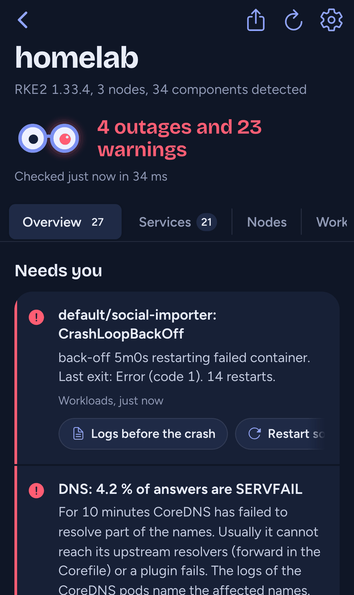 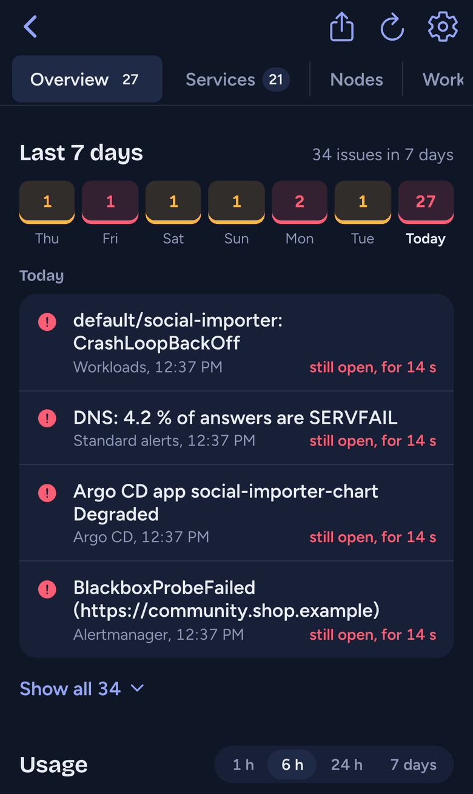 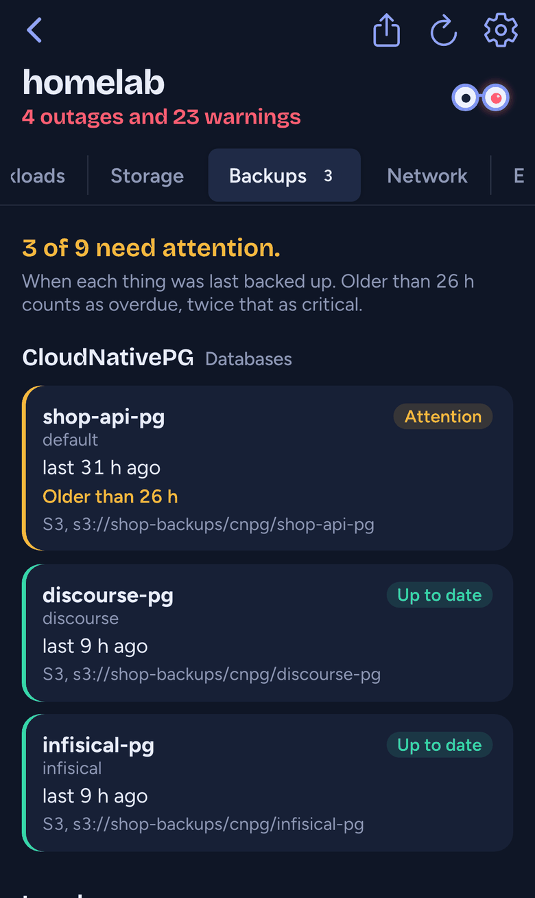</p>

*What the app shows: the cluster's light and issues, the last seven days, the backups.*

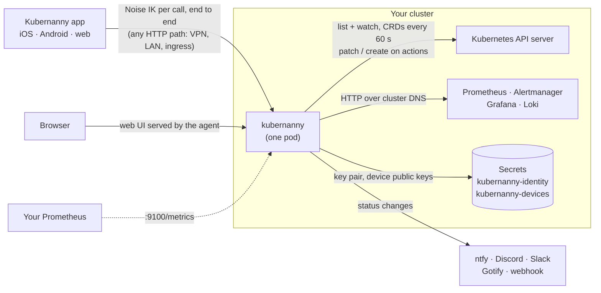

With the default values nothing leaves your network except the notifications you configure; the relay, native push, the vulnerability lookup and image updates reach out only when you switch them on (every outbound connection: [IN-CLUSTER.md](IN-CLUSTER.md#outbound)). There is no account and no telemetry; the only server we run is the optional public relay.

## Contents

1. [The agent](#the-agent)
   - [One run](#one-run)
   - [Inventory](#inventory)
   - [Discovery](#discovery)
   - [Modules](#modules)
   - [From issues to a light and a score](#from-issues-to-a-light-and-a-score)
   - [Detail views and history](#detail-views-and-history)
   - [Actions](#actions)
   - [Notifications](#notifications)
   - [Keys, pairing and the end-to-end channel](#keys-pairing-and-the-end-to-end-channel)
   - [HTTP surface](#http-surface)
   - [Demo mode](#demo-mode)
2. [The app](#the-app)
3. [Deployment](#deployment)
4. [Design decisions](#design-decisions)

---

## The agent

Node 24 (22 works), no web framework and no Kubernetes client library: a route table on `node:http` (`src/http/server.ts`) serves about thirty routes, and a thin `fetch` wrapper (`src/kube/kube-client.ts`) with a watch cache on top (`src/kube/watch-cache.ts`) is all the API access it needs; it never falls behind a Kubernetes release. The image runs one esbuild bundle (`npm run bundle`), no `node_modules`.

```
agent/src
├── main.ts                 bootstrap: listen, metrics port, pairing banner, SIGTERM handover
├── agent.ts                every service wired by hand, start-up, readiness, graceful shutdown
├── http/                   the route table on node:http: guard, CORS, static web UI, errors, ETags
├── cli.ts                  admin commands inside the pod (pair, devices, revoke) over the internal socket
├── app.routes.ts           the HTTP API (routes in appRoutes)
├── config.ts               every environment variable, validated at start
├── kube/                   fetch wrapper: ServiceAccount token, list/get/watch/patch/create, 404 = "not installed"; the watch cache
├── lease/                  which pod is in charge during a rolling update (coordination.k8s.io Lease)
├── inventory/              the cluster as the checks see it: watch caches (cluster-cache), field stripping, per-run lists
├── discovery/              catalog of ~75 components, matching by image, service and ingress lookup
├── checks/                 pure functions: Kubernetes objects in, issues out (nodes, pods, etcd, Longhorn, …)
├── modules/
│   ├── module.ts           the base classes: CheckModule, CoreCheck, Integration
│   ├── core/               core checks, one file each: nodes, etcd, API server, workloads, PDBs, HPAs, volumes
│   ├── kubernetes-support/ end-of-life table of Kubernetes minors and the check against it
│   ├── integrations/       one Integration subclass per tool (Longhorn, Argo CD, CNPG, Prometheus, Gatus, Uptime Kuma, …)
│   └── service-proxy.ts    HTTP to in-cluster services; Prometheus query client
├── status/                 the run loop (status.service), running modules and merging issues (run-modules), snapshot types, light and score (snapshot)
├── views/                  nodes, workloads, storage, network, events, backups, incidents, history for the detail tabs
├── incidents/              the episode log: incident history (GET /incidents) and the weekly report's data
├── history/                the ConfigMap kubernanny-history (episode log, own CPU and memory record) and the metrics recorder
├── actions/                the issue actions (some opt-in, docs/PERMISSIONS.md), logs, the opt-in Argo CD rollback
├── silence/                silenced issues and their end times (ConfigMap kubernanny-settings)
├── notify/                 when to notify, and the body for ntfy, Discord, Slack, Gotify, JSON
├── push/                   native push: registration, sealing per device, widget status pushes, the dead man's switch deposits
├── settings/               what runs: module, action and notification switches (Helm + app)
├── rbac/                   the permissions each module and action needs; feeds the chart
├── auth/                   agent key pair, paired device keys, the guard for internal calls
├── e2e/                    POST /api/e2e (Noise, replay cache, rate limit), the internal Unix socket
├── pairing/                one-time pairing codes, QR banner
├── i18n/                   texts in English and German: catalogs, Text values, rendering per request (decisions/0006)
├── relay/                  RELAY_URL: the outbound WebSocket to the relay, calls into E2eService (docs/RELAY.md)
├── metrics/                Prometheus text format for kubernanny_* metrics
├── security/               HTTP security headers (CSP), which hosts plain HTTP may go to (localhost, `*.svc`)
├── util/                   small helpers: capped reads, serial queues, log-safe strings, start-up reads
└── demo/                   a made-up cluster in three scenarios (DEMO=broken|warning|healthy)
```

### One run

`StatusService` runs every `CHECK_INTERVAL_SECONDS` (60), on `POST /api/status/refresh`, and 3 s after a watched change that can open or close an issue (a pod into CrashLoopBackOff or an image pull error, a node condition changing, a workload losing or regaining its replicas, a PVC phase, a failed job), at most every 15 s, so the app sees it within seconds. Concurrent triggers share one run. Each run records where its time went (reading the cluster, the integrations in parallel, then the core checks, and every Prometheus query, at most 8 at a time); the Kubernanny component's sheet lists it as "Letzte Prüfung" with the slowest modules and queries (`status/run-timing.ts`). Every status answer carries `nextCheckAt`, the next interval tick or the pending early run if that comes first (`nextRunAt`), which the app counts down to. Notifications keep their own rules (`NOTIFY_AFTER_SECONDS`, each change sent once), so an early run never sends more.

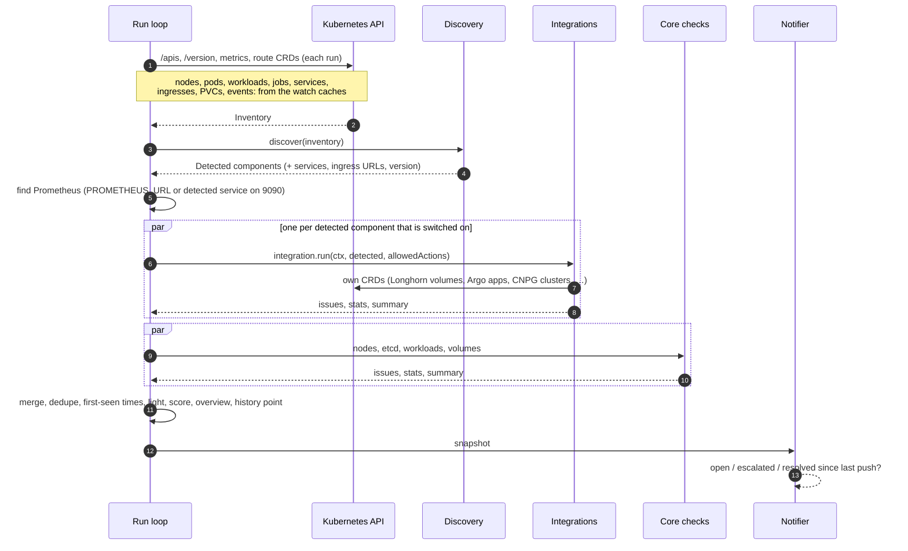

A module that throws does not stop the run: it is reported with status `error` and its message, and the light can no longer be green (a check that could not run is not "all fine"). If the core reads fail (API unreachable, RBAC missing), the previous snapshot is kept and marked with `error`.

### Inventory

`gatherInventory()` assembles everything the modules and detail views need. Most of it comes from memory: nodes, pods, namespaces, Deployments, StatefulSets, DaemonSets, Jobs, CronJobs, Services, Ingresses, PVCs, StorageClasses and warning events are kept current by one watch cache per kind (`inventory/cluster-cache.ts`, `kube/watch-cache.ts`): a paged list for a complete copy and its `resourceVersion`, then a watch from there with bookmarks; a broken stream reconnects with backoff (1 to 30 s) from the last version, `410 Gone` relists, and every kind is relisted every 15 minutes anyway. API discovery (`/apis`), the version, `metrics.k8s.io` (which cannot be watched) and the Gateway API and Traefik route CRDs are listed per run; integrations keep listing their own CRDs when they run, so a module switched off starts no request at all. ReplicaSets are not read: the owner of a pod is derived from its name.

Memory follows the number of objects, not their size: before an object is stored it is cut to the fields the checks read (`inventory/strip.ts`: no `managedFields`, only the three annotations anything reads, containers with image, resources, security context and ports, no env, probes or node image lists), and warning events are capped at the newest 2000 and 6 hours. `strip.spec.ts` runs every check and view of the demo on stripped and on full objects and requires the same result.

A cache whose kind cannot be watched (no `watch` verb, three failed watches in a row) or listed falls back to a list per run. Nodes and pods are required: if they cannot be read the run fails and the cluster counts as unreachable. Any other kind whose read fails (timeout, 429, 5xx, 403 after an RBAC change) is **stale**, not empty: its last known objects stay, so no issue resolves and no "resolved" is sent because of a failed read, and every module that reads it (`CheckModule.uses`; components rest on pods, workloads, services and routes) reports `error`, which keeps the light from turning green. A 404 (an API that is not installed) is an empty list, not an error.

Metrics come from `metrics.k8s.io` (metrics-server) when the group exists: per node and per pod CPU and memory. Quantities are parsed once (`parseQuantity`, binary and decimal suffixes).

### Discovery

`discover()` walks every Deployment, StatefulSet and DaemonSet and matches its container images against the catalog (`discovery/catalog.ts`, about 75 entries, [list](COMPONENTS.md)). Image matching was chosen over labels or Helm release names because it is the one thing every installation method keeps: a Bitnami chart, an operator and a hand-written manifest all run the same image.

For each match it records:

- **workloads** with ready/desired replicas,
- **services** whose selector matches the workload's pod template labels,
- **links**: every ingress host routing to one of those services (`https://` when the host is in the ingress's TLS section),
- **version**: the image tag, without a leading `v`.

The first catalog entry that matches wins, so specific entries (Argo CD Image Updater) come before broad ones.

### Modules

Everything Kubernanny reports comes from a module. A module produces `issues` (what is broken), `stats` (two to four key figures for its sheet), `details` (its objects as lists or short tables, problems first) and a one-line `summary`.

`details` is a list of sections (`modules/types.ts`): `{ title, kind: 'list', rows: [{ name, sub?, tone, value?, meta?: [{ text, tone? }] }], more? }` or `{ title, kind: 'table', columns, rows: [{ cells, tone }], more? }`. The builders live in `modules/details.ts` (CNPG clusters, Longhorn volumes and nodes, Argo CD apps, certificates, Prometheus targets per job, operator objects with their last reconcile, ingress routes); a row's tone mirrors the object's own state, the judgement stays with the checks. `keyFigures()` keeps four stats and moves the rest into a plain list. Every recognised component also gets, after its integration's sections, what the inventory alone tells (`modules/component-details.ts`): its pods (node, ready, restarts, why the last run ended), CPU and RAM per workload against requests and limits, and the volumes its pods mount; a component without an integration gets pods ready, restarts, CPU and RAM as key figures. The overview carries `perNode` (use, requests, limits and pods without a limit per node) for the app's per-node breakdown. The Argo CD module also carries `pendingSyncs` (`checks/argocd-pending.ts`): manual apps with a change waiting, which are no issue; the app shows them as one card and a "Bereit zum Sync" list, and their sync runs through `ActionsService` like an issue's (`StatusService.findIssue` falls back to the list). A component installed more than once also carries `instances` (`{ namespace, name, version, ready, desired }`). Untrusted integrations go through `boundDetails` (6 sections, 50 rows, strings cut). How the app shows them: [DESIGN.md](DESIGN.md#module-sheets).

| Kind | Where | Runs when |
|---|---|---|
| Core check (`CoreCheck`) | `modules/core/`, `modules/kubernetes-support/`, `security/`, `vulnerabilities/` | switched on: `nodes`, `etcd`, `apiserver`, `kubernetes-support`, `pods` (workloads), `pdb`, `hpa`, `volumes`, `security`, `vulnerabilities` (off by default) |
| Integration (`Integration`) | `modules/integrations/<id>.ts` | its component was detected, and it is switched on |
| Workload health | `status/run-modules.ts` | for every detected component without an integration |

Both base classes extend `CheckModule`, which declares `reads` (the API resources it lists) and `actions` (the action types its issues may offer). Those declarations are what the rest relies on: the chart's RBAC is generated from `reads`, actions outside `actions` or switched off are stripped, and the switches address modules by `id`.

### Switches

What runs is decided in two layers (`settings/settings.service.ts`):

1. **The deployment** (Helm `checks.disabled`, `actions.disabled`, `rbac.allowActions`; env `DISABLED_MODULES`, `DISABLED_ACTIONS`). This is the security boundary: the chart also leaves out the RBAC of a disabled module (its reads and the permissions of the actions only it offers) and of disabled actions, so with `checks.disabled: [argocd]` the agent could neither read nor patch Argo CD even if it tried.
2. **The app**, within those limits: any paired device switches modules, action types and notifications off and on (`GET/POST /settings`). Stored in the ConfigMap `kubernanny-settings`, logged with the device. A change starts a new run at once.

Most of the logic lives in pure functions in `checks/` and the `evaluate*` functions next to each check (`evaluateNodes`, `evaluatePods`, `evaluateCnpg`, `evaluateJobs`, …): Kubernetes objects in, issues out, no I/O. They carry almost all of the unit tests. The complete list of checks, thresholds and the actions they offer is in [CHECKS.md](CHECKS.md).

**Issue ids are stable** across runs (`pods/default/Deployment/web`, `cnpg/default/pg/backup`): the agent uses them to remember since when an issue exists and whether it was already notified, and the app uses them to name the issue when it runs an action.

**Deduplication**: three crashing replicas are one issue, not three. A Deployment whose crashing pods already have an issue gets no second "0/3 ready" issue. Workload issues are also attached to the component they belong to, so the Argo CD sheet shows a crashing `argocd-repo-server`.

### From issues to a light and a score

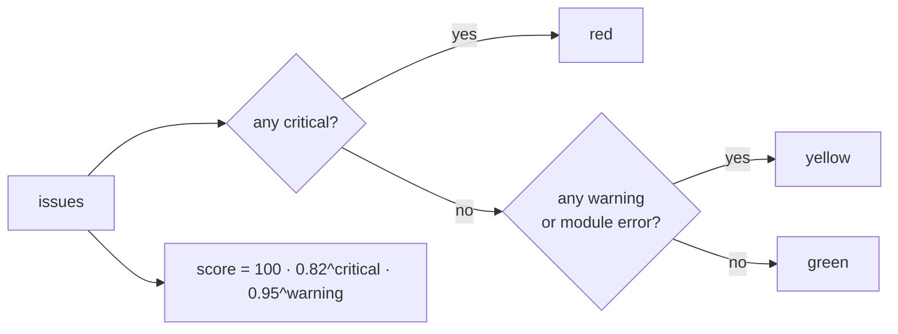

The score is multiplicative on purpose: a linear penalty sat at 0 for most real clusters and could not tell "16 problems" from "6". One warning costs 5, one critical issue costs 18 points, and many issues still differ. It is kept for the API and the Prometheus metric (`kubernanny_health_score`) only: the app does not show it, because a number like "1 of 100" read as alarming and said less than the headline with its counts.

Severity follows one rule: **critical** means something is down or data is at risk now (no ready replica, quorum lost, WAL archiving failing, certificate expired or expiring within 3 days); **warning** means it will become critical if nobody acts (backup older than 26 h, volume degraded, certificate within 14 days, an automated Argo CD app drifting); **hint** (`info`) is worth knowing but not a problem (a manual Argo CD app with a change waiting). Hints never change the light or the score and are never sent.

### Detail views and history

The tabs of the app read views built on request from the last inventory (`views/views.ts`): nodes with used vs. requested CPU and memory, workloads with pods, restarts and usage, volumes with fill level and Longhorn state, ingress hosts with certificate days left, warning events (grouped per object and reason). The backups view (`views/backups.ts`) is built the same way from the lists the CNPG, Longhorn, etcd and Velero modules keep in `RunData`, so it makes no API call of its own. Building them costs microseconds, so nothing is cached.

The incident history (`GET /incidents`) comes from `IncidentsService` (`incidents/`), which owns the episode log: the run loop records every run into it (notifications paused or not), the weekly report and the route read it. Seven days deep, kept in memory and in the ConfigMap `kubernanny-history` (below). It holds the same problems the notifier sends (`EpisodeLog` gets `NOTIFY_AFTER_SECONDS`): an episode that ends sooner is dropped, an open one only counts once it lasted that long, and 3 short blips of one issue within an hour become one episode with `flaps` (the count), which later blips within an hour extend. The blips before that are a small in-memory list per issue id, never stored ([NOTIFICATIONS.md](NOTIFICATIONS.md#when-a-message-is-sent)).

History (`views/history.ts`) comes from Prometheus when one was found: cluster CPU, memory, network in/out, container restarts, etcd WAL fsync p99, API server p99, and CPU/memory per node, over 1 hour to 7 days with about 120 points. The result is cached for 60 s. Without Prometheus (none found, or `checks.disabled: [prometheus]`) the agent records CPU and memory itself (`history/metrics-recorder.ts`): every run already reads `metrics.k8s.io`, so each run adds its reading to a 5-minute bucket (average and peak, as a share of allocatable) for the cluster and each node, seven days deep. `GET /history` then answers `source: agent` with `stepSeconds`, about 120 points per range like Prometheus, and the app says the data comes from Kubernanny itself at 5-minute resolution. While Prometheus is there nothing is recorded, so nothing is kept twice.

### State that survives a restart (`history/`)

Most state is in memory and rebuilt within a minute. Two things are not rebuildable from the cluster, the week of problems and the agent's own CPU and memory record, so `HistoryStore` (`history/history-store.ts`) keeps them in the ConfigMap `kubernanny-history` of the agent's namespace (switch: `history.persist`, env `HISTORY_PERSIST`, default on; never in the demo):

- **Created by the chart**, empty (and by `install.yaml`), so `helm uninstall` removes it; the agent never sets `data` through Helm, so `helm upgrade` leaves its keys alone. The Role grants `get` and `patch` on that one name, no `create`. A missing ConfigMap is logged once and the history stays in memory.
- **Read at start**, in `loadState()` before the internal socket, the first run and the public port: the new pod serves the history (and `coveredSince`, the first start ever) from its first answer. The read is merged into the in-memory log, never replaces it.
- **Written only by the pod in charge** (the lease holder with current state), at most once a minute after a run, only the keys that changed (merge patch), and once more on SIGTERM before the lease is released (at most 5 s). A takeover reads the ConfigMap again and merges what the previous pod flushed last; an issue both pods saw open stays one episode, from the earlier start.
- **Two keys, versioned (`v: 1`), each capped at 384 KiB** (768 KiB in all, well under the 1 MiB a ConfigMap holds). `episodes`: compact JSON per episode (issue id, title as message key with parameters, so it reads in either language; severity, module, start, end, silenced, and `f`, the blip count of a flapping episode, which older agents ignore), rolling 7 days; short episodes an older agent stored are dropped on the read; past the cap the oldest ended episodes go first, open ones only as a last resort. `metrics`: per series the allocatable CPU and memory and four strings of 2016 buckets (CPU average and peak, memory average and peak), each value 12 bits in two base64url characters (0.1 % steps): 16 128 characters per series plus the name. The cluster totals and the 20 busiest nodes (by average use over the week) are 21 series, at most about 346 KB even with 253-character node names; the recorder follows up to 80 nodes in memory, so a node climbs into the stored ones with a history of its own.
- **Unreadable or oversized content** (another version, broken JSON, over the cap) is logged once and replaced by a fresh history; nothing crashes. A read that fails for another reason (API unreachable) is tried again before the first write, so a short outage never overwrites a week with an empty one.
- **Limits**: an issue that ended while no agent ran ends at the first run after the start; the time no agent ran counts as watched. With `history.persist: false` every start begins a new week, and `coveredSince` (the app's "Nothing known before …") is that start.

### Actions

The actions that change something are bound to open issues. These are on by default:

- Argo CD **sync** and **hard refresh**;
- **restart** of a Deployment/StatefulSet/DaemonSet (the same patch as `kubectl rollout restart`). On a crash loop it comes second, after the logs, with a hint that it only helps once the cause is gone; after an OOMKill it is not offered at all (the cause names the memory limit to raise); with the opt-in `config-change-hint`, when a ConfigMap the pod reads through env/envFrom changed after its last start it comes first, as the fix;
- **backups now**: CloudNativePG (a `Backup`), Longhorn (a `Snapshot` and a `Backup` of it), Velero (a `Backup` from a schedule's template, like `velero backup create --from-schedule`);
- **reconcile now** (`reconcile-now`): Flux Kustomizations and HelmReleases, ExternalSecrets, InfisicalStaticSecrets (an annotation their controller reconciles on), and cert-manager Certificates (the `Issuing` condition, like `cmctl renew`);
- **uncordon** a Ready node cordoned for over 30 minutes that no kured reboot or drain is working on;
- **clean up** finished pods (Failed, evicted, or Succeeded without their Job) of a namespace.

Others are off until the deployment names them in `actions.enabled` (as is `config-change-hint`, the ConfigMap read behind the restart offer), because the permission each needs reaches further than the action if the pod were compromised: **run a failed Job again** (`job-rerun`: `create` on Jobs), **force-delete** a pod stuck in Terminating on a lost node (`force-delete-terminating`), **end** an Argo CD sync running for over 30 minutes (`argocd-terminate-op`), let a sync **delete** what is no longer in Git or **replace** objects Kubernetes refused to patch (`argocd-sync-prune`, `argocd-sync-replace`: choices in the sync's confirmation, not buttons of their own) and **grow** an almost full volume by a quarter (`pvc-expand`). Logs of a pod (including the previous, crashed container) are read the same way, as an action of their own. The Argo CD **rollback** is the one exception to that binding and off by default too (below). The complete list, with what each one changes, is generated in [PERMISSIONS.md](PERMISSIONS.md#write-access-at-a-glance); when each is offered: [CHECKS.md](CHECKS.md#actions).

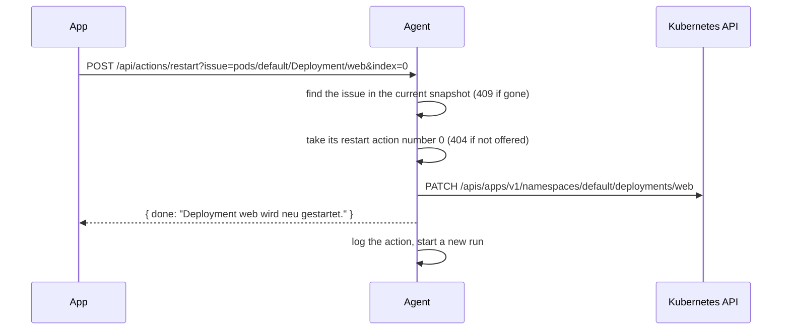

The request names an issue and an action type, never a target. Namespace, name and kind come from the agent's own check result. A stolen device key can therefore restart what is broken right now, and nothing else; it cannot read Secrets, patch a healthy workload or delete anything but finished pods (and, opt-in, a pod already stuck in Terminating). RBAC is the second line: each action's verbs are granted only while it is on, and without `rbac.allowActions` the ServiceAccount has no write verbs at all. The admission policies are the third: they hold every write verb to exactly what its action sends (an uncordon may only turn `spec.unschedulable` off, a pod delete only hit a finished pod). Every run is written to the audit log with the device that asked.

**The exception: Argo CD rollback (`argocd-rollback`).** A bad deploy is not always something Kubernanny can see (a release that is healthy to Kubernetes but broken for its users), so `POST /api/argocd/rollback` names a target: the app's namespace and name and an id from its `status.history`, **with or without an open issue**. It is off unless the deployment opts in (`actions.enabled: [argocd-rollback]`), and the agent narrows it as far as it can: only manual-sync, single-source apps, only a revision from the app's own history with the same repository and path or chart, never a source, never a prune, at most once per app in 5 minutes, announced through the channels first, and the admission policy only renders the branch that lets the agent set a revision when the action is opted in. With it on, a stolen device key can roll any such app back to one of its recent deployments, healthy or not; [SECURITY.md](SECURITY.md) lists it as its own row in the threat model. Details: [CHECKS.md](CHECKS.md#rolling-back-argocd-rollback-off-by-default).

What a stolen device key *can* do beyond that is blind and lock out the owner: any paired device may switch notifications, modules and actions off, silence issues, start a maintenance window of up to 24 h and revoke every other device (the lost-phone case needs exactly that power), and switch on a module that is off by default because it sends data out of the cluster (`vulnerabilities`, `image-updates`). So each of these changes, and every new pairing, sends one short notification through the configured channels **before** it takes effect, naming the device, past the app's notification switch and any maintenance window (`Notifier.securityAlert`); only `checks.disabled: [notifications]` in Helm silences them. The owner then revokes that device from another one, or rotates the keys if it already revoked theirs. See [SECURITY.md](SECURITY.md).

### Notifications

`notify/notifier.ts` keeps which issues were sent. Per run:

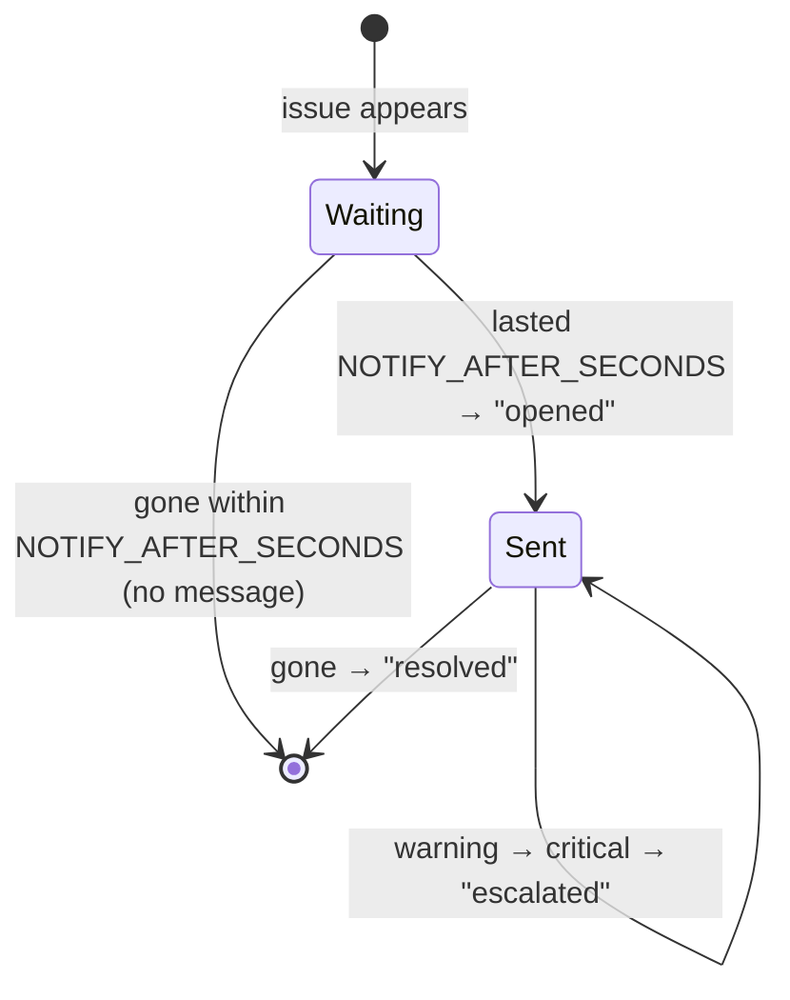

All changes of one run go out as one message per channel. A failed send is retried on the next run; an issue is only marked as sent once at least one channel accepted it. Channels and formats: [NOTIFICATIONS.md](NOTIFICATIONS.md).

The weekly report reads its episodes from `IncidentsService`, the same log behind `GET /incidents`, which survives restarts in `kubernanny-history` (above).

### Keys, pairing and the end-to-end channel

```mermaid
sequenceDiagram
  participant G as Agent
  participant K as Kubernetes API
  participant L as Pod log
  participant P as Phone
  G->>K: GET secret kubernanny-identity
  alt not found
    G->>K: POST secret (new X25519 key pair)
  end
  G->>G: issue pairing code (10 chars, 60 min, 1 use)
  G->>L: QR + kubernanny://pair?url=…&code=…&key=<agent public key>
  P->>L: scan in the app or with the camera (kubectl logs)
  P->>P: show name, address, relay, agent key fingerprint; wait for the tap
  P->>P: new key pair for this cluster, pin the agent key
  P->>G: POST /api/e2e: Noise message 1 { POST /pair, code, name }
  G->>K: patch secret kubernanny-devices (+ device public key)
  G-->>P: message 2 { deviceId }
  P->>P: store url and agent key (Capacitor Preferences), own private key (Keychain / Keystore)
```

After pairing, every call goes the same way:

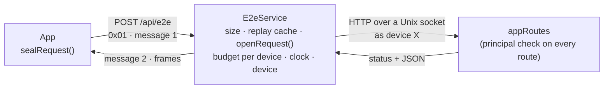

`E2eService` (`agent/src/e2e/`) decrypts, checks and dispatches; the routes are the same route table as on the TCP port, reached through the internal socket ([0003](decisions/0003-internal-socket.md)), so validation, audit log and tests are shared. The guard (`principalOf`, applied by `http/server.ts`) sits in front of every route: each needs a device the channel proved, except the four marked `public: true` (`/healthz`, `/readyz`, `/api/identity`, `/api/e2e`), so on the TCP port every other route answers 401, and a new route is guarded unless someone decides otherwise (`auth/public-routes.spec.ts` enumerates them). With `RELAY_URL` set, `RelayClient` (`agent/src/relay/`) hands the calls arriving over its relay connection to the same `E2eService.handle()` ([RELAY.md](RELAY.md)).

The log never contains a credential: a code works once and expires after an hour, and the agent key in the link is public. Wrong codes are throttled, but never burn the code, and the right one is compared first, so nobody who knows the agent key can keep the owner from pairing. Each pairing registers the **device's own public key**; the agent lists devices with their last activity and revokes them one by one. A paired device can create a code for the next one (`POST /pair/code`); `kubectl exec … node dist/cli.js pair` does the same from the pod.

How every channel is protected, with a diagram: [COMMUNICATION.md](COMMUNICATION.md).

### HTTP surface

| Port | Path | Auth | Purpose |
|---|---|---|---|
| 8080 | `/healthz` | none | liveness, no cluster data |
| 8080 | `/readyz` | none | readiness: 200 once the first run is in memory (or after `READY_TIMEOUT_SECONDS`, 90), 503 from SIGTERM on; no data |
| 8080 | `/api/identity` | none | the agent's public key (for pairing by hand) |
| 8080 | `/api/e2e` | Noise IK: device key, every call | every API call, see [PROTOCOL.md](PROTOCOL.md) and [API.md](API.md) |
| 8080 | other `/api/*` | | 401 `E2E_REQUIRED`: only reachable through the internal socket |
| socket | `/tmp/kubernanny.sock` | in-pod only (mode 0600) | the API routes, for decrypted calls and the admin CLI |
| 8080 | `/` | none | the web UI (static files), only with `WEB_ROOT` |
| 9100 | `/metrics` | none | `kubernanny_*` metrics; not routed by the chart's ingress |

### Demo mode

`DEMO=broken|warning|healthy` swaps the Kubernetes client for `DemoKubeClient`: a made-up three-node RKE2 cluster with Longhorn, Argo CD, CNPG, kube-prometheus-stack, Loki, kured and a dozen apps, including Prometheus answers for every chart. The same code paths run as in a real cluster, so the demo doubles as the integration test (`app.spec.ts`, `demo/scenarios.spec.ts`), the source of every screenshot and a way to try Kubernanny without a cluster.

---

## The app

Angular 22, zoneless, standalone components and signals; Ionic 8 for the native look and Capacitor 8 for iOS and Android. The same build is the web UI the agent serves.

```
app/src/app
├── core/
│   ├── agent.model.ts          the agent's API types (mirrors agent/src; agent/drift/app-model.ts checks the copy)
│   ├── agent-client.service.ts HTTP client, error texts
│   ├── cluster-store.service.ts clusters on the device (Capacitor Preferences; private keys through device-key-vault.ts)
│   ├── device-key-vault.ts      the device key per cluster in the iOS Keychain / Android Keystore (origin storage on the web)
│   ├── status-store.service.ts  polls every 30 s while visible, keeps the last answer
│   ├── cluster-data.store.ts    detail views per cluster, loaded per tab
│   ├── format.ts                bytes, cores, percent, relative times (German formats)
│   └── icons.ts                 every ionicon, generated from the agent's catalog
├── clusters/    list of clusters, empty state with install steps
├── cluster/     one cluster: hero + seven tabs, module sheet, view models
├── pair/        pairing from a link, QR code or typed code
├── cluster-form/settings: address, agent key fingerprint, agent info, devices, test notification, pair another device
└── ui/          nanny's eye, area chart, meter, usage bar, issue list, logs modal
```

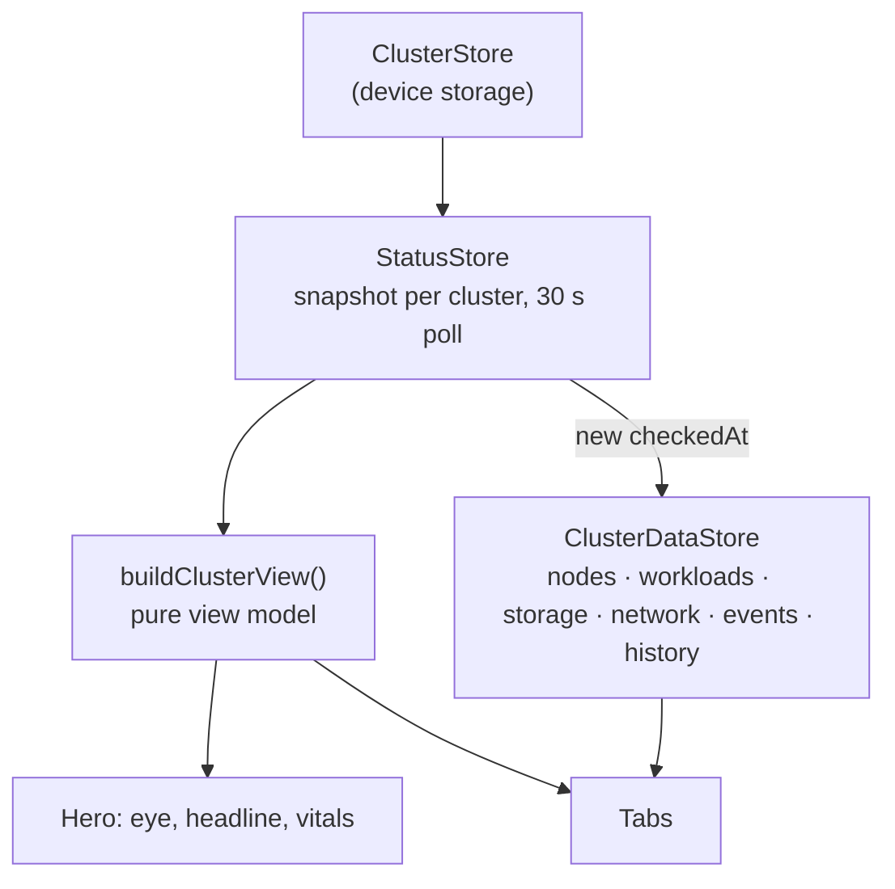

**View models, not template logic.** Every screen derives its display values in one `computed()` (`buildClusterView`, `nodeCards`, `workloadGroups`, `volumeRows`, `hostRows`). Templates only read properties; there are no getters or method calls in bindings. The view-model functions are pure and carry the app's unit tests.

**Countdown**: the hero shows "Geprüft vor 12 s · nächste in 48 s" and a ring around the eye's right lens that fills towards `nextCheckAt` (`cluster/countdown.ts`), driven by one one-second timer (five seconds with reduced motion) that stops while the page is hidden; tapping the eye or the line checks at once. Agents without `nextCheckAt` get the line without "nächste" and no ring.

**Polling** stops when the app goes to the background or the tab is hidden, and resumes on return; push takes over in between. A cluster that stops answering keeps its last snapshot, greyed out, with the reason ("Agent nicht erreichbar. Bist du im VPN?").

**Routing** uses hash URLs, so the agent can serve the build as plain static files without a fallback rule, and pairing links (`/#/pair?code=…`) keep the code out of server logs.

### Widgets

Two widgets on each platform, navy like the app icon with the nanny's glasses, the lights in the app's tones, and every state also in words:

| | iOS (WidgetKit) | Android (RemoteViews, no Glance) |
|---|---|---|
| **All clusters** ("Kubernanny", the original kind and receiver, so placed widgets stay) | small: everything added up ("2 outages and 4 warnings"), a dot per cluster; medium: a row per cluster with light, counts and age; large and extra large (iPad): the sum on top, the rows, the three worst problems with their cluster | resizable from 2 × 1 cells: 2 or 3 rows, from about 200 dp the sum on top with 3 rows (a 4 × 2 widget), then 4 rows, then the worst problems (a layout per size, chosen by the launcher from Android 12, by the reported size before; the steps in `OverviewLayout.kt` stay clear of the cell heights, which the launcher reports a few dp apart from bind to bind) |
| **One cluster** ("Cluster") | iOS 17 and later, chosen per widget ("Choose cluster", an App Intent over the clusters in the widget storage; unset: the worst); small: glasses, name, the counts as large type, age; medium: the same with the worst problems beside it; large: count tiles and the problems; Lock Screen and StandBy: circular (symbol and count), rectangular, inline | the cluster in the worst state (no configuration screen); small, wide with the problems beside it, large with count tiles |
| **Lock Screen** | the accessories above; on iOS 16 the all-clusters widget offers them (added up). Problem titles are `privacySensitive`, hidden while the device is locked | no lock-screen widgets on phones |

A tap opens the cluster (`kubernanny://cluster?id=…`, handled in `app.ts` with `clusterLinkId`, also as the launch URL of a cold start); a problem opens its cluster.

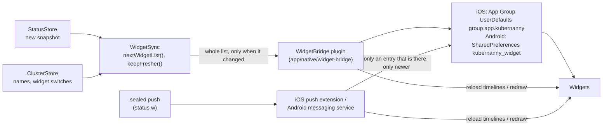

- **The widget never talks to an agent and holds no key.** It shows a short list (`WidgetCluster` in `core/widget/widget-summary.ts`: id, name, light, number of outages and warnings counted like the headline, `checkedAt`, demo flag, and the titles of the three worst problems with their severity; no causes, addresses or keys). The headline sentence is built natively from the counts, in the widget's own localization files (English and German). Fields added later are optional for the natives, so a list stored by an older version still reads (`problems` came after `kubernanny.widget.clusters.v1`; no new key was needed).

**What refreshes it, and when:**

| Situation | What happens |
|---|---|
| App open | `WidgetSync` writes whenever the list differs from the last write: a new snapshot (every poll), a renamed, removed or switched-off cluster; the plugin then reloads the widgets. |
| A native push arrives (app closed, in the background or open) | The iOS Notification Service Extension / the Android messaging service open it, and when it carries a status (`w`, [PROTOCOL.md](PROTOCOL.md#push-status)) newer than the stored entry, write that cluster's entry and reload the widgets. Only with push on for that cluster, on a change the agent notifies (new problem after 5 minutes, escalation, resolution, weekly report). |
| An hour without a push (a widget placed, push on) | The agent sends a silent status push, the state only ([NOTIFICATIONS.md](NOTIFICATIONS.md#the-home-screen-widget)). iOS: a background push the app opens in `AppDelegate` (`StatusPush.swift`, compiled into the app and the extension), when iOS delivers it; Android: the messaging service. Both write the entry as above and redraw, with no notification. The app tells the agent whether a widget is placed (`WidgetBridge.placed()`, `widget` on `POST /push/register`) on start and on every resume. |
| Nothing happens (no push gets through, app closed) | Nothing new can arrive: the widget cannot reach an agent. It shows its age instead: iOS ticks "2 min ago" from timeline entries made in advance (every minute for an hour, then sparser, for a day), Android shows the time of the check. After 2 hours without a check (one missed status push is not enough) a cluster turns grey and says "Not current" with "Open Kubernanny" under it, or under a list whose every cluster is grey (iOS: a timeline entry at that moment; Android: an alarm that does not wake the device, plus `updatePeriodMillis` every 30 minutes). After an app update Android redraws at once (`MY_PACKAGE_REPLACED`). |

The app never refreshes the widget in the background itself: that would need the device key and the Noise protocol in Swift and Kotlin. The silent status push is the periodic refresh instead: `AppPushService.refreshWidgets` (`agent/src/push/app-push.service.ts`) runs after each check on the pod holding the lease and sends the state, sealed and without text, to every device that registered with a widget and got no push of any kind for `WIDGET_REFRESH_MINUTES` (default 60, 0 off, never below 30), only through a relay whose `Ready` said `statusPush` ([PROTOCOL.md](PROTOCOL.md#status-pushes)). After a restart or a handover the first ones go out an interval later; a push the relay refuses is tried again ten minutes later. Whether a widget is placed comes from iOS `WidgetCenter` and Android `AppWidgetManager`, checked on start and on every resume. An entry the app has no answer for keeps its last state; `keepFresher` keeps a state a push stored if it is newer than the app's.

- **Switches.** Per cluster in its settings ("Show this cluster on the home-screen widget", `ClusterConfig.widgetOff`) and for all clusters on the cluster list (`widgetsOff` in Preferences). Off removes the entries from the shared storage before the switch's promise resolves, and nothing is written for them afterwards, by the app or by a push (a push only updates an entry that is there). Both are shown only in the native apps.
- **Code.** TypeScript: `app/src/app/core/widget/` (pure `widgetCluster` / `nextWidgetList` / `keepFresher`, unit-tested with a fake bridge; the web implementation of the plugin is a no-op). Plugin: `app/native/widget-bridge/`, a local npm package that `npx cap sync` wires in like any Capacitor plugin (Swift package `KubernannyWidgetBridge`, Android library with both widget providers, `WidgetRender`, the refresh receiver, layouts and resources, which the manifest merger adds to the app). From a push: `WidgetPushStatus.swift` in the push extension, `WidgetPushStatus.java` in `app/native/push`. iOS widget extension: `app/ios/App/KubernannyWidget/`; its Xcode target is set up by a script ([RELEASING.md](RELEASING.md#widgets)).

**Design**: [DESIGN.md](DESIGN.md).

---

## Deployment

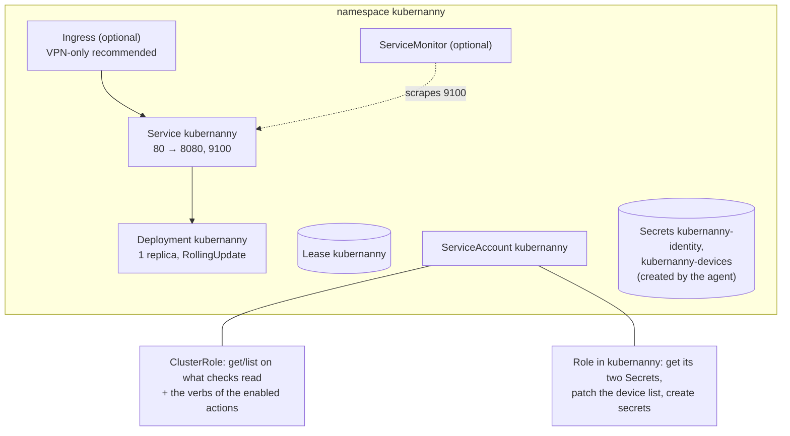

- **One replica, rolling updates without downtime.** `RollingUpdate` with `maxSurge: 1, maxUnavailable: 0`: the new pod starts next to the old one and gets traffic once `/readyz` says its first run is in memory, so the page never goes dark. Two pods must not both notify, write or hold the relay (which keeps one connection per agent key and would have them throw each other out), so only the pod holding the Lease `kubernanny` (`lease/leader.ts`; get and patch on that one name, create) does: it sends notifications, the weekly report and pushes, runs write routes and pairing, and holds the relay (and with it the dead man's switch deposits, which the new leader renews as soon as it connects, well within the shortest grace of 10 minutes). The other answers reads and refuses writes with 503 `AGENT_HANDOVER`, which the app retries; it reads devices and switches again before every call, so a device revoked meanwhile gets nothing there.

  ```mermaid
  sequenceDiagram
    participant O as old pod (holds the lease)
    participant N as new pod
    participant K as Kubernetes
    K->>N: start; first run (reads only, no notifications)
    N-->>K: /readyz 200
    K->>O: SIGTERM (endpoint removed)
    O->>O: /readyz 503, relay closed (1001), watches and timers stopped
    O->>K: release the Lease
    N->>K: take the Lease (within 2 s)
    N->>N: read devices and switches again (fail closed), connect to the relay
    O->>O: answer 5 s more, finish requests in flight (≤ 10 s), exit
  ```

  What was already notified lives in the ConfigMap `kubernanny-settings` (key `notified`), which the new pod reads before its first send, so a rollout sends nothing twice. The week of problems and the own CPU and memory record live in `kubernanny-history`: the new pod reads it at start, the old one writes it one last time on SIGTERM before releasing the lease, and the new one merges that write when it takes over. A pod that dies without releasing loses the lease after 15 s. Readiness does not wait for the lease on purpose: the old pod only gets SIGTERM once the new one is ready, so a new pod that waited for the lease would never start. There is no PodDisruptionBudget: with one replica it could only block node drains. On a drain the pod is evicted and its replacement starts elsewhere at the same time, so the page is away for the replacement's start (usually under 10 s), and notifications resume once it holds the lease (at most 15 s).
- **Hardened pod**: non-root, read-only root filesystem (plus a 1 MiB in-memory `/tmp` for the internal socket), no capabilities, `RuntimeDefault` seccomp.
- **Image**: one multi-arch image (amd64, arm64) with the agent, the protocol package and the web build (`Dockerfile` at the repository root).
- **Install paths**: Helm chart (`deploy/helm/kubernanny`, published as OCI), plain manifests (`deploy/install.yaml`), or an Argo CD Application pointing at the chart. Values: [CONFIGURATION.md](CONFIGURATION.md).

---

## Design decisions

In short; the ones with a record of their own link to it ([all records](decisions/README.md)).

- **No Kubernetes client library.** List, watch, get, merge patch, create and a text read need a 120-line `fetch` wrapper and a 400-line watch cache, with no version coupling, and the demo client is a simple subclass. `@kubernetes/client-node` would bring a large dependency tree into a pod whose memory is the point, and deciding what to keep of each object is ours either way.
- **No web framework.** The agent used NestJS and Express for about thirty JSON routes, one guard and one error shape, at about 30 MB of memory and a decorator-based DI the tests had to boot; a route table on `node:http` with the same behaviour on the wire (`http/server.spec.ts`) replaced them. The relay keeps NestJS for now.
- **Detection by image.** Labels and release names depend on how something was installed; images do not. The cost is a catalog to maintain, kept honest by a test against [COMPONENTS.md](COMPONENTS.md).
- **Pure check functions.** Testable without a cluster, and the same code runs in demo mode.
- **Actions bound to issues.** An API taking a namespace and a name would turn every paired device into a cluster-wide restart button; binding to an open issue keeps the blast radius to what is already broken. An action whose permission a compromised pod could use for much more than the action is opt-in. The opt-in Argo CD rollback is the one exception ([Actions](#actions)).
- **Services over cluster DNS, not the API server proxy.** The proxy needs a cluster-wide grant that reaches every internal service; direct calls are subject to NetworkPolicies. The proxy path is only used in development with `kubectl proxy`.
- **Device keys instead of tokens, one-time pairing codes.** Logs travel further than Secrets, and a token crosses every hop; now nothing secret is printed or sent: [0002](decisions/0002-device-keys-instead-of-tokens.md).
- **End to end, one Noise IK handshake per call.** The path between app and agent is never trusted: [0001](decisions/0001-noise-ik-per-request.md).
- **API routes only behind the internal socket.** The TCP port answers 401 for everything but the public routes: [0003](decisions/0003-internal-socket.md).
- **Direct first, the relay as fallback**, and its protocol: [0004](decisions/0004-direct-and-relay.md), [0005](decisions/0005-relay-protocol.md).
- **Texts as message keys, rendered per request** in the app's language: [0006](decisions/0006-agent-languages.md).
- **Native push sealed per device** through the relay and FCM: [0007](decisions/0007-native-push.md).
- **In-memory state.** Snapshots, first-seen times and notification state are rebuilt within one run after a restart; a database would add an operational burden to a tool whose job is to reduce one.
- **Hash routing and a single build.** The web UI the agent serves and the app in the stores are the same bundle; the agent needs no SPA fallback and pairing codes stay out of access logs.
