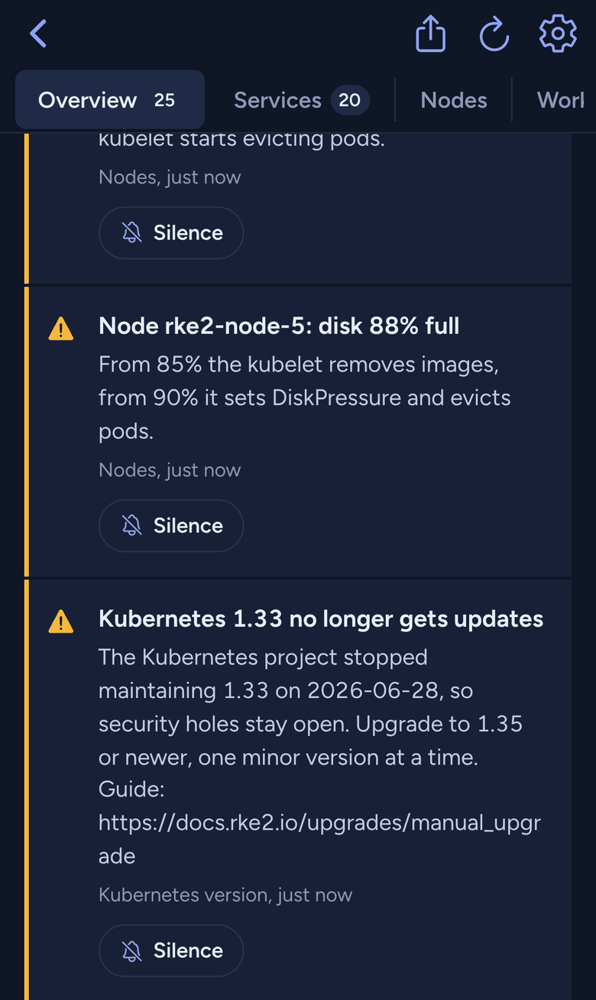
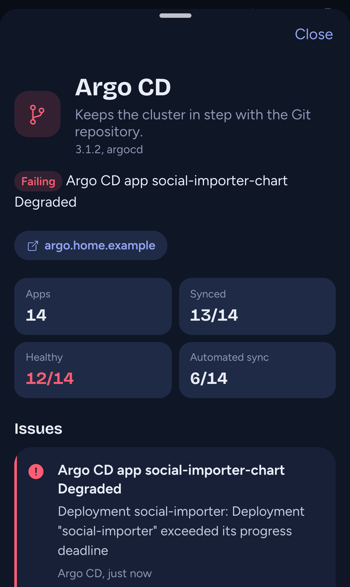

# Checks reference

Every issue Kubernanny can raise, with its id pattern, severity, cause and the actions it offers. Thresholds marked *(config)* are set through environment variables or chart values ([CONFIGURATION.md](CONFIGURATION.md)).

Severity rule: **critical** = down or data at risk now; **warning** = becomes critical if nobody acts; **hint** (`info`) = worth knowing, not a problem. Hints are listed under "Hints", never colour the light, never cost score and are never sent as notifications.

<p> </p>

*Issues as the app shows them, and a component's detail sheet.*

A module that cannot run (API error, missing RBAC) shows as *not checkable* and keeps the light from being green. A component that is not installed is skipped silently.

## Core checks (on unless switched off)

### Nodes (`nodes`)

| Issue id | Severity | When | Data source |
|---|---|---|---|
| `nodes/<node>/not-ready` | critical | `Ready` condition not `True` | Node status |
| `nodes/<node>/not-ready` | **warning** | same, but the node is cordoned (planned reboot, e.g. kured) | Node spec |
| `nodes/<node>/MemoryPressure`, `DiskPressure`, `PIDPressure` | warning | kubelet reports the condition | Node status |
| `nodes/<node>/memory` | warning ≥ 90 %, critical ≥ 97 % | memory used / allocatable | metrics-server |
| `nodes/<node>/disk` | warning ≥ 85 %, critical ≥ 95 % | root filesystem used | node-exporter via Prometheus |

Stats: nodes ready, cluster CPU and RAM %, cores, memory.

### Node clocks (`node-clocks`)

| Issue id | Severity | When |
|---|---|---|
| `node-clocks/<node>` | warning > 0.5 s, critical > 5 s | offset from `node_timex_offset_seconds` (else `node_ntp_offset_seconds`), via Prometheus |
| `node-clocks/<node>` | warning | `node_timex_sync_status` 0 for 5 min and max error ≥ 16 s |

0.5 s is half of etcd's 1 s peer clock-drift warning. Above 5 s the clock is not being corrected: new certificates are "not yet valid" and JWTs fail beyond the API server's one-minute leeway. Without Prometheus: no issue. Off: `checks.disabled: [node-clocks]`.

### etcd (`etcd`)

Reads the static pods labelled `component=etcd` in `kube-system` (RKE2, kubeadm). Skipped for external etcd or kine (k3s with SQLite).

| Issue id | Severity | When | Actions |
|---|---|---|---|
| `etcd/members` | warning | a member is not ready, quorum still holds | logs of the members |
| `etcd/members` | critical | ready members < ⌊n/2⌋+1: the API refuses writes | logs |

On RKE2 and k3s the module also reads the snapshots the distribution records as `ETCDSnapshotFile` (`k3s.cattle.io`; skipped where the CRD does not exist):

| Issue id | Severity | When |
|---|---|---|
| `etcd/snapshots` | warning | no snapshot recorded at all |
| `etcd/snapshot-failed` | warning | the newest snapshot has an error (node, local or S3, and the message) |
| `etcd/snapshot-age` | warning older than `BACKUP_MAX_AGE_HOURS` (26) *(config)*, critical older than twice that | age of the newest snapshot that is ready to use |

Stats: members ready, WAL fsync p99 (warning tone over 10 ms), leader changes in the last hour (warning tone over 3), from Prometheus; snapshot count and age of the newest.

### API server (`apiserver`)

| Issue id | Severity | When |
|---|---|---|
| `apiserver/certificate` | warning within 30 days, critical within 7 days or expired | expiry of the certificate the API server presents (read with a TLS handshake) |

RKE2 and k3s renew their certificates on restart when they expire within 90 days; a warning here means the servers have not been restarted for a long time. Stats: Kubernetes version, certificate end date.

### Workloads (`pods`)

| Issue id | Severity | When | Actions |
|---|---|---|---|
| `pods/<ns>/<Kind>/<name>` | critical | a container waits with `CrashLoopBackOff`, `ImagePullBackOff`, `ErrImagePull`, `CreateContainerConfigError`, `CreateContainerError`, `InvalidImageName` or `RunContainerError`. One issue per workload, however many pods. | logs (of the previous, crashed run for CrashLoopBackOff), restart of the owner |
| `pods/<ns>/<Kind>/<name>` | warning | a pod is `Pending` for more than 10 minutes (scheduler message as cause) | logs, restart |
| `workloads/<ns>/<Kind>/<name>` | critical | no replica ready, not explained by a pod issue, workload older than 5 minutes | restart |
| `workloads/<ns>/<Kind>/<name>` | warning | some replicas not ready, or `ProgressDeadlineExceeded` | restart |
| `jobs/<ns>/<cronjob>` | warning | the newest finished run of a CronJob failed | logs of its pod |
| `jobs/<ns>/<job>` | warning | a Job without CronJob failed within the last 24 h | logs |

The owner of a pod is resolved through its ReplicaSet (`<deployment>-<pod-template-hash>`), StatefulSet or DaemonSet. Pods of finished Jobs (`Succeeded`) are ignored.

### Volumes (`volumes`)

| Issue id | Severity | When |
|---|---|---|
| `volumes/<ns>/<pvc>` | critical | phase `Lost` |
| `volumes/<ns>/<pvc>` | warning | phase `Pending` for more than 5 minutes (StorageClass named; `WaitForFirstConsumer` explained) |
| `volumes/<ns>/<pvc>/full` | warning ≥ 85 %, critical ≥ 95 % | `kubelet_volume_stats_used_bytes / capacity` from Prometheus |

### Disruption budgets (`pdb`)

| Issue id | Severity | When |
|---|---|---|
| `pdb/<ns>/<name>` | warning | a PodDisruptionBudget allows zero disruptions while all its pods are healthy (`minAvailable` equal to the replica count, or `maxUnavailable: 0`). A node drain (kured, upgrades) then waits forever. |

A PDB that blocks only because pods are unhealthy right now is not reported: that is the PDB doing its job. Stats: PDBs, how many block drains.

### Autoscalers (`hpa`)

| Issue id | Severity | When |
|---|---|---|
| `hpa/<ns>/<target>` | warning | `ScalingActive=False`: the autoscaler gets no metrics (metrics-server missing, no resource requests) |
| `hpa/<ns>/<target>` | warning | `AbleToScale=False` |
| `hpa/<ns>/<target>` | warning | `ScalingLimited` with `TooManyReplicas` and running at `maxReplicas` |

Stats: autoscalers, how many run at their maximum.

### Kubernetes version (`kubernetes-support`)

Compares the API server's minor version with a built-in table of upstream end-of-life dates (`agent/src/modules/kubernetes-support/releases.ts`, from https://kubernetes.io/releases/, compiled 2026-11-24). No network access beyond the in-cluster Prometheus.

| Situation | Severity |
|---|---|
| 120 to 61 days before end of life | hint |
| 60 days before end of life or less | warning |
| past end of life, a newer maintained minor known | warning |
| past end of life, the table knows nothing newer (table out of date) | hint |
| minor newer than the table | nothing |

The cause names the oldest maintained newer minor ("one minor version at a time") and the upgrade guide of the distribution as plain text (RKE2, k3s, kubeadm; managed clusters: kubernetes.io/releases). Issue id `kubernetes-support/<minor>`. The table is updated with every Kubernetes minor release.

**Deprecated APIs in use.** With Prometheus, the module also reads the API server's own `apiserver_requested_deprecated_apis` (1 for every deprecated API something asked for since the API server last started, with the release that removes it). One issue per removing release: a **warning** for the next minor, since that upgrade breaks whatever still asks for them, a **hint** for later ones. Issue id `kubernetes-support/deprecated-apis/<release>`. The metric does not say who asked; the cause points to the API server's audit log. The number is a stat on the module's sheet; without Prometheus this part is left out.

### Security posture (`security`)

From the pod specs the run already reads; no extra RBAC, nothing leaves the cluster. One issue per finding type and namespace. System namespaces (`kube-system`, `longhorn-system`, … plus `checks.systemNamespaces`) are skipped; recognised host-level components (Longhorn, Node Exporter, CNIs, kured, …) are exempt from the first three. Details: [SECURITY-CHECKS.md](SECURITY-CHECKS.md).

| Issue id | Severity | When |
|---|---|---|
| `security/<ns>/privileged` | warning | a container sets `securityContext.privileged: true` |
| `security/<ns>/host-access` | hint | `hostNetwork`, `hostPID`, `hostIPC` or a `hostPath` volume |
| `security/<ns>/root` | hint | neither `runAsNonRoot: true` nor a non-zero `runAsUser` (or `runAsUser: 0`) |
| `security/<ns>/no-memory-limit` | hint | a container without `resources.limits.memory` |
| `security/<ns>/mutable-image` | hint | image tag `latest` or none, without a digest |

Stats: findings, namespaces with privileged containers, namespaces with findings, exempt namespaces.

### Known vulnerabilities (`vulnerabilities`, off by default)

**Limited by design:** matches only the Kubernetes version and the image-tag versions of the 13 mapped components against OSV.dev (or `VULN_DB_URL`), cached 12 h. It does not see your own images, other components, or the libraries and base layer inside any image; for those, run Trivy Operator (`trivy` below), which scans every image. The module's sheet says so, and says whether Trivy Operator was found. Sends package names and versions, nothing else; switch on with `vulnerabilities.enabled` or in the app. One issue per component, never with actions; the app links each advisory id to osv.dev. Details and the list of mapped components: [SECURITY-CHECKS.md](SECURITY-CHECKS.md).

| Issue id | Severity | When |
|---|---|---|
| `vulnerabilities/<component>` (`vulnerabilities/kubernetes`) | critical | a critical advisory (CVSS ≥ 9.0) with a released fix on a component reachable through an ingress |
| | warning | a critical advisory with a fix on a component without one, or a high one (≥ 7.0) with a fix |
| | hint | medium, low, or no released fix yet |

Database unreachable: answers up to 7 days old are shown and marked, and OSV.dev is left alone for 15 minutes before the next try; without any, the module is *not checkable* (yellow, never red). Stats: what it compares, whether every image is covered (Trivy Operator found or not), versions checked, components left to Trivy, advisories per level, components without a lookup, database host.

A component whose every workload has a fresh Trivy Operator report is left to Trivy: no lookup, no `vulnerabilities/<component>` issue, so the same advisories never show twice.

### Available updates (`image-updates`, off by default)

`image-updates/<component>` (hint): a newer patch, minor or major tag of a recognised component with a plain `x.y.z` tag on Docker Hub, ghcr.io, quay.io or registry.k8s.io. Cached 12 h. Sends repository names only. Details: [SECURITY-CHECKS.md](SECURITY-CHECKS.md). Locked off: `checks.disabled: [image-updates]` (no registry contact, no egress rule).

## Integrations (when the component is detected and switched on)

### Longhorn (`longhorn`)

| Issue id | Severity | When |
|---|---|---|
| `longhorn/<volume>` | warning | `robustness: degraded` (fewer healthy replicas than requested, rebuilding) |
| `longhorn/<volume>` | critical | `robustness: faulted` (no healthy replica) |
| `longhorn/node/<node>` | warning | Longhorn node not `Ready` |
| `longhorn/capacity` | warning < 15 % free, critical < 5 % | free disk across all Longhorn disks |
| `longhorn/backup-target/<name>` | critical | a configured backup target (S3, NFS) is not available: no volume backups run |
| `longhorn/backup/<volume>` | warning | the newest backup of a volume failed (Longhorn's message as cause) |
| `longhorn/backup/<volume>` | warning older than `BACKUP_MAX_AGE_HOURS` *(config)*, critical older than twice that | age of the newest completed backup, for volumes that have backups (a RecurringJob that stopped) |

Detached volumes report `unknown` robustness; that is normal and ignored. Stats: volumes healthy/attached, total, free disk, scheduled share, nodes.

### cert-manager (`cert-manager`)

| Issue id | Severity | When |
|---|---|---|
| `certificates/<ns>/<name>` | critical | `notAfter` in the past |
| `certificates/<ns>/<name>` | warning, critical within 3 days *(config)* | `Ready=False` (with cert-manager's message) |
| `certificates/<ns>/<name>` | warning < 14 days *(config)*, critical < 3 days | expiry close. cert-manager renews a 90-day certificate 30 days early, so this means renewal is failing. |
| `certificates/issuer/<name>` | critical | ClusterIssuer not ready: no new certificate can be issued |

Stats: certificates ready, ClusterIssuers, next expiry.

### Argo CD (`argocd`)

| Issue id | Severity | When | Actions |
|---|---|---|---|
| `argocd/<app>/health` | critical | health `Degraded` or `Missing`; the cause names the broken resources | restart of up to three degraded workloads, sync, hard refresh |
| `argocd/<app>/operation` | critical | last sync `Failed` or `Error` | sync, hard refresh |
| `argocd/<app>/sync` | **hint** | `OutOfSync` on an app with **manual** sync: a commit waits for someone to sync it. That is the normal state of a manual app, not a fault. | sync, hard refresh |
| `argocd/<app>/sync` | warning | `OutOfSync` on an app with **automated** sync: Argo CD should have fixed it, so a sync is stuck or something changes the cluster behind Git's back | sync, hard refresh |
| `argocd/<app>/comparison` | warning | `ComparisonError` condition | hard refresh |

No sync is offered while an operation is running. Stats: apps, synced, healthy, automated.

### CloudNativePG (`cnpg`)

| Issue id | Severity | When | Actions |
|---|---|---|---|
| `cnpg/<ns>/<cluster>/instances` | critical | no ready instance | logs of the primary |
| `cnpg/<ns>/<cluster>/instances` | warning | fewer ready instances than requested, or phase not healthy | logs |
| `cnpg/<ns>/<cluster>/archiving` | critical | `ContinuousArchiving=False`: the primary keeps every WAL segment it cannot upload until its volume is full | logs |
| `cnpg/<ns>/<cluster>/backup` | warning | backup configured but never succeeded, or last success older than 26 h *(config)* | start a backup |
| `cnpg/<ns>/<cluster>/backup` | critical | older than twice that | start a backup |

Backup checks only run for clusters with `spec.backup` or a Barman plugin. Stats: clusters, instances ready, oldest last backup, per cluster ready instances and primary.

### Prometheus (`prometheus`)

| Issue id | Severity | When |
|---|---|---|
| `prometheus/down/<job>` | warning | targets of a scrape job are down (`up == 0`), instances listed |

Stats: targets up, jobs, head series. Prometheus is reached at `PROMETHEUS_URL`, else the detected service with port 9090.

### Alertmanager (`alertmanager`)

Your own alerting rules, read from `/api/v2/alerts` (active, not silenced, not inhibited). One issue per alert name (`alertmanager/<alertname>`), critical if any instance has `severity=critical`, warning for `severity=warning`; other severities, `Watchdog` and `InfoInhibitor` are ignored. Silencing in Alertmanager silences Kubernanny too. Stats: firing, critical, active silences.

### Grafana, Loki

| Issue id | Severity | When |
|---|---|---|
| `grafana/database` | warning | `/api/health` reports the database not `ok` |
| `loki/ready` | warning | `/ready` does not answer `ready` |

Stats: Grafana version and database; Loki readiness and lines received per second.

### kured (`kured`)

| Issue id | Severity | When |
|---|---|---|
| `kured/lock` | warning | the reboot lock (`weave.works/kured-node-lock` on the DaemonSet) is held for more than 2 hours: no other node reboots and security updates wait |

Stats: node rebooting now, nodes waiting for a reboot (`kured_reboot_required`). Nodes held by the lock show "Startet neu" in the Nodes tab, and their NotReady is a warning.

### System Upgrade Controller (`system-upgrade-controller`)

`upgrade/<plan>` (warning) when a plan cannot resolve its version (`LatestResolved=False`). Stats: each plan's version and the nodes it is applying to.

### Velero (`velero`)

Per schedule, the newest backup: `velero/<schedule>` critical on `Failed`, warning on `PartiallyFailed` or when older than 26 h *(config)*.

### Flux, External Secrets, Infisical

Every Kustomization, HelmRelease and GitRepository (Flux), ExternalSecret and ClusterSecretStore (External Secrets), InfisicalSecret (Infisical) with `Ready=False` is a warning with the controller's message. Stats: ready per kind.

### Gatus (`gatus`)

Reads `GET /api/v1/endpoints/statuses` on Gatus' service (port 8080) over cluster DNS. An endpoint whose newest result failed counts as down; one **warning** per Gatus group (`gatus/group/<group>`, `-` for ungrouped), naming the endpoints and Gatus' error or the condition not met. Stats: up, down, without result. API behind a login (401/403): no issue, a stat saying so. Untrusted: never offers actions.

### Uptime Kuma (`uptime-kuma`)

Uptime Kuma has no read API without credentials (`/metrics` needs an API key in 2.x and can be switched off). With `UPTIME_KUMA_STATUS_PAGE` set to a published status page's slug, the agent reads that page like a browser does (`GET /api/status-page/<slug>` and `/api/status-page/heartbeat/<slug>`, port 3001): a monitor whose newest heartbeat is down counts; one **warning** per status page group (`uptime-kuma/group/<group id>`). Only monitors on that page are seen. Without the setting: workload health only, plus a stat explaining how to enable it. Untrusted: never offers actions.

### Rook Ceph (`rook-ceph`)

`…/<ns>/<name>/health`: warning on HEALTH_WARN, critical on HEALTH_ERR (with Ceph's own messages). `…/capacity`: warning ≥ 75 %, critical ≥ 85 % raw use. Ceph's own per-OSD defaults are nearfull 85 %, backfillfull 90 % and full 95 %; the cluster average runs behind the fullest OSD, hence earlier. `…/operator`: warning on a Failure phase or condition, or a status older than 15 min. Off: `checks.disabled: [rook-ceph]`.

### Traefik, ingress-nginx (`traefik`, `ingress-nginx`)

`<id>/errors/<route>`: the 5xx share over 15 min, only with ≥ 200 requests and ≥ 10 errors, so a quiet homelab never alarms. Warning > 5 % (far beyond a 0.1 to 1 % error budget and rollout blips), critical > 25 %. Without Prometheus: workload health only.

### Kyverno, Gatekeeper (`kyverno`, `gatekeeper`)

`kyverno/policy/<policy>` and `gatekeeper/<Kind>/<name>`: a hint with the violation count (security posture, not an outage). A warning only for Enforce/deny policies whose engine reports errors (`…/errors`), or a Kyverno policy that is not Ready (`…/not-ready`). Gatekeeper makes one CRD per constraint kind, so `constraints.gatekeeper.sh` is read with `*` (read only).

### Trivy Operator (`trivy`)

Reads Trivy Operator's `VulnerabilityReport`s (and `ClusterVulnerabilityReport`s where they exist), read only, nothing leaves the cluster. One issue per workload with the built-in lookup's severity rules:

| Issue id | Severity | When |
|---|---|---|
| `trivy/<ns>/<kind>/<name>` | critical | a critical advisory with a `fixedVersion` on a workload reachable through an ingress |
| | warning | a fixable critical on a workload without one, or a fixable high |
| | hint | no fix yet, medium, low |

Reports older than 14 days or of an image the workload no longer runs are skipped; only counts and the worst advisories are kept. Shown on the component's sheet too. Advisories can be marked as not applicable per workload. Off: `checks.disabled: [trivy]`. Details and suggested Trivy settings: [SECURITY-CHECKS.md](SECURITY-CHECKS.md#trivy-operator-trivy).

### metrics-server (`metrics-server`)

`metrics-server/api` (warning) when it is installed but delivers no node values (often `--kubelet-insecure-tls` missing, or the APIService unavailable).

## Every other component

Recognised components without an integration ([list](COMPONENTS.md)) are judged by their workloads: the status is critical when a workload has no ready replica, warning when some are missing, and the Workloads issues of their pods are attached to them. A component whose workloads are only CronJobs (e.g. descheduler) reads "Läuft nach Zeitplan"; a failed run is a `jobs/…` issue. Their sheet shows version, namespace, pods and ingress URLs, found through Ingresses, Gateway API HTTPRoutes and Traefik IngressRoutes.

### Your own applications

`CUSTOM_COMPONENTS` (Helm `customComponents`) adds your own images to the catalog, so they appear as components with their own name, icon and category instead of anonymous workloads:

```yaml
customComponents:
  - name: Shop API
    images: [ghcr.io/acme/shop-api]   # prefix; matches any tag or digest
    category: apps                                  # apps (default), platform, storage, …
    icon: restaurant-outline                        # any ionicon
    description: Backend of the shopping list app.
```

An image prefix matches only at a boundary: `ghcr.io/acme/api` matches `ghcr.io/acme/api:1.2` and `ghcr.io/acme/api@sha256:…`, never `ghcr.io/acme/api-evil`. A prefix ending in `/` matches everything below it (`ghcr.io/acme/`). Your entries are checked before the built-in catalog.

## Not checked (yet)

Controller-manager and scheduler health beyond what the workloads show, ingress reachability from outside (use the Blackbox Exporter, Kubernanny reports its alerts), node-level hardware (SMART), vulnerabilities of components without an OSV mapping and of your own images without Trivy Operator (the `vulnerabilities` module only knows the versions of Kubernetes and 13 recognised components; with Trivy Operator in the cluster every image is covered). See [ROADMAP.md](ROADMAP.md).
