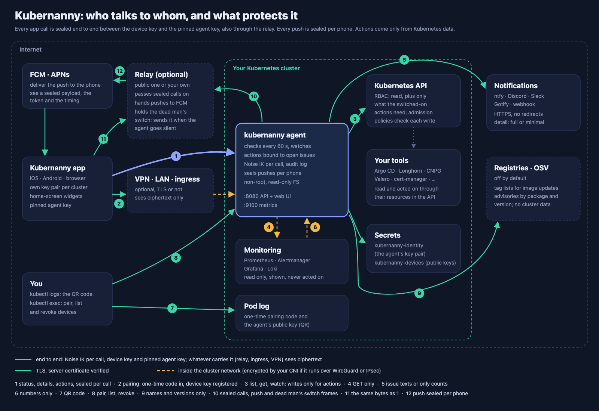
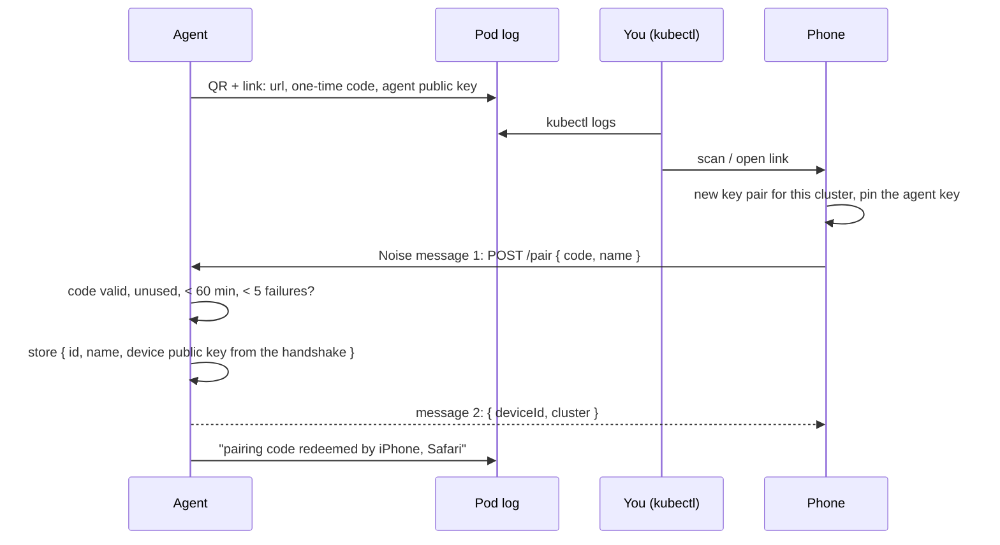

# Communication and trust

Every connection Kubernanny makes or accepts, what protects it, and what an attacker on it could do. This is the part of Kubernanny that has to be right; read it before exposing an agent. The wire format itself is specified in [PROTOCOL.md](PROTOCOL.md).



## Principles

1. **The cluster is the source of truth, the agent the only thing that touches it.** The app never talks to Kubernetes. It talks to one agent per cluster.
2. **End to end, whatever the path.** Every call between app and agent is a Noise handshake between the device's key and the agent's pinned key. TLS, plain HTTP in the LAN, a VPN, a proxy or a relay only carry ciphertext.
3. **No secret crosses the network.** Devices prove a private key that never leaves them; there is no token to steal on the wire or in the agent's Secrets.
4. **No backend of ours in the trust path.** No account, no telemetry. The optional relay ([0004](decisions/0004-direct-and-relay.md)) forwards ciphertext and can be self-hosted or switched off.
5. **Requests name problems, never targets.** An action is "fix issue X", and the agent takes namespace, name and kind from its own check. No request can point the agent at anything else.
6. **Only the Kubernetes API is trusted to cause actions.** Data from Prometheus, Alertmanager, Grafana and Loki is shown, never acted upon.

## The channels

| # | From → to | Protocol | Authenticates | Confidential against | Carries |
|---|---|---|---|---|---|
| 1 | App / browser → agent | Noise IK per call over HTTP(S) `POST /api/e2e` | device key and agent key, every call | everyone but the device and the agent, including ingress, proxies, relay | status, details, logs of broken pods, action requests |
| 2 | Phone → agent, once | the same, `POST /pair` inside | one-time code + the device key from the handshake | the same | device name in, device id out |
| 3 | Agent → Kubernetes API | HTTPS | ServiceAccount token (projected, rotated) | network; server certificate checked against the cluster CA | list/get; patch/create for the four actions |
| 4 | Agent → Prometheus, Alertmanager, Grafana, Loki | HTTP inside the cluster | none | by your CNI, if it encrypts (WireGuard, IPsec) | GET of read endpoints only |
| 5 | Agent → notification service | HTTPS (HTTP only to `*.svc`) | URL / token you configure | network | cluster name, issue titles and causes (or only counts) |
| 6 | Prometheus → agent `:9100` | HTTP inside the cluster | none | by your CNI | counts and scores, no names |
| 7 | Operator → agent log | `kubectl logs` | your kubeconfig | network | QR code with a one-time code and the agent's public key |
| 8 | Operator → admin CLI | `kubectl exec` + Unix socket in the pod | your kubeconfig (`pods/exec`) | network | new pairing code, device list, revoke |
| 9 | Agent → vulnerability database (**off by default**) | HTTPS to api.osv.dev or your mirror (HTTP only to `*.svc`) | server certificate | network | component package names and versions, advisory ids; no cluster data |
| 10 | Agent → relay, outbound WebSocket (**off by default**) | `wss://`, frames around the sealed bodies of channel 1 | the agent proves its key at registration; TLS for the relay's name | everyone but device and agent for content, the relay included; TLS for the metadata | channel 1's ciphertext, a heartbeat |
| 11 | App / browser → relay (when the agent is out of reach) | HTTPS `POST /v1/agents/{agentId}/e2e` | nothing at the relay; inside, the same handshake as channel 1 | the same as channel 1 | the same bytes as channel 1 |
| 12 | Agent → relay → FCM (→ APNs) → phone: native push (**off until a device opts in**; needs channel 10) | a `Push` frame on channel 10's socket; HTTPS from the relay to FCM with the relay's service account | the agent's registration proof (relay); `mode_auth` HPKE with the pinned agent key (phone) | everyone but the agent and the one device: relay, Google, Apple | title and body of a notification (or only counts with `detail: minimal`), sealed per device; FCM token, platform and key id in clear for the relay and FCM |

### 1. App / browser → agent

```
App ── HTTPS or plain HTTP ──▶ (Ingress) ──▶ kubernanny :8080  POST /api/e2e
     0x01 | Noise message 1  (device key encrypted, request encrypted)
     ◀── 0x01 | message 2 | frames  (answer, readable only by this device)
```

- **Confidentiality and integrity.** The request is encrypted to the agent's static key, the answer to the keys of exactly this call. Whoever carries the bytes (ingress, a corporate proxy, the LAN, a relay) sees sizes and timing, nothing else, and any change makes the call fail.
- **Authentication, both ways, every call.** The device proves its private key in the handshake (Noise `ss`, `se`); the agent proves its own. There are no bearer credentials, no cookies, so no CSRF and nothing to replay from a log.
- **Pinned agent key.** The app stores the agent's public key at pairing. A different machine answering under the agent's address (DNS hijack, a rogue Wi-Fi, a compromised ingress) cannot answer at all.
- **Transport.** Because of the above, the address may be plain `http://` in a LAN or VPN. Only fetching a key that is *not* pinned yet (manual pairing without the QR code) is restricted to `https://`, `localhost` or the web UI's own origin (`transportAllowed`, `app/src/app/core/agent-client.service.ts`).
- **Replay and freshness.** The agent remembers each call's ephemeral key for 10 minutes and refuses calls whose clock is more than 5 minutes off; the device corrects its clock from the agent's authenticated answer.
- **The public port** answers only `/healthz`, `/api/identity` (the public key), `/api/e2e` and the web UI. Every other route is reachable only through the internal socket after a successful handshake ([0003](decisions/0003-internal-socket.md)); on the port it answers 401 `E2E_REQUIRED`.
- **Abuse.** A handshake costs the agent four X25519 operations; a token bucket (60, refilled at 20 per second) caps them. Bodies are at most 64 KiB.
- **Authorisation.** Reads are open to every paired device. Actions are bound to open issues (`POST /actions/restart?issue=pods/default/Deployment/web`): the agent looks the issue up in its own snapshot and runs the action stored there (409 when the issue is gone, 404 when it does not offer that action). There is no parameter for a namespace, name or kind.
- **Audit.** Every action, log read, pairing, code and revocation is logged with the device's name and id.
- **Browser hardening** on everything the agent serves: a Content Security Policy that allows scripts only from the agent's own origin (no inline scripts, no eval), no framing, `nosniff`, `Referrer-Policy: no-referrer`, HSTS behind HTTPS, `Cache-Control: no-store` on the API. The UI loads nothing from third parties and Angular escapes every value from the cluster.
- **Reachability** is still worth limiting: the chart's NetworkPolicy lets port 8080 accept connections only from the ingress controller's namespace, and a VPN-only entry point keeps the agent out of internet scanners' sight.

### 2. Pairing



- The code is 10 characters from a 31-letter alphabet, works **once** and expires after **60 minutes**. Wrong attempts never burn it, directly or through the relay: past five in 10 minutes (a blank code counts as one) they are answered `PAIRING_RATE_LIMITED`, and the right code is compared first, so it always pairs. Guessing is bounded by the budget all unknown keys share ([PROTOCOL.md](PROTOCOL.md)). A new code invalidates the previous one, and a new pairing is announced through the notification channels.
- The log may be shipped to Loki and read by many people. What they see is a code that is used or expired and a public key; neither is a credential.
- A paired device can create a code for the next one; with kubectl, `kubectl -n kubernanny exec deploy/kubernanny -- node dist/cli.js pair` prints a fresh banner.
- Without the QR code (address and code typed by hand), the agent key is fetched once over HTTPS or a port-forward, and the app shows its fingerprint, which the log shows too.
- A pairing link never pairs by itself: anyone can make one. The app shows name, address, relay and the agent key's fingerprint and pairs on a tap; a link that would give a cluster already in the app another key is refused unless the person explicitly replaces it ([SECURITY.md](SECURITY.md#threats)).

### 3. Agent → Kubernetes API

- HTTPS to `KUBERNETES_SERVICE_HOST`, server certificate verified against the ServiceAccount CA (`NODE_EXTRA_CA_CERTS`); TLS verification is never disabled.
- The ServiceAccount token is read from the projected volume on every request, so rotation needs no restart.
- What the ServiceAccount may do is listed in [SECURITY.md](SECURITY.md#what-the-agent-can-do). A test (`agent/src/rbac.spec.ts`) fails if it changes.

### 4. Agent → Prometheus, Alertmanager, Grafana, Loki

- Reached directly over cluster DNS (`http://prometheus-operated.monitoring.svc:9090`), not through the API server's service proxy, which would need a grant reaching every internal service.
- **GET only**, no credentials sent, redirects refused, 10 s timeout, responses over 8 MB refused.
- **Untrusted by design.** These endpoints are found by the images that run them, so anyone who can run a pod with a Prometheus image could answer instead. Issues from these sources are stripped of actions (integrations with `untrusted = true`); the `Integration` base class enforces it: only untrusted integrations get the Prometheus client and `this.http()`. Pin the real ones with `PROMETHEUS_URL` / `ALERTMANAGER_URL` if that matters to you.

### 5. Agent → notifications

- `NTFY_URL` and `WEBHOOK_URL` must be HTTPS; plain HTTP only for a service inside the cluster (`*.svc`). Redirects are refused.
- **What leaves the cluster**: the cluster name, issue titles and causes. With `NOTIFY_DETAIL=minimal` only the cluster name and counts. Use that for public services like ntfy.sh, or self-host ntfy.
- Secrets in webhook URLs belong in `notifications.existingSecret`, not in Helm values.

### 6. Metrics

`:9100/metrics` has no authentication and carries only numbers. It is not routed by the chart's ingress; the NetworkPolicy lets only the monitoring namespace reach it. `METRICS_PORT=0` turns it off.

### 7. The log

Shows the pairing QR code, the agent's fingerprint and the audit trail. No credential. Device names are cleaned (control characters removed), so a device cannot forge log lines.

### 8. Admin CLI

`node dist/cli.js pair | devices | revoke <id>` inside the pod talks to the internal socket. Only someone allowed to `exec` into the pod can run it, and that person could read the agent's Secrets anyway.

### 9. Vulnerability database

Only while the `vulnerabilities` module is switched on (Helm `vulnerabilities.enabled`, `ENABLED_MODULES` or the app); it is off by default. The agent sends OSV package names and versions (`github.com/argoproj/argo-cd/v3` at `3.1.2`, `k8s.io/kubernetes` at `1.33.4`) and fetches advisories by id, at most twice a day per version. No cluster name, namespace, workload, host or address. `VULN_DB_URL` points it at a self-hosted mirror instead. Details: [SECURITY-CHECKS.md](SECURITY-CHECKS.md).

### 10 and 11. Relay

Only with `relay.enabled` (Helm) / `RELAY_URL`; without it the agent opens no outbound connection. Details and the full wire format: [RELAY.md](RELAY.md), the decisions behind it: [0005](decisions/0005-relay-protocol.md).

```
App ── HTTPS POST /v1/agents/{agentId}/e2e ──▶ Relay ◀── wss:// (outbound, kept open) ── Agent
        0x01 | Noise message 1                 │ Call #n: the same bytes ─────────────▶ E2eService.handle()
     ◀── the agent's answer, unchanged ────────┘ ◀── ReplyEnd #n: status | 0x01 | message 2 | frames
```

- **The relay carries channel 1's bytes and nothing else.** Requests and answers are sealed between device and agent as on any other path; the relay holds no key that could open them, and an answer it made up does not open in the app.
- **What it learns**: the agent id (a hash of the agent's public key) and when the agent is online, the IP addresses of the agent and of the calling phone or browser, and the timing and sizes of calls. Not which device calls (the device key travels encrypted), not a path, not a byte of cluster data.
- **Registration needs the agent's private key.** The relay challenges every connection with a nonce and an ephemeral key; only the holder of the agent's private key can answer, and the public key must hash to the id it claims. A squatter cannot take an agent's place.
- **The agent's own checks all still apply**: the relay hands the bytes to the same code as `POST /api/e2e` (rate limit, replay cache, handshake, clock, device). The relay adds per-agent limits in front (calls per minute, in flight, bytes per hour).
- **The agent does not trust the relay with its resources**: a relay message is at most one request, one challenge per connection, cancels only for calls in flight, a cap on calls in flight and on unread answers. Pairing attempts follow the same rule whether they come through the relay or directly.
- **The app learns the relay only from pinned or authenticated sources**: the pairing link (only together with the agent key in the same link) or the agent's sealed `/info`. It never fetches an agent key through the relay.

### 12. Native push

Only when a device taps "Push to this device" in a cluster's settings, and only with a relay that delivers push ([NOTIFICATIONS.md](NOTIFICATIONS.md#native-push), decision [0007](decisions/0007-native-push.md)). `notifications.appPush.enabled: false` removes it entirely.

- **Sealed per device.** The agent seals each message with HPKE for that device's push key (a key pair of its own per cluster, [PROTOCOL.md](PROTOCOL.md#push-messages)), authenticated with the agent's static key. The relay, Google and Apple carry bytes they cannot read, and a message that does not come from the pinned agent does not open.
- **What travels in clear**: the device's FCM token, its platform, a key id (a hash of the random push key) and the size and time of each push, for the relay and FCM. The token is stored with the device in `kubernanny-devices`, never logged, and goes when the device is revoked or turns push off.
- **No new connection from the agent**: the push rides on the relay WebSocket. The relay talks to `oauth2.googleapis.com` and `fcm.googleapis.com`.
- **Registration** is an ordinary sealed call (`POST /api/push/register`); a device registers only itself.
- **Shape**: Android gets data-only messages (no `notification` block), so the app's own code shows them; iOS always gets `mutable-content` with a placeholder, so the extension replaces it. Every opened push carries the person's marker, which never leaves the phone; a notification without it was sent around Kubernanny by whoever holds the relay's Firebase credentials ([NOTIFICATIONS.md](NOTIFICATIONS.md#is-this-push-real)).

## What an attacker can do

| Position | Can | Cannot |
|---|---|---|
| On the network anywhere between app and agent (Wi-Fi, ISP, ingress, proxy, future relay) | see that a device talks to an agent, sizes, timing; drop traffic | read or change requests or answers, learn which device calls, replay a call, pose as the agent |
| Knows the agent's address and public key, no device | complete a handshake and be told `DEVICE_UNKNOWN`; use up the budget unknown keys share, which slows other pairing attempts down | read anything, act, burn the pairing code, keep the owner from pairing with the right code, touch a paired device's budget |
| Holds a device's private key (stolen, unlocked phone) | read cluster state and logs of broken pods; sync, refresh or restart what is broken; start an overdue backup; pair another device; switch notifications, modules and actions off, silence issues, start a 24 h maintenance window, revoke the other devices | target anything healthy, delete, read Secrets, make the blinding changes unnoticed: each one (and every new pairing) is announced through the notification channels first, naming the device. Revoke the device from another one and the key is dead on the next call; rotate if it revoked yours ([SECURITY.md](SECURITY.md)). |
| Reads the pod log (e.g. in Loki) | a pairing code that is used or expires within an hour, the agent's public key | any credential |
| Can read the Secret `kubernanny-devices` | public keys and names | anything usable |
| Can read the Secret `kubernanny-identity` | impersonate the agent to devices whose traffic they also intercept; read recorded **requests** (not answers) | act as a device. Rotate: delete the Secret, restart, pair again. |
| Runs a pod with a fake Prometheus image | make Kubernanny show wrong numbers or alerts | trigger any action |
| Controls a notification endpoint | read what you send there | anything in the cluster (outbound only) |
| Controls the vulnerability database (or a mirror you point at) | see which component versions you run; show made-up advisories or hide real ones | trigger any action (vulnerability issues carry none), make the app open a site other than osv.dev |
| Runs the relay (the public one, or yours if compromised) | see which agents are online, when and how much they are called, the IP addresses of agents and phones; tell kinds of calls apart by size (status, views, logs, actions, pairing); drop, delay or replay calls (replays are refused); use up the budget unknown keys share (never a paired device's) | read or change a call or an answer, learn which device calls, pose as the agent, register in an agent's place, burn a pairing code, make the agent spend more memory or CPU than a direct caller could |
| Knows an agent's public key and can reach its relay | send calls through the relay; get `DEVICE_UNKNOWN` like at the agent's address; use up that agent's relay rate limit (calls fail with `RELAY_RATE_LIMITED` while it lasts; the direct path is unaffected) and the agent's budget for unknown keys | read anything, act, burn the pairing code, block the right code |
| Anyone on the internet, against the relay itself | register agent ids of their own (20 per address); from one address hold at most a quarter of the relay's answer memory, for at most 15 s per answer; open unproven connections up to 8 per address; with many addresses, slow the relay down for everyone | crash the relay with a malformed request; take another agent's id; fill the relay or its answer memory from one or two addresses; keep real agents from registering from other addresses for longer than one proof round trip at a time |
| Runs the relay with push, or holds its Firebase service account | everything in the relay row above; the FCM tokens of registered devices; make those phones show notifications with any text, on Android (an FCM notification message) and on iOS (an APNs alert without `mutable-content`, which skips the extension); FCM and APNs cannot forbid it | read a Kubernanny push or forge one that opens; show a real cluster's text; add the person's push marker, so such a notification is recognisable by its missing marker; trigger any action (a tap at most opens a cluster already in the app) |
| Google (FCM) or Apple (APNs) | that a phone gets Kubernanny pushes, when, how large; drop them | read them |
| Extracts a phone's push key | open that cluster's pushes, recorded ones included | act as the device, call the agent |
| Code execution in the agent pod | what the ServiceAccount may do | read other Secrets, escalate RBAC; the pod runs non-root, read-only, without capabilities |

## Residual risks, honestly

No system is 100 % secure. These are the risks that remain:

- **Requests are not forward-secret against the agent's key** (see PROTOCOL.md, "Limits"). Answers are. Requests carry paths and action names, no cluster data.
- **Device private keys** live in the iOS Keychain and the Android Keystore, marked "this device only": not synced through iCloud Keychain and not restored onto another phone from a backup. In the browser (the web UI) they sit in the origin's storage, guarded by the CSP; anyone with access to that browser profile has the key.
- **Logs of broken pods** are readable with any paired device, also with `rbac.allowActions: false` (reading a log is no write). If your applications log secrets, restrict who gets a device, or set `actions.disabled: [logs]`: the chart then grants no `pods/log` and `GET /api/logs` answers 403 ([PERMISSIONS.md](PERMISSIONS.md)). With the plain manifest (`deploy/install.yaml`), remove the `pods/log` rule and set `DISABLED_ACTIONS=logs`.
- **Custom URL schemes can be claimed by other apps.** A malicious app registered for `kubernanny://` could receive the pairing link and pair itself; it would show in the device list and the log, and can be revoked. Verified app links will replace the scheme with the native apps.
- **Manual pairing without the QR code** trusts TLS (or the port-forward) once, to fetch the agent key. Compare the fingerprint with the log if in doubt.
- **The agent is exposed to whoever can reach it.** Authentication happens before anything is dispatched, but an agent reachable from the internet is still a target for the next bug in Node or express. Prefer a VPN or the relay over a public ingress.
- **In-cluster hops to monitoring are plain HTTP** unless your CNI encrypts.
- **The relay sees metadata** when it is on: which agent, when, how much, and the IP addresses of agent and phone. Sizes are not padded, so it can tell kinds of calls apart (status, a log, an action, a pairing attempt). Run your own ([RELAY.md](RELAY.md)) if that matters, or leave it off and stay in the VPN.
- **A stranger with the agent's public key can slow pairing down**: unknown keys share one small budget, so a flood of them delays other pairing attempts (`E2E_RATE_LIMITED`, the app retries). They can never burn the code or have the right code refused for their wrong ones, and paired devices are not affected.
- **Whoever holds the relay's Firebase service account can put a notification of their own on a registered phone, on Android and on iOS.** That is the relay's operator (for the public relay, the Kubernanny project) or anyone who steals the key. They cannot read or forge Kubernanny's sealed pushes, but Android shows an FCM *notification* message without the app's code, and iOS shows an APNs alert without `mutable-content` without the Notification Service Extension; FCM and APNs offer no way to forbid either. Such a notification can never carry a real cluster's text and cannot trigger any action (a tap at most opens a cluster already in the app). It is recognisable: every push the phone really opened starts with the marker the person picked when turning push on, which only the phone knows ([NOTIFICATIONS.md](NOTIFICATIONS.md#is-this-push-real)). A relay of your own with your own Firebase project and app build removes the third party; not switching push on, or `notifications.appPush.enabled: false`, removes the risk entirely.

## Checklist for a new install

- [ ] Agent reachable only in the VPN/LAN (or no ingress at all and the relay, [RELAY.md](RELAY.md))
- [ ] `networkPolicy.enabled: true` with the right ingress-controller and monitoring namespaces
- [ ] Notifications over HTTPS; `notifications.detail: minimal` for public services
- [ ] `rbac.allowActions: false` if you only want to look
- [ ] `actions.disabled: [logs]` if your applications may log secrets
- [ ] Revoke devices you no longer use (settings → Paired devices, or `node dist/cli.js revoke <id>`)
