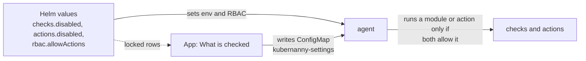
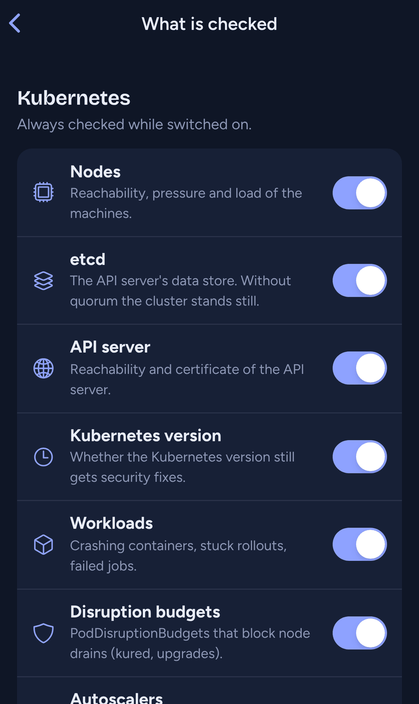
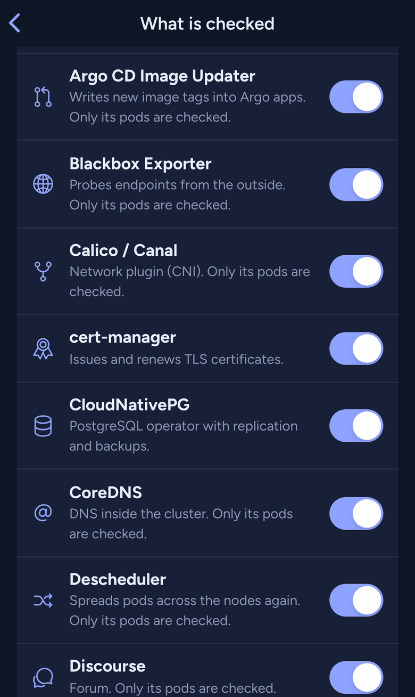

# Configuration

Kubernanny needs no configuration to run: install it, read the log, scan the code. Everything below is optional.

## Helm values

Chart: `deploy/helm/kubernanny` (OCI: `oci://ghcr.io/kubernanny/charts/kubernanny`).

| Value | Default | Effect |
|---|---|---|
| `clusterName` | `homelab` | Shown in the app and every notification |
| `image.repository` / `image.tag` | `ghcr.io/kubernanny/agent` / appVersion | |
| `publicUrl` | `""` | Address the app uses, for pairing links. Defaults to `https://<ingress.host>` when the ingress is on |
| `notifications.ntfyUrl` | `""` | ntfy topic URL |
| `notifications.webhookUrl` | `""` | Discord, Slack, Gotify or any JSON endpoint |
| `notifications.webhookFormat` | `auto` | `auto`, `discord`, `slack`, `gotify`, `json` |
| `notifications.existingSecret` | `""` | Secret with `NTFY_TOKEN` and/or a secret `WEBHOOK_URL`; only these two keys are read, `webhookUrl` wins |
| `notifications.notifyAfterSeconds` | `300` | An issue must last this long before it is sent |
| `notifications.detail` | `full` | `minimal`: only the cluster name and counts leave the cluster (for ntfy.sh and other public services) |
| `checks.intervalSeconds` | `60` | |
| `checks.certWarnDays` / `certCriticalDays` | `14` / `3` | |
| `checks.backupMaxAgeHours` | `26` | CNPG and Velero; critical at twice |
| `checks.disabled` | `[]` | Modules switched off for good by id, e.g. `[argocd, loki]` (ids in [CHECKS.md](CHECKS.md) and [COMPONENTS.md](COMPONENTS.md), e.g. `rook-ceph`, `traefik`, `ingress-nginx`, `kyverno`, `gatekeeper`, `trivy`, `node-clocks`, `image-updates`): not run, and no RBAC to read them. `notifications` switches all notifications off. The app cannot switch these on. |
| `actions.disabled` | `[]` | Action types switched off for good: `restart`, `argocd-sync`, `argocd-refresh`, `cnpg-backup`, `logs`. A permission is dropped once no enabled action of an enabled module needs it (`argocd-sync` and `argocd-refresh` share theirs). |
| `checks.prometheusUrl` / `alertmanagerUrl` | `""` | Override discovery |
| `rbac.allowActions` | `true` | `false`: no write verbs at all, actions answer 403 |
| `rbac.admissionPolicy.enabled` | `true` | ValidatingAdmissionPolicies that limit the agent's write permissions to exactly what its actions change (the restart annotation, a plain Argo CD sync or refresh, a plain CNPG Backup). Needs Kubernetes 1.30+; on older clusters the chart notes say it is missing |
| `service.type` / `service.port` | `ClusterIP` / `80` | |
| `ingress.enabled` / `className` / `host` / `annotations` / `tls` | off | Keep it on a VPN or behind SSO; see [SECURITY.md](SECURITY.md) |
| `serviceMonitor.enabled` / `interval` | off / `60s` | Prometheus Operator scrape of `kubernanny_*` |
| `networkPolicy.enabled` | `false` | Ingress to 8080 only from `networkPolicy.ingressControllerNamespace`, to 9100 only from `networkPolicy.monitoringNamespace` |
| `networkPolicy.egress.enabled` | `false` | Also restrict outbound: DNS, API server ports (`apiServerPorts`, default 443 and 6443), the monitoring namespace, HTTPS out (`internetHttps`) |
| `networkPolicy.egress.apiServerCIDRs` | `[]` | The API server's CIDRs. Empty: the API-server ports (443, 6443) stay open to any address, so `internetHttps: false` alone does not block HTTPS out |
| `resources` | 20m / 128Mi, limit 256Mi | Measured around 96 MB resident |
| `notifications.weeklyDigest` | `enabled: false, weekday: 1, hour: 9` | Weekly report through the configured channels ([NOTIFICATIONS.md](NOTIFICATIONS.md)) |
| `timezone` | `""` (UTC) | `TZ` of the agent, for the weekly report, e.g. `Europe/Berlin` |
| `checks.systemNamespaces` | `[]` | Namespaces the security posture check skips, on top of kube-system and the other system namespaces it knows |
| `vulnerabilities.enabled` | `false` | Switches the `vulnerabilities` module on for this install: sends component package names and versions to api.osv.dev (or `dbUrl`). It only covers the Kubernetes version and 13 recognised components, not your own images; Trivy Operator in the cluster covers every image (the `trivy` integration reads its reports, on by default when found). The app can still switch it off; `checks.disabled: [vulnerabilities]` locks it off. See [SECURITY-CHECKS.md](SECURITY-CHECKS.md) |
| `vulnerabilities.dbUrl` | `""` | OSV-compatible mirror instead of `https://api.osv.dev` (https, or http to an in-cluster `*.svc` host) |
| `vulnerabilities.dbNamespace` | `""` | With `networkPolicy.egress`: namespace of that mirror. Empty: HTTPS to anywhere is allowed while the module is enabled |
| `vulnerabilities.allowAccept` | `true` | `false`: nobody can mark an advisory as not applicable (built-in lookup and Trivy Operator findings); the API refuses (403 `ACCEPT_LOCKED`) before touching anything, and stored acceptances are ignored |
| `imageUpdates.enabled` | `false` | Switches on the lookup of newer image tags at the registries (`ENABLED_MODULES=image-updates`); sends repository names only. The app can still switch it off; `checks.disabled: [image-updates]` locks it off. Adds an HTTPS egress rule when `networkPolicy.egress.internetHttps` is false |
| `language` | `en` | `en` or `de`: notifications, the weekly report, the pairing banner in the pod log, and answers to callers that name no language. The app asks for its own UI language with every call. |
| `customComponents` | `[]` | Your own applications as components: `{ name, images: [prefix], category, icon, description }`, see [CHECKS.md](CHECKS.md#your-own-applications) |
| `relay.enabled` | `false` | Reach the agent from outside the VPN without an inbound port: one outbound WebSocket to the relay, which carries only end-to-end encrypted bytes ([RELAY.md](RELAY.md)). Off: no outbound connection at all |
| `relay.url` | `wss://relay.kubernanny.app` | The public relay, or your own (`deploy/relay/`, `relay/cloudflare/`) |
| `relay.egressPort` | `443` | Port for the NetworkPolicy egress rule to the relay |
| `notifications.appPush.enabled` | `true` | Push straight to the Kubernanny app, sealed per device, through the relay and Firebase ([NOTIFICATIONS.md](NOTIFICATIONS.md)). Nothing leaves until a device opts in, and that needs the relay. `false` (env `APP_PUSH=off`): the push routes answer 404, stored tokens are deleted on start, nothing is handed to the relay, the app shows it locked |
| `extraEnv`, `nodeSelector`, `tolerations`, `affinity` | | |

Example for a VPN-only Traefik setup with cert-manager and ntfy:

```yaml
clusterName: homelab
ingress:
  enabled: true
  className: traefik
  host: kubernanny.example.com
  annotations:
    cert-manager.io/cluster-issuer: letsencrypt-prod
    traefik.ingress.kubernetes.io/router.middlewares: kube-system-vpn-only@kubernetescrd
notifications:
  ntfyUrl: https://ntfy.sh/homelab-7f3a9c1e2b
serviceMonitor:
  enabled: true
```

## Environment variables

The chart sets these; set them yourself with `deploy/install.yaml` or `docker run`.

| Variable | Default | Effect |
|---|---|---|
| `CLUSTER_NAME` | `cluster` | |
| `POD_NAMESPACE` | `kubernanny` | Namespace of the agent's own Secrets `kubernanny-identity` and `kubernanny-devices` (from the downward API) |
| `INTERNAL_SOCKET` | `/tmp/kubernanny.sock` | Unix socket of the internal API (end-to-end calls, admin CLI). At most 100 bytes. |
| `PULSE_TOKEN` | | Removed in 0.3: the agent refuses to start while it is set. Devices pair with their own keys. |
| `PUBLIC_URL` | | For pairing links and ntfy's click action |
| `PORT` | `8080` | API and web UI |
| `METRICS_PORT` | `9100` | `0` disables `/metrics` |
| `WEB_ROOT` | `/app/web` in the image | Directory of the web build; unset: API only |
| `CHECK_INTERVAL_SECONDS` | `60` | |
| `NOTIFY_AFTER_SECONDS` | `300` | |
| `NTFY_URL`, `NTFY_TOKEN` | | HTTPS, or HTTP only to an in-cluster `*.svc` host; the agent refuses to start otherwise |
| `WEBHOOK_URL`, `WEBHOOK_FORMAT` | `auto` | same rule |
| `NOTIFY_DETAIL` | `full` | `minimal`: no names, hosts or messages in notifications |
| `CERT_WARN_DAYS`, `CERT_CRITICAL_DAYS` | `14`, `3` | |
| `BACKUP_MAX_AGE_HOURS` | `26` | |
| `DISABLED_MODULES` | | Comma-separated module ids switched off in the deployment (`DISABLED_CHECKS`, the name before 0.3, still works). The chart sets it from `checks.disabled`. |
| `DIGEST`, `DIGEST_WEEKDAY`, `DIGEST_HOUR` | off, 1, 9 | `DIGEST=weekly` turns the weekly report on |
| `TZ` | UTC | Time zone of the agent |
| `ENABLED_MODULES` | | Comma-separated modules that are off by default (`vulnerabilities`), switched on for this install. The chart sets it from `vulnerabilities.enabled`. |
| `VULN_DB_URL` | `https://api.osv.dev` | OSV-compatible vulnerability database; https, or http only to an in-cluster `*.svc` host |
| `SECURITY_SYSTEM_NAMESPACES` | | Comma-separated namespaces the security posture check skips, in addition to the built-in ones |
| `LANGUAGE` | `en` | `en` or `de`, see the Helm value `language`. glibc uses the same variable as a list (`de_DE:en`): the first entry counts; anything unknown means English. |
| `UPTIME_KUMA_STATUS_PAGE` | | Slug of a published Uptime Kuma status page (letters, digits, dashes). The `uptime-kuma` module then reads its monitors; without it only the pods are checked. Helm: `extraEnv: [{ name: UPTIME_KUMA_STATUS_PAGE, value: homelab }]`. In demo mode it defaults to `homelab`. |
| `RELAY_URL` | | `wss://` relay address (`ws://` only for localhost or an in-cluster `*.svc` host). Unset: no outbound connection. The chart sets it from `relay.enabled` / `relay.url`. The relay's own settings (limits, `TRUST_PROXY`) are in [RELAY.md](RELAY.md). |
| `APP_PUSH` | `on` | `off` disables native push for good (Helm `notifications.appPush.enabled`) |
| `CUSTOM_COMPONENTS` | | JSON array of your own components (the chart sets it from `customComponents`) |
| `DISABLED_ACTIONS` | | Comma-separated action types switched off in the deployment. The chart sets it from `actions.disabled`, plus the four write actions without `rbac.allowActions`. |
| `PROMETHEUS_URL`, `ALERTMANAGER_URL` | | Override discovery |
| `CORS_ORIGINS` | Capacitor, Ionic and localhost dev origins | Comma-separated; the web UI served by the agent needs none |
| `PAIRING_LOG` | `true` | `false`: no pairing banner in the log |
| `NODE_EXTRA_CA_CERTS` | ServiceAccount CA (chart) | Lets Node trust the API server |
| `DEMO` | | Built-in demo cluster, every device counts as paired and any pairing code works: `broken`, `warning`, `healthy`, `1` or `true` (= `broken`) turn it on; unset, empty, `0`, `false` or `off` turn it off; any other value stops the agent at start |
| `K8S_API_URL`, `K8S_TOKEN` | | Development outside a cluster, e.g. `kubectl proxy` on `http://127.0.0.1:8001` |

Invalid values fail the start with a clear message instead of running with a surprise: unknown ids in `DISABLED_MODULES` / `DISABLED_ACTIONS` (the chart also refuses unknown ids in `checks.disabled` / `actions.disabled`), and any unrecognised value of `VULN_ACCEPT`, `NOTIFY_DETAIL`, `WEBHOOK_FORMAT`, `DIGEST`, `PAIRING_LOG`, `METRICS_PORT`, `APP_PUSH` or `DEMO`. `DIGEST_WEEKDAY` takes 0 to 6 and `DIGEST_HOUR` 0 to 23. `checks.disabled: [prometheus]` means no Prometheus request at all, from any module.

## The app

Per cluster the app stores a name, the agent address and the agent's public key with Capacitor Preferences (`UserDefaults` on iOS, `SharedPreferences` on Android, `localStorage` on the web). This device's private key goes to the iOS Keychain or the Android Keystore (`@aparajita/capacitor-secure-storage`, "this device only"); on the web to the origin's storage. Keys stored by earlier versions are moved there on the first start. It polls every 30 seconds while in the foreground. Light and dark mode follow the system.

## Switches in the app



<p> </p>

*The app's switches: every check, tool and action type.*

Two layers. The Helm values are hard: what they switch off is not run and, for integrations and actions, not even permitted by RBAC, and the app shows it locked. The app's switches are soft: they stop the agent from using something the RBAC still allows, and anyone with a paired device can flip them back.

Cluster settings → "What is checked" lists every core check, every recognised component, the action types and notifications, each with a switch. Switches set in the app are stored in the ConfigMap `kubernanny-settings` in the agent's namespace and survive restarts; anything switched off in the Helm values shows as locked. Known vulnerabilities is off until switched on; its row says what it would send and where. `kubectl -n kubernanny delete configmap kubernanny-settings` resets the app's switches.
