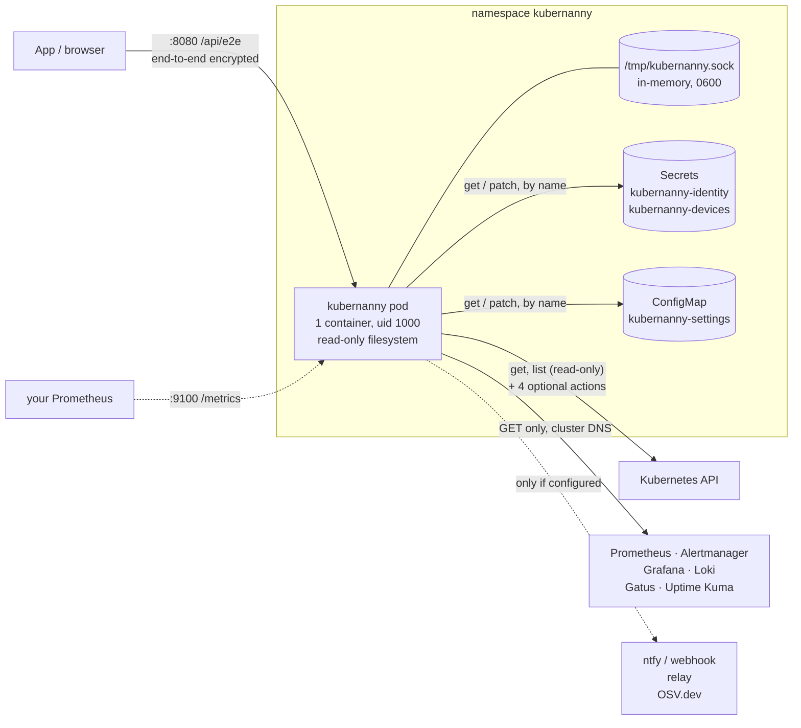
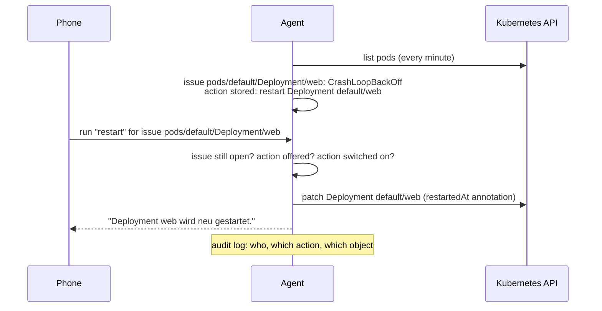

# What runs in your cluster

Everything Kubernanny puts into your cluster, everything it may do there, every connection it makes and everything it stores, in one place. Each statement says how to check it yourself. If anything here does not match what you see, that is a bug: please report it ([SECURITY.md](../SECURITY.md)).

## At a glance

| | |
|---|---|
| Workloads | **one** Deployment, one replica, one container (`ghcr.io/kubernanny/agent`) |
| Runs as | uid 1000, non-root, read-only root filesystem, no capabilities, no privilege escalation, `RuntimeDefault` seccomp |
| Writes to disk | nothing; a 1 MiB in-memory `/tmp` holds one Unix socket |
| Kubernetes access | read-only across the cluster, plus four optional write actions, each bound to an open issue |
| Secrets it can read | **only its own two**, by name, in its own namespace |
| Stores | two Secrets and one ConfigMap it creates itself, nothing else |
| Inbound | port 8080 (web UI and the end-to-end encrypted API), port 9100 (numbers for Prometheus) |
| Outbound, always | the Kubernetes API; Prometheus, Alertmanager, Grafana, Loki, Gatus and Uptime Kuma inside the cluster (GET only), when found |
| Outbound, only if you configure it | your notification URLs; the relay; OSV.dev for the vulnerability check |
| Default memory | requests 128 Mi, limit 256 Mi (about 100 MB used on a 3-node homelab) |



Solid lines happen in every install, dotted ones only when you set them up.

## The pod

`deploy/helm/kubernanny/templates/deployment.yaml` (and `deploy/install.yaml`, kept in step by a test):

```yaml
securityContext:                 # pod
  runAsNonRoot: true
  runAsUser: 1000
  seccompProfile: { type: RuntimeDefault }
containers:
  - name: agent
    securityContext:
      allowPrivilegeEscalation: false
      readOnlyRootFilesystem: true
      capabilities: { drop: [ALL] }
    volumeMounts:
      - { name: tmp, mountPath: /tmp }   # emptyDir, medium: Memory, sizeLimit: 1Mi
```

One process: `node dist/main.js`. It runs the checks once a minute (`CHECK_INTERVAL_SECONDS`), keeps the result in memory and answers the app. There is no database, no sidecar, no init container, no CRD, no webhook, no DaemonSet: Kubernanny never runs anything on your nodes.

Check it:

```sh
kubectl -n kubernanny get all,secrets,configmaps,networkpolicies,serviceaccounts,roles,rolebindings
kubectl -n kubernanny get pod -l app.kubernetes.io/name=kubernanny -o jsonpath='{.items[0].spec}' | jq '.securityContext, .containers[0].securityContext'
```

## What it may do in the Kubernetes API

The ClusterRole is generated from the code: each module declares the resources it reads, each action the permission it needs (`agent/src/rbac/rules.ts` → `deploy/helm/kubernanny/files/rbac.json` → `templates/rbac.yaml`). Anything you switch off in the Helm values is left out of the ClusterRole, not just unused. CI renders the chart with the switches and fails if a switched-off permission is still granted.

### Always (the inventory every run reads)

| Resources | Verbs | Why |
|---|---|---|
| nodes, pods, services, namespaces, events, persistentvolumeclaims | get, list | nodes, workloads, volumes, events |
| deployments, statefulsets, daemonsets, jobs, cronjobs | get, list | workload health, owner of a pod |
| ingresses, httproutes (Gateway API), ingressroutes (Traefik) | get, list | which component is reachable under which address |
| storageclasses | get, list | the Storage tab |
| metrics.k8s.io nodes, pods | get, list | CPU and memory, if metrics-server runs |

### Per module (dropped with `checks.disabled: [<id>]`)

| Module | Resources (get, list) |
|---|---|
| `argocd` | argoproj.io applications |
| `cert-manager` | certificates, clusterissuers |
| `cnpg` | postgresql.cnpg.io clusters |
| `etcd` | k3s.cattle.io etcdsnapshotfiles (RKE2, k3s) |
| `external-secrets` | externalsecrets, clustersecretstores |
| `flux` | kustomizations, helmreleases, gitrepositories |
| `hpa` | horizontalpodautoscalers |
| `infisical` | infisicalsecrets, infisicalstaticsecrets |
| `longhorn` | longhorn.io volumes, nodes, backups, backuptargets |
| `pdb` | poddisruptionbudgets |
| `system-upgrade-controller` | upgrade.cattle.io plans |
| `velero` | velero.io backups |

Note what is **not** there: no Secrets of any other namespace, no ConfigMaps of other namespaces, no `services/proxy`, no `pods/exec`, no `delete` on anything, no RBAC objects, no node access.

### Actions (dropped with `actions.disabled: [<type>]` or `rbac.allowActions: false`)



An action never names its target in the request: the app says "run `restart` for issue X", and the agent takes namespace, kind and name from its own check result. It can only touch what is broken right now. Each action's permission is granted only while the action is enabled **and** a module offering it is enabled.

| Action | Permission | Offered by |
|---|---|---|
| `restart` | patch deployments, statefulsets, daemonsets (sets the `restartedAt` annotation, like `kubectl rollout restart`) | `pods`, `argocd` |
| `argocd-sync`, `argocd-refresh` | patch argoproj.io applications (they share it: disable both, or the module, to drop it) | `argocd` |
| `cnpg-backup` | create postgresql.cnpg.io backups | `cnpg` |
| `logs` | get pods/log (the last 300 lines of the pod an issue names) | `pods`, `cnpg`, `etcd` |

Every action and every log read is written to the agent's log with the device that asked (`kubectl -n kubernanny logs deploy/kubernanny | grep audit`).

### In its own namespace (Role)

| Resource | Names | Verbs | Holds |
|---|---|---|---|
| Secret | `kubernanny-identity` | get | the agent's X25519 key pair |
| Secret | `kubernanny-devices` | get, patch | public keys and names of paired devices |
| ConfigMap | `kubernanny-settings` | get, patch | the switches set in the app, silenced issues |
| Secrets, ConfigMaps | | create | Kubernetes cannot limit `create` by name; the agent creates only the three above |

Check it yourself, as the agent's ServiceAccount:

```sh
SA=system:serviceaccount:kubernanny:kubernanny
kubectl auth can-i --list --as=$SA                       # everything, cluster-wide
kubectl auth can-i --list --as=$SA -n kubernanny         # plus its own namespace
kubectl auth can-i get secrets -n default --as=$SA       # no
kubectl auth can-i delete pods -n default --as=$SA       # no
kubectl auth can-i create pods/exec -n default --as=$SA  # no
```

## Network

### Inbound

| Port | Path | Who | Protection |
|---|---|---|---|
| 8080 | `/` | anyone who reaches it | the web UI as static files; Content Security Policy, no inline scripts |
| 8080 | `/healthz` | kubelet probes | `{"ok":true}`, no cluster data |
| 8080 | `/api/identity` | the app when pairing by hand | the agent's public key; public by nature |
| 8080 | `/api/e2e` | the app | one Noise IK handshake per call: device authenticated, request and answer encrypted ([PROTOCOL.md](PROTOCOL.md)) |
| 8080 | any other `/api/*` | | 401: only reachable through `/api/e2e`, over the Unix socket below |
| 9100 | `/metrics` | Prometheus | scores and counts, no names; not on the ingress |
| socket | `/tmp/kubernanny.sock` | the agent itself, `kubectl exec` | mode 0600 inside the pod; not on the network |

The chart's NetworkPolicy (`networkPolicy.enabled: true`) lets 8080 accept connections only from the ingress controller's namespace and 9100 only from the monitoring namespace.

### Outbound

| To | When | What | Turn off |
|---|---|---|---|
| Kubernetes API (`KUBERNETES_SERVICE_HOST`) | every run | list/get, and the actions above | it is the job |
| Prometheus, Alertmanager, Grafana, Loki over cluster DNS | when detected (or `PROMETHEUS_URL` / `ALERTMANAGER_URL`) | GET of read endpoints only, no credentials, no redirects, max 8 MB; their answers never trigger actions | `checks.disabled: [prometheus, alertmanager, grafana, loki]` |
| Gatus, Uptime Kuma over cluster DNS | when detected; Uptime Kuma only with `UPTIME_KUMA_STATUS_PAGE` set | the same rules: GET `/api/v1/endpoints/statuses` (Gatus), GET `/api/status-page/<slug>` and `/api/status-page/heartbeat/<slug>` (Uptime Kuma's public status page) | `checks.disabled: [gatus, uptime-kuma]` |
| your ntfy / webhook URL | when you set one and an issue opens, escalates or resolves (plus the optional weekly report) | cluster name, issue titles and causes, or only counts with `notifications.detail: minimal` | leave the URLs empty, or `checks.disabled: [notifications]` |
| the relay (`relay.url`) | only with `relay.enabled: true` | one outbound WebSocket: a registration proof, then encrypted calls it cannot read ([RELAY.md](RELAY.md)) | `relay.enabled: false` (default) |
| api.osv.dev (or your mirror) | only when the `vulnerabilities` module is on (off by default) | package names and versions of recognised components, nothing else ([SECURITY-CHECKS.md](SECURITY-CHECKS.md)) | leave it off, or `checks.disabled: [vulnerabilities]` |

Nothing else: no telemetry, no update check, no analytics, no font or script downloads. With the default values, the only connections leaving the cluster are the notifications you configure.

Optional egress policy (`networkPolicy.egress.enabled: true`) limits outbound traffic to DNS, the API server, the monitoring namespace and, if needed, HTTPS for notifications, the relay and the vulnerability database. Test it on your cluster first: the API server's address and port differ between distributions. Gatus, Uptime Kuma, Grafana or Loki outside the monitoring namespace are then unreachable and show as not checkable.

## What it stores

| Where | What | Who can read it |
|---|---|---|
| Secret `kubernanny-identity` | the agent's private key (32 bytes) | whoever can read Secrets in the namespace |
| Secret `kubernanny-devices` | per device: id, name, public key, pairing date | same; nothing in it is secret |
| ConfigMap `kubernanny-settings` | switched-off modules and actions, modules switched on (vulnerabilities), notifications paused, silenced issues with their end time | whoever can read ConfigMaps in the namespace |
| memory only | the last snapshot, 6 hours of CPU/RAM points, issues already notified, the replay cache of the end-to-end channel (10 min), the week of issue episodes for the incident history and the weekly report | lost on restart; the snapshot is rebuilt within a minute, the history starts again |

None of these is created by Helm, so `helm uninstall` leaves them (and your paired devices) in place. `kubectl delete namespace kubernanny` removes everything.

## Switching things off

| You want | Do |
|---|---|
| no actions at all, read-only | `rbac.allowActions: false` |
| Kubernanny never to look at a tool (e.g. Argo CD) | `checks.disabled: [argocd]`: not run, no RBAC |
| one action never to be possible | `actions.disabled: [restart]` |
| no logs readable from the app | `actions.disabled: [logs]` |
| nothing to leave the cluster | leave notifications, relay and the vulnerability check unset (the default) |
| fewer details in notifications | `notifications.detail: minimal` |

Everything not locked in the Helm values can also be switched in the app: cluster settings → "What is checked". Those switches are softer: they stop the agent from using a permission, the permission stays granted.

## Updating and removing

```sh
helm upgrade kubernanny oci://ghcr.io/kubernanny/charts/kubernanny -n kubernanny --reuse-values
helm uninstall kubernanny -n kubernanny && kubectl delete namespace kubernanny
```

Images and the chart are signed (Sigstore, keyless, by the release workflow) and carry an SBOM and build provenance; how to verify: [SECURITY.md](SECURITY.md#supply-chain).
