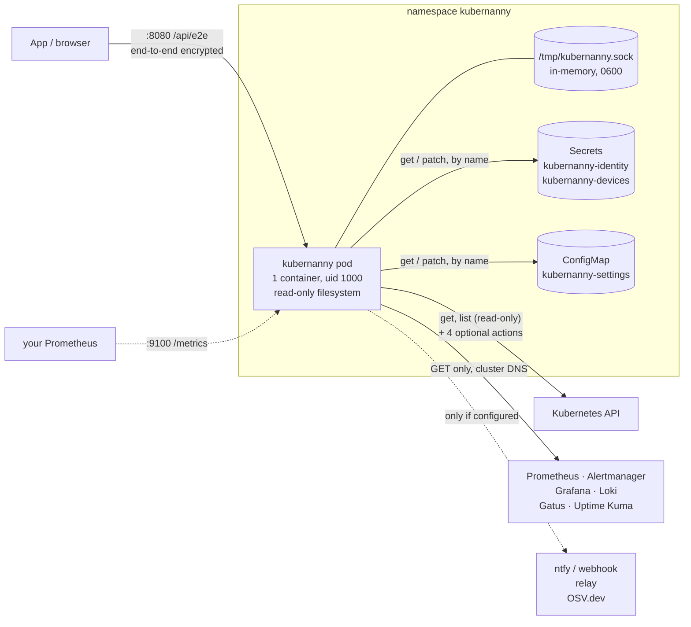
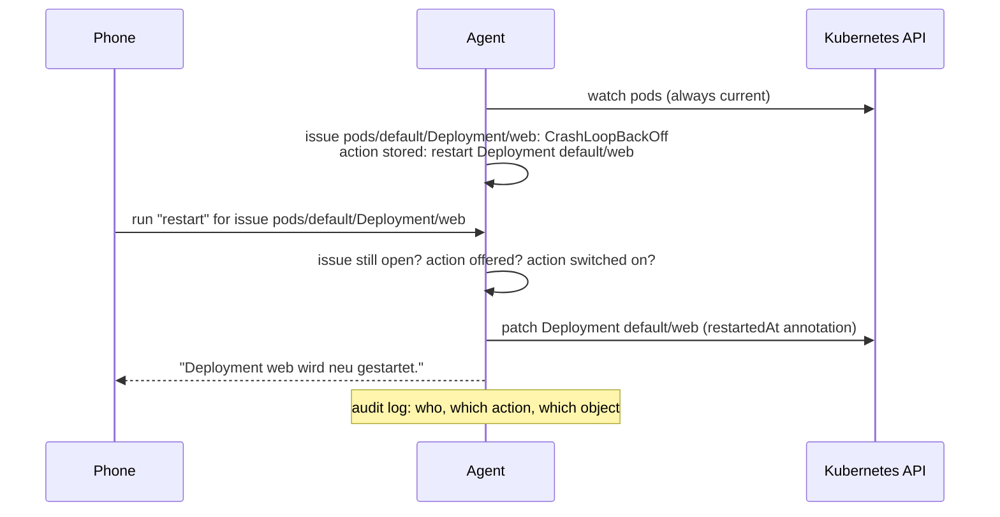

# What runs in your cluster

Everything Kubernanny puts into your cluster, everything it may do there, every connection it makes and everything it stores, in one place. Each statement says how to check it yourself. If anything here does not match what you see, that is a bug: please report it ([SECURITY.md](../SECURITY.md)).

## At a glance

| | |
|---|---|
| Workloads | **one** Deployment, one replica, one container (`ghcr.io/kubernanny/agent`) |
| Runs as | uid 1000, non-root, read-only root filesystem, no capabilities, no privilege escalation, `RuntimeDefault` seccomp |
| Writes to disk | nothing; a 1 MiB in-memory `/tmp` holds one Unix socket |
| Kubernetes access | read-only across the cluster, plus four optional write actions, each bound to an open issue, and one opt-in action (`argocd-rollback`, off unless `actions.enabled` names it) |
| Secrets it can read | **only its own two**, by name, in its own namespace |
| Stores | two Secrets and one ConfigMap it creates itself, nothing else |
| Inbound | port 8080 (web UI and the end-to-end encrypted API), port 9100 (numbers for Prometheus) |
| Outbound, always | the Kubernetes API; Prometheus, Alertmanager, Grafana, Loki, Gatus and Uptime Kuma inside the cluster (GET only), when found |
| Outbound, only if you configure it | your notification URLs; the relay (which also carries native push); OSV.dev for the vulnerability check |
| Default memory | requests 128 Mi, limit 256 Mi (about 100 MB used on a 3-node homelab) |



Solid lines happen in every install, dotted ones only when you set them up.

## The pod

`deploy/helm/kubernanny/templates/deployment.yaml` (and `deploy/install.yaml`, kept in step by a test):

```yaml
securityContext:                 # pod
  runAsNonRoot: true
  runAsUser: 1000
  runAsGroup: 1000
  seccompProfile: { type: RuntimeDefault }
containers:
  - name: agent
    securityContext:
      allowPrivilegeEscalation: false
      readOnlyRootFilesystem: true
      capabilities: { drop: [ALL] }
    volumeMounts:
      - { name: tmp, mountPath: /tmp }   # emptyDir, medium: Memory, sizeLimit: 1Mi
```

One process: `node dist/main.js`. It keeps what it reads from the API current with watches, runs the checks once a minute (`CHECK_INTERVAL_SECONDS`, and within seconds of a change such as a pod going into CrashLoopBackOff), keeps the result in memory and answers the app. During a rolling update two pods run for a few seconds; only the one holding the Lease `kubernanny` sends notifications and runs actions. There is no database, no sidecar, no init container, no CRD, no webhook, no DaemonSet: Kubernanny never runs anything on your nodes. The only cluster-scoped objects besides the RBAC are the ValidatingAdmissionPolicies described below (Kubernetes 1.30+), which the API server evaluates itself: no webhook, no extra pod.

Check it:

```sh
kubectl -n kubernanny get all,secrets,configmaps,networkpolicies,serviceaccounts,roles,rolebindings
kubectl -n kubernanny get pod -l app.kubernetes.io/name=kubernanny -o jsonpath='{.items[0].spec}' | jq '.securityContext, .containers[0].securityContext'
```

## What it may do in the Kubernetes API

**[PERMISSIONS.md](PERMISSIONS.md)** lists every permission, generated from the code: what each module reads and why, the write actions and exactly what each changes, the Role in its own namespace, what it never has, and which Helm value removes what. Anything you switch off in the Helm values is left out of the ClusterRole, not just unused. CI renders the chart with the switches and fails if a switched-off permission is still granted.



An action never names its target in the request: the app says "run `restart` for issue X", and the agent takes namespace, kind and name from its own check result. It can only touch what is broken right now. For an Argo CD Application the restart targets are not taken from the Application's `status` (anyone who can edit an Application writes that), only workloads the agent's own inventory shows not ready, in the Application's destination namespace. The one exception is the opt-in Argo CD rollback (`actions.enabled: [argocd-rollback]`, off by default): it names an app and an entry of its history, works without an open issue, and only on apps with manual sync and a single source. The agent re-reads the Application and rolls back only to a revision recorded for the app's own repository and path or chart (a commit SHA or chart version), never to another source, at most once per app in 5 minutes, announced through the notification channels first. It adds no RBAC verb; the admission policy gains a branch that allows exactly that sync and nothing else.

That binding lives in the agent's code. Should the pod itself be compromised, RBAC alone would let it use the cluster-wide `patch` for anything on those objects. On Kubernetes 1.30+ the chart therefore also installs ValidatingAdmissionPolicies that deny the agent's ServiceAccount every change but the restart annotation on workloads, a plain sync or refresh on Applications, and a plain Backup on CNPG ([PERMISSIONS.md](PERMISSIONS.md#admission-policy)). Check them with `kubectl get validatingadmissionpolicies | grep kubernanny`, and try one: `kubectl set image deploy/<any> '*=busybox' --as=system:serviceaccount:kubernanny:kubernanny --dry-run=server` must be refused. Every action and every log read is written to the agent's log with the device that asked (`kubectl -n kubernanny logs deploy/kubernanny | grep audit`).

Check it yourself, as the agent's ServiceAccount:

```sh
SA=system:serviceaccount:kubernanny:kubernanny
kubectl auth can-i --list --as=$SA                       # everything, cluster-wide
kubectl auth can-i --list --as=$SA -n kubernanny         # plus its own namespace
kubectl auth can-i get secrets -n default --as=$SA       # no
kubectl auth can-i delete pods -n default --as=$SA       # no
kubectl auth can-i create pods/exec -n default --as=$SA  # no
```

## Network

### Inbound

| Port | Path | Who | Protection |
|---|---|---|---|
| 8080 | `/` | anyone who reaches it | the web UI as static files; Content Security Policy, no inline scripts |
| 8080 | `/healthz` | kubelet probes | `{"ok":true}`, no cluster data |
| 8080 | `/api/identity` | the app when pairing by hand | the agent's public key; public by nature |
| 8080 | `/api/e2e` | the app | one Noise IK handshake per call: device authenticated, request and answer encrypted ([PROTOCOL.md](PROTOCOL.md)) |
| 8080 | any other `/api/*` | | 401: only reachable through `/api/e2e`, over the Unix socket below |
| 9100 | `/metrics` | Prometheus | scores and counts, no names; not on the ingress |
| socket | `/tmp/kubernanny.sock` | the agent itself, `kubectl exec` | mode 0600 inside the pod; not on the network |

The chart's NetworkPolicy (`networkPolicy.enabled: true`) lets 8080 accept connections only from the ingress controller's namespace and 9100 only from the monitoring namespace.

### Outbound

| To | When | What | Turn off |
|---|---|---|---|
| Kubernetes API (`KUBERNETES_SERVICE_HOST`) | every run | list/get, and the actions above | it is the job |
| Prometheus, Alertmanager, Grafana, Loki over cluster DNS | when detected (or `PROMETHEUS_URL` / `ALERTMANAGER_URL`) | GET of read endpoints only, no credentials, no redirects, max 8 MB; their answers never trigger actions | `checks.disabled: [prometheus, alertmanager, grafana, loki]` |
| Gatus, Uptime Kuma over cluster DNS | when detected; Uptime Kuma only with `UPTIME_KUMA_STATUS_PAGE` set | the same rules: GET `/api/v1/endpoints/statuses` (Gatus), GET `/api/status-page/<slug>` and `/api/status-page/heartbeat/<slug>` (Uptime Kuma's public status page) | `checks.disabled: [gatus, uptime-kuma]` |
| your ntfy / webhook URL | when you set one and an issue opens, escalates or resolves (plus the optional weekly report) | cluster name, issue titles and causes, or only counts with `notifications.detail: minimal` | leave the URLs empty, or `checks.disabled: [notifications]` |
| the relay (`relay.url`) | only with `relay.enabled: true` | one outbound WebSocket: a registration proof, then encrypted calls it cannot read ([RELAY.md](RELAY.md)); with native push, also pushes sealed for each registered device, over the same connection | `relay.enabled: false` (default); push alone: `notifications.appPush.enabled: false` |
| api.osv.dev (or your mirror) | only when the `vulnerabilities` module is on (off by default) | package names and versions of recognised components, nothing else ([SECURITY-CHECKS.md](SECURITY-CHECKS.md)) | leave it off, or `checks.disabled: [vulnerabilities]` |
| registry-1.docker.io + auth.docker.io, ghcr.io, quay.io, registry.k8s.io (+ the `*.pkg.dev` mirror it redirects to) | only when the `image-updates` module is on (off by default), at most every 12 h per image | the repository name of recognised components' images (`GET /v2/<name>/tags/list` and an anonymous pull token for that name); no tag, no cluster data, no credentials ([SECURITY-CHECKS.md](SECURITY-CHECKS.md#available-updates-image-updates)) | leave it off, or `checks.disabled: [image-updates]` |

Nothing else: no telemetry, no update check, no analytics, no font or script downloads. Native push adds no connection: the agent never talks to Firebase or Apple, the relay does ([NOTIFICATIONS.md](NOTIFICATIONS.md#native-push)). With the default values, the only connections leaving the cluster are the notifications you configure.

Optional egress policy (`networkPolicy.egress.enabled: true`) limits outbound traffic to DNS, the API server, the monitoring namespace and, if needed, HTTPS for notifications, the relay, the vulnerability database and the registries of `image-updates` (only while `imageUpdates.enabled` is set and `checks.disabled` does not name it). Test it on your cluster first: the API server's address and port differ between distributions. Gatus, Uptime Kuma, Grafana or Loki outside the monitoring namespace are then unreachable and show as not checkable.

**The API-server rule is only as narrow as you make it.** A NetworkPolicy cannot name "the API server", and its address differs per distribution (node IPs on most). Without `networkPolicy.egress.apiServerCIDRs` that rule allows ports 443 and 6443 to *any* address, so `internetHttps: false` alone does not stop HTTPS to the internet; the chart notes say so after an install. Set the CIDRs from `kubectl get endpoints kubernetes -n default` (e.g. `[192.168.1.10/32]`) to make it hold.

## What it stores

| Where | What | Who can read it |
|---|---|---|
| Secret `kubernanny-identity` | the agent's private key (32 bytes) | whoever can read Secrets in the namespace |
| Secret `kubernanny-devices` | per device: id, name, public key, pairing date; with native push switched on by that device, its FCM token, platform and push public key | same; the FCM token is the phone's address at Firebase (it lets the holder of the relay's Firebase credentials send to that phone), so it is never logged or listed |
| ConfigMap `kubernanny-settings` | switched-off modules and actions, modules switched on (vulnerabilities), notifications paused, silenced issues with their end time, advisories accepted as not applicable (component, advisory, end, device name, optional reason), issues already notified (`notified`: id, severity, title, at most 300 and 96 KiB) | whoever can read ConfigMaps in the namespace |
| memory only | the last snapshot, 6 hours of CPU/RAM points, the replay cache of the end-to-end channel (10 min), the week of issue episodes for the incident history and the weekly report | lost on restart; the snapshot is rebuilt within a minute, the history starts again |

None of these is created by Helm, so `helm uninstall` leaves them (and your paired devices) in place. `kubectl delete namespace kubernanny` removes everything.

## Switching things off

| You want | Do |
|---|---|
| no actions at all, read-only | `rbac.allowActions: false` |
| Kubernanny never to look at a tool (e.g. Argo CD) | `checks.disabled: [argocd]`: not run, no RBAC |
| one action never to be possible | `actions.disabled: [restart]` |
| no rollbacks of Argo CD apps (the default) | leave `actions.enabled` empty; `actions.disabled: [argocd-rollback]` or `rbac.allowActions: false` also win over it |
| no logs readable from the app | `actions.disabled: [logs]` |
| nothing to leave the cluster | leave notifications, relay, the vulnerability check and image updates unset (the default) |
| image updates never to contact a registry | `checks.disabled: [image-updates]`: not run, the app cannot switch it on, no NetworkPolicy egress rule for it |
| no look at Rook Ceph, Kyverno or Gatekeeper | `checks.disabled: [rook-ceph]`, `[kyverno]`, `[gatekeeper]`: not run, their reads leave the ClusterRole |
| no error rates of the ingress controller | `checks.disabled: [traefik]` / `[ingress-nginx]`: no Prometheus query (the component then shows nothing at all, not even workload health) |
| no clock check | `checks.disabled: [node-clocks]`: no Prometheus query |
| no request to Prometheus at all | `checks.disabled: [prometheus]`: no module or view queries it (nodes, volumes, etcd, clocks, ingress error rates, history). Switching the Prometheus module off in the app only hides that module; the others keep using Prometheus |
| no notification ever, security alerts included | `checks.disabled: [notifications]`: the chart passes no channel to the agent, the test route answers 403 |
| fewer details in notifications | `notifications.detail: minimal` |
| no native push to the app, ever | `notifications.appPush.enabled: false` (`APP_PUSH=off`): the push routes answer 404 before touching anything, stored push tokens are deleted on start, nothing is handed to the relay for push, and the app shows push as locked |

Everything not locked in the Helm values can also be switched in the app: cluster settings → "What is checked". Those switches are softer: they stop the agent from using a permission, the permission stays granted. Every Helm switch and exactly what it removes: [PERMISSIONS.md, "Switch -> what is removed"](PERMISSIONS.md#switch---what-is-removed).

## Updating and removing

```sh
helm upgrade kubernanny oci://ghcr.io/kubernanny/charts/kubernanny -n kubernanny --reuse-values
helm uninstall kubernanny -n kubernanny && kubectl delete namespace kubernanny
```

Images and the chart are signed (Sigstore, keyless, by the release workflow) and carry an SBOM and build provenance; how to verify: [SECURITY.md](SECURITY.md#supply-chain).
