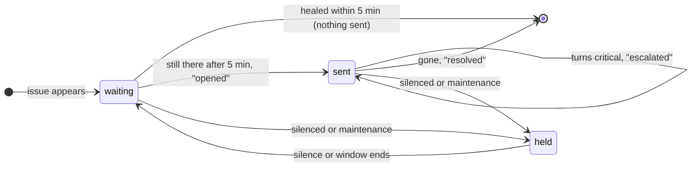
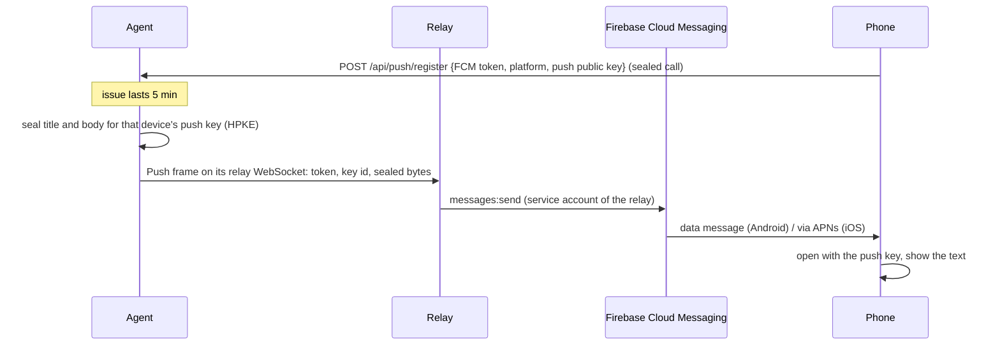

# Notifications

The app shows the state while it is open. For the rest of the time the agent sends messages itself, to channels you already run.

## When a message is sent

- **Opened**: an issue has lasted `NOTIFY_AFTER_SECONDS` (default 300). A rollout or a planned node reboot that heals within five minutes never reaches your phone.
- **Escalated**: an issue that was sent as a warning turns critical.
- **Resolved**: an issue that was sent is gone. An issue that was never sent produces no "resolved" either.



All changes of one run are one message per channel. Priority: 5 (urgent) when anything critical is in it, 3 for warnings, 2 for resolutions only.

```
homelab: 2 problems
🔴 default/social-importer: CrashLoopBackOff: back-off 5m0s restarting failed container. Last exit: Error (code 1). 14 restarts.
🟡 Last backup of default/shop-api-pg was 31 h ago: Expected at least every 26 h. Is the ScheduledBackup still running?
✅ resolved: Certificate translate.shop.example expires in 9 days
```

Messages are written in the agent's `LANGUAGE` (`en` by default, or `de`; Helm `language`), whatever language the app is set to: a message has no reader to ask. With `LANGUAGE=de` the same message reads `homelab: 2 Probleme`, `✅ behoben: Zertifikat translate.shop.example läuft in 9 Tagen ab`, and so on. Messages from the cluster itself (an alert's summary, a container's error) stay as they are.

If every channel fails, nothing is marked as sent and the next run tries again. Hints (e.g. a manual Argo CD app waiting for its sync) are never sent.

<p></p>

*Silencing an issue from the app.*

**Silenced issues** (in the app: "Silence" on an issue, for 1 hour, 8 hours, a day or a week) send nothing new while silenced: no "opened", no "escalated". Silencing never sends a "resolved" either; that only comes when the issue is really gone. Silences live in the ConfigMap `kubernanny-settings` and survive restarts; every silence is in the audit log with the device.

<p></p>

**Maintenance window** (in the app: cluster settings, for 1, 2, 4, 8 or 24 hours; `POST /api/maintenance`): planned work on the cluster without a phone that buzzes through it. The checks keep running and the app keeps showing the truth, with a banner until when; only messages wait. Whatever is still broken when the window ends is sent on the first run after it, and anything that broke and healed inside the window is never sent. It can be ended early, lives in `kubernanny-settings` like the silences and is in the audit log.

**Weekly report** (`notifications.weeklyDigest.enabled: true`, env `DIGEST=weekly`): every Monday at 9:00 (`weekday`, `hour`, in `timezone`), one message through the same channels:

```
homelab: weekly report
4 problems in the last 7 days, 1 of them critical. Open now: 1.
Longest:
🟡 Last backup of default/shop-api-pg was 31 h ago (28 h)
🔴 default/social-importer: CrashLoopBackOff (5 h, still open)
```

With `detail: minimal` only the first line. The agent keeps the week in memory: after a restart the report covers the time since then and says so, and it waits until the agent has watched for a day.

**Pausing everything**: cluster settings → "What is checked" → Notifications, or `checks.disabled: [notifications]` in the chart.

### What leaves the cluster

With the default `detail: full`: the cluster name, issue titles and causes, which contain namespaces, workload names and host names. With `notifications.detail: minimal` (`NOTIFY_DETAIL=minimal`) only this:

```
homelab: new problems
1 critical, 2 warnings. Details in Kubernanny.
```

Use `minimal` for public services like ntfy.sh, where anyone who guesses the topic reads along, or run ntfy inside the cluster. Notification URLs must be HTTPS (plain HTTP only to an in-cluster `*.svc` host) and redirects are refused.

## Channels

Set one or both of `NTFY_URL` and `WEBHOOK_URL`. The app's settings have a **test notification** button.

### ntfy

```yaml
notifications:
  ntfyUrl: https://ntfy.sh/homelab-7f3a9c1e2b   # long random topic on ntfy.sh, or your own server
```

Title (RFC 2047 encoded, so umlauts survive), priority and tags are set; with `PUBLIC_URL` a tap opens Kubernanny. For a protected topic put `NTFY_TOKEN` into `notifications.existingSecret`.

### Discord, Slack, Gotify, JSON

`WEBHOOK_URL` is recognised by its shape; `WEBHOOK_FORMAT` overrides:

| Format | Detected from | Body |
|---|---|---|
| `discord` | `discord.com/api/webhooks/…` | embed, coloured coral / amber / mint |
| `slack` | `hooks.slack.com/…` | `{ "text": "*title*\nbody" }` |
| `gotify` | path ending in `/message` | `{ title, message, priority }` (priority ×2: 10, 6, 4) |
| `json` | anything else | below |

```json
{
  "cluster": "homelab",
  "title": "homelab: 2 Probleme",
  "body": "🔴 …\n🟡 …",
  "priority": 5,
  "opened": [{ "id": "pods/default/Deployment/social-importer", "title": "…", "severity": "critical", "cause": "…" }],
  "escalated": [],
  "resolved": [{ "id": "certificates/weblate/weblate-tls", "title": "…" }]
}
```

The JSON form is meant for n8n, Home Assistant, Node-RED or your own scripts. Webhook URLs often are credentials: put them into `notifications.existingSecret` as `WEBHOOK_URL` instead of the values file.

## Native push

Push straight to the Kubernanny app, without ntfy or Discord. Each message is sealed on the agent for the one device it goes to; the relay and Google carry it and cannot read it. Why it is built this way: [decisions/0007](decisions/0007-native-push.md).



**In the app**: a cluster's settings, "Push to this device". Only then does the app ask for permission to show notifications (never at start), make a key pair for push on this cluster and register it. The same place turns it off again and sends a test push. A removed device or cluster takes its registration with it. The option is hidden in the web app and in app builds without Firebase config, and shown locked when the deployment switched push off.

**What it needs**: the relay (`relay.enabled`, [RELAY.md](RELAY.md)), and a relay that delivers push. The public relay does, for the app from the stores. Messages are the same as on every other channel: the five-minute rule, escalations, resolutions, silences, the maintenance window, security alerts and the weekly report, and with `detail: minimal` only counts (still sealed). The app is a channel like ntfy: it counts for the test button and for "a channel took it".

### Who sees what

| Party | Sees | Never sees |
|---|---|---|
| Agent | everything (it writes the message) | |
| Relay | the device's FCM token and platform, a key id, the size and time of each push, the agent id | title, body, cluster name, anything in the cluster |
| Google (FCM), Apple (APNs, iOS) | the token, the app, size and time | the content: it is sealed for the phone's push key |
| Phone | the message, opened with its push key for that cluster | |

A message opens only if the agent sealed it: the phone checks it against the agent key it pinned at pairing. On iOS a message that does not open shows a generic "Kubernanny: new status from a cluster"; on Android it is dropped.

### Switching it off

`notifications.appPush.enabled: false` (env `APP_PUSH=off`) switches native push off for good, not just from view:

- `POST` and `DELETE /api/push/register` and `POST /api/push/test` answer `404 PUSH_OFF` before reading or writing anything;
- push tokens stored earlier are deleted from `kubernanny-devices` when the agent starts;
- the agent never hands a push to the relay (the relay connection is not offered for push at all);
- the app shows push as locked, without a button; it cannot switch it back on.

The default is on: nothing leaves the cluster until a device opts in, and that needs the relay, which is off by default. The relay has its own switch (`RELAY_PUSH=off`), and is off anyway without a Firebase service account.

### Setting it up yourself

Only for a self-built app or your own relay; the store apps and the public relay need nothing.

1. **A Firebase project** (console.firebase.google.com). Add an Android app `app.kubernanny` and an iOS app `app.kubernanny`. For iOS, upload an APNs authentication key (Apple Developer, Keys, "Apple Push Notifications service") under Project settings, Cloud Messaging; FCM uses it to reach iPhones.
2. **The app's config files**, not committed (`.gitignore` lists them): `google-services.json` into `app/android/app/`, `GoogleService-Info.plist` into `app/ios/App/App/`. Fastlane copies them from `~/.config/kubernanny-store/` ([RELEASING.md](RELEASING.md)). Without them the app builds and runs as before, without push.
3. **iOS project, once**: `cd app && bundle exec ruby scripts/add-push-extension.rb` adds the Notification Service Extension and the App Group `group.app.kubernanny.push`; register that App Group for both identifiers in the Apple Developer account.
4. **A service account for the relay**: Google Cloud console of the same project, IAM, Service accounts, one allowed to send FCM messages (the role "Firebase Cloud Messaging API Admin" is enough), with a JSON key. Give it to the relay as `FCM_SERVICE_ACCOUNT` (Node: the variable or `FCM_SERVICE_ACCOUNT_FILE`; Worker: `wrangler secret put FCM_SERVICE_ACCOUNT`). Keep it in a Secret: it can push to every install of that app. The relay logs `native push on (FCM project …)` at start.

The relay's service account and the app's config files must belong to the same Firebase project: FCM tokens are only valid within their project.

## Alerting on Kubernanny itself

With `serviceMonitor.enabled`, Prometheus scrapes `kubernanny_*`. Two rules worth having:

```yaml
- alert: KubernannyAgentStale
  expr: time() - kubernanny_last_run_timestamp_seconds > 300
  for: 5m
- alert: KubernannyCritical
  expr: kubernanny_issues{severity="critical"} > 0
  for: 10m
```
