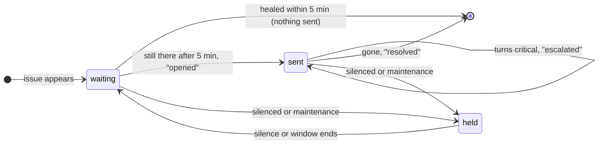
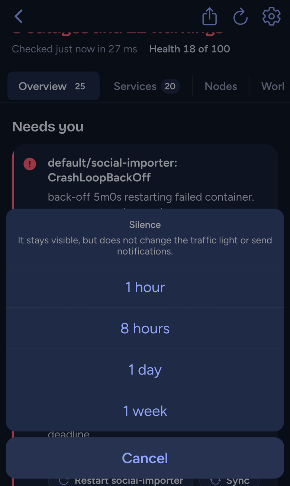
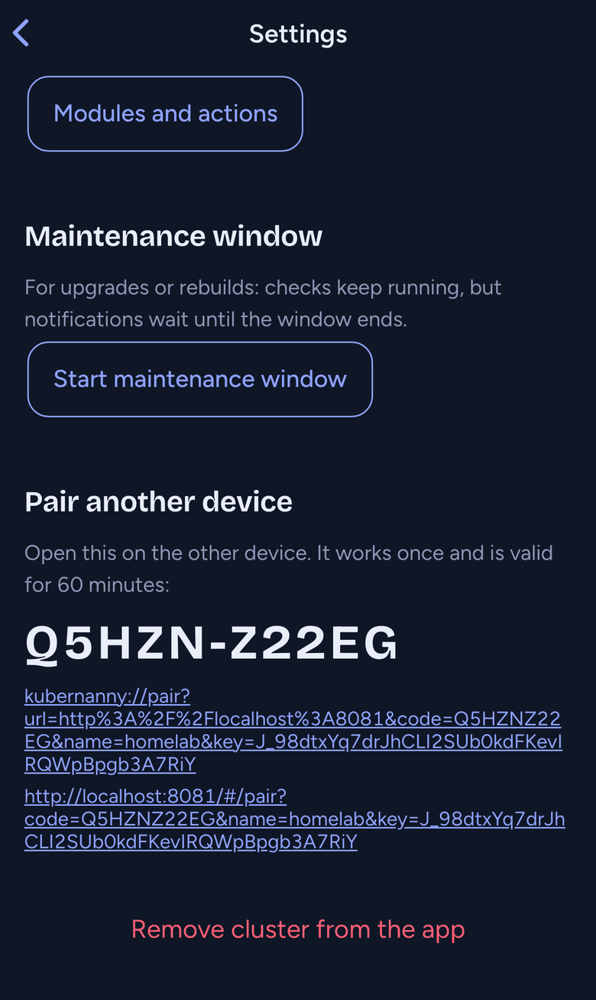
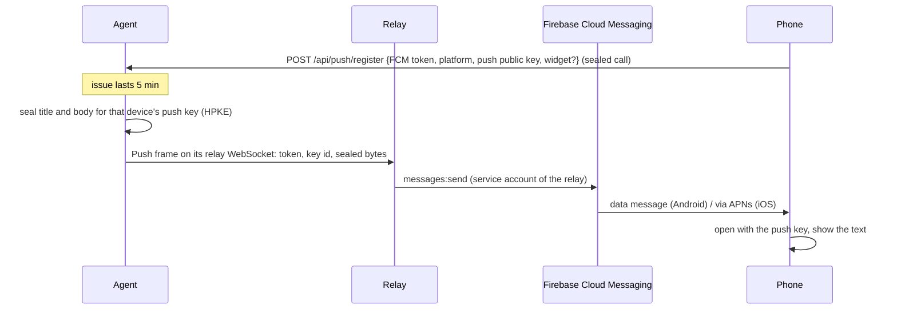
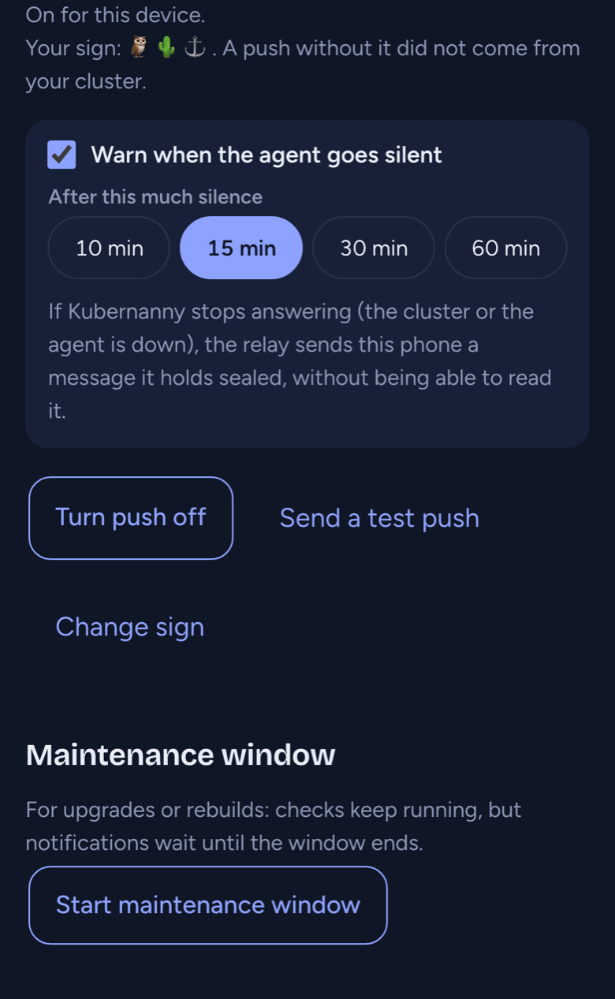
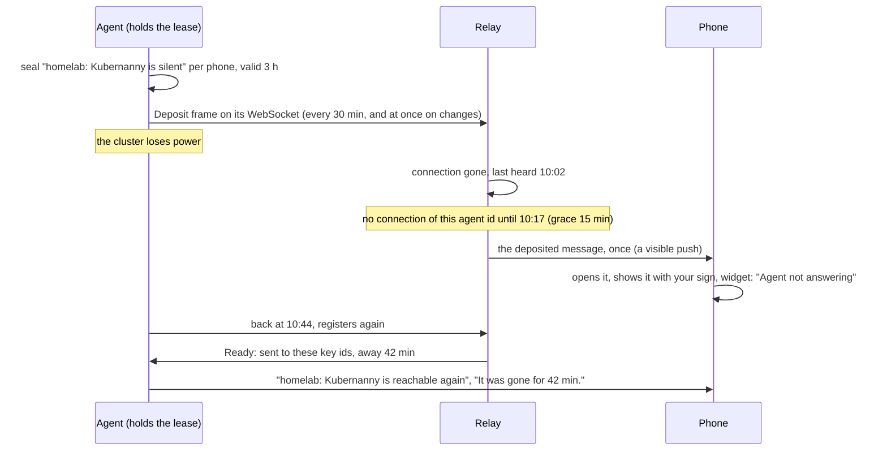

# Notifications

The app shows the state while it is open. For the rest of the time the agent sends messages itself, to channels you already run.

## When a message is sent

- **Opened**: an issue has lasted `NOTIFY_AFTER_SECONDS` (default 300). A rollout or a planned node reboot that heals within five minutes never reaches your phone.
- **Escalated**: an issue that was sent as a warning turns critical.
- **Resolved**: an issue that was sent is gone. An issue that was never sent produces no "resolved" either.



All changes of one run are one message per channel. Priority: 5 (urgent) when anything critical is in it, 3 for warnings, 2 for resolutions only.

```
homelab: 2 problems
🔴 default/social-importer: CrashLoopBackOff: back-off 5m0s restarting failed container. Last exit: Error (code 1). 14 restarts.
🟡 Last backup of default/shop-api-pg was 31 h ago: Expected at least every 26 h. Is the ScheduledBackup still running?
✅ resolved: Certificate translate.shop.example expires in 9 days
```

Messages are written in the agent's `LANGUAGE` (`en` by default, or `de`; Helm `language`), whatever language the app is set to: a message has no reader to ask. With `LANGUAGE=de` the same message reads `homelab: 2 Probleme`, `✅ behoben: Zertifikat translate.shop.example läuft in 9 Tagen ab`, and so on. Messages from the cluster itself (an alert's summary, a container's error) stay as they are.

If every channel fails, nothing is marked as sent and the next run tries again. Hints (e.g. a manual Argo CD app waiting for its sync) are never sent.

<p></p>

*Silencing an issue from the app.*

**Silenced issues** (in the app: "Silence" on an issue, for 1 hour, 8 hours, a day or a week) send nothing new while silenced: no "opened", no "escalated". Two limits keep a silence from hiding too much: it covers only the severity the issue had when it was silenced (a warning silenced for a week that becomes an outage notifies like any outage), and every silence of a warning or an outage is announced through your channels first, naming the device. Silencing never sends a "resolved" either; that only comes when the issue is really gone. Silences live in the ConfigMap `kubernanny-settings` and survive restarts; every silence is in the audit log with the device.

<p></p>

**Maintenance window** (in the app: cluster settings, for 1, 2, 4, 8 or 24 hours; `POST /api/maintenance`): planned work on the cluster without a phone that buzzes through it. The checks keep running and the app keeps showing the truth, with a banner until when; only messages wait. Whatever is still broken when the window ends is sent on the first run after it, and anything that broke and healed inside the window is never sent. It can be ended early, lives in `kubernanny-settings` like the silences and is in the audit log.

**Weekly report** (`notifications.weeklyDigest.enabled: true`, env `DIGEST=weekly`): every Monday at 9:00 (`weekday`, `hour`, in `timezone`), one message through the same channels:

```
homelab: weekly report
4 problems in the last 7 days, 1 of them critical. Open now: 1.
Longest:
🟡 Last backup of default/shop-api-pg was 31 h ago (28 h)
🔴 default/social-importer: CrashLoopBackOff (5 h, still open)
```

With `detail: minimal` only the first line. The agent keeps the week in memory: after a restart the report covers the time since then and says so, and it waits until the agent has watched for a day.

**Pausing everything**: cluster settings → "What is checked" → Notifications, or `checks.disabled: [notifications]` in the chart.

### What leaves the cluster

With the default `detail: full`: the cluster name, issue titles and causes, which contain namespaces, workload names and host names. With `notifications.detail: minimal` (`NOTIFY_DETAIL=minimal`) only this:

```
homelab: new problems
1 critical, 2 warnings. Details in Kubernanny.
```

Use `minimal` for public services like ntfy.sh, where anyone who guesses the topic reads along, or run ntfy inside the cluster. Notification URLs must be HTTPS (plain HTTP only to an in-cluster `*.svc` host) and redirects are refused.

## Channels

Set one or both of `NTFY_URL` and `WEBHOOK_URL`. The app's settings have a **test notification** button.

### ntfy

```yaml
notifications:
  ntfyUrl: https://ntfy.sh/homelab-7f3a9c1e2b   # long random topic on ntfy.sh, or your own server
```

Title (RFC 2047 encoded, so umlauts survive), priority and tags are set; with `PUBLIC_URL` a tap opens Kubernanny. For a protected topic put `NTFY_TOKEN` into `notifications.existingSecret`.

### Discord, Slack, Gotify, JSON

`WEBHOOK_URL` is recognised by its shape; `WEBHOOK_FORMAT` overrides:

| Format | Detected from | Body |
|---|---|---|
| `discord` | `discord.com/api/webhooks/…` | embed, coloured coral / amber / mint |
| `slack` | `hooks.slack.com/…` | `{ "text": "*title*\nbody" }` |
| `gotify` | path ending in `/message` | `{ title, message, priority }` (priority ×2: 10, 6, 4) |
| `json` | anything else | below |

```json
{
  "cluster": "homelab",
  "title": "homelab: 2 Probleme",
  "body": "🔴 …\n🟡 …",
  "priority": 5,
  "opened": [{ "id": "pods/default/Deployment/social-importer", "title": "…", "severity": "critical", "cause": "…" }],
  "escalated": [],
  "resolved": [{ "id": "certificates/weblate/weblate-tls", "title": "…" }]
}
```

The JSON form is meant for n8n, Home Assistant, Node-RED or your own scripts. Webhook URLs often are credentials: put them into `notifications.existingSecret` as `WEBHOOK_URL` instead of the values file.

## Native push

Push straight to the Kubernanny app, without ntfy or Discord. Each message is sealed on the agent for the one device it goes to; the relay and Google carry it and cannot read it. Why it is built this way: [decisions/0007](decisions/0007-native-push.md).



**In the app**: a cluster's settings, "Push to this device". The app first asks you to pick your sign for pushes (below), then for permission to show notifications (never at start), makes a key pair for push on this cluster and registers it. The same place turns it off again, changes the sign and sends a test push. Tapping a push opens that cluster in the app. A removed device or cluster takes its registration with it. The option is hidden in the web app and in app builds without Firebase config, and shown locked when the deployment switched push off.

**What it needs**: the relay (`relay.enabled`, [RELAY.md](RELAY.md)), and a relay that delivers push. The public relay does, for the app from the stores. Messages are the same as on every other channel: the five-minute rule, escalations, resolutions, silences, the maintenance window, security alerts and the weekly report, and with `detail: minimal` only counts (still sealed). The app is a channel like ntfy: it counts for the test button and for "a channel took it".

**When the agent goes silent**, the relay sends a message the agent sealed in advance ([When the agent goes silent](#when-the-agent-goes-silent)).

**The home-screen widget catches up with every push**, and with a silent status push about once an hour ([The home-screen widget](#the-home-screen-widget)).

### The home-screen widget

Each push also carries the cluster's state, sealed like the text: its light, the numbers of outages and warnings, the time of the last check and, with `detail: full`, the titles of the three worst problems. The phone writes it into the widget's storage and redraws the widgets without starting the app, so a resolution push turns the widget green again.

Pushes only come with a change, so on a quiet day the widget would go stale. For that, a phone that has a widget gets a **status push**: when no other push reached it for an hour, the agent sends the state alone, without any text, marked silent. The phone shows nothing for it; only the widget changes.

| What | When | On the phone |
|---|---|---|
| An alert, escalation, resolution, the weekly report, a security alert | when it happens (five-minute rule, [above](#when-a-message-is-sent)) | shown, and the widget takes the state it carries |
| A status push | at most once per `notifications.appPush.widgetRefreshMinutes` (default 60, at least 30) per phone, and only when nothing else was pushed to that phone within that time | nothing shown; the widget takes the state |
| The app is open | every poll | the app writes the widget's list itself |

- **Who gets it.** Only phones with push on for that cluster *and* a widget placed; the app tells the agent at registration and whenever that changes. One placed widget counts for every cluster in the widget list; a cluster switched off for the widget gets none. It needs a relay that delivers status pushes silently; the agent never sends one to a relay that does not.
- **Maintenance and pauses.** Status pushes keep coming during a [maintenance window](#when-a-message-is-sent): they are not notifications, and the widget should show the truth (with the maintenance light). They stop while notifications are paused in the app or switched off in the chart (`checks.disabled: [notifications]`), like every other push, and with `notifications.appPush.widgetRefreshMinutes: 0` (env `WIDGET_REFRESH_MINUTES=0`).
- **On iOS it is best effort.** The status push is a background push: iOS hands it to the app when it sees fit, throttles it (battery, Low Power Mode, how often the app is used), and never delivers it to an app the person swiped away in the app switcher, until the app is opened again. On Android it is a data message at normal priority, which may wait for a maintenance window of Doze.
- **Still grey sometimes.** When no status push gets through (iOS throttles, the phone is offline, the relay is down), the widget shows how old its state is and turns grey after 2 hours without new data, with "Open Kubernanny" under "Not current". Two hours, so one missed status push does not grey a healthy cluster. The cluster settings in the app explain this and say whether push is on for the device.

How the widget and the status push work inside: [ARCHITECTURE.md, Widgets](ARCHITECTURE.md#widgets); their wire format: [PROTOCOL.md, Status pushes](PROTOCOL.md#status-pushes). What the widget stores on the phone: [SECURITY.md](SECURITY.md#what-is-stored-on-the-phone).

### When the agent goes silent

Every other message comes from the agent, so a cluster that is down, or an agent that is gone, says nothing. For that the relay holds a message for each phone, sealed in advance: the **dead man's switch**.

<p></p>



- **In the app**: the cluster's push section, "Warn when the agent goes silent", on by default whenever push is on, with the grace: 10, 15 (default), 30 or 60 minutes of silence. It is a setting of this phone for this cluster; each phone chooses its own. Switched off in the deployment, or with a relay or an agent before it, the section says so.
- **What is sent**: `{cluster}: Kubernanny is silent`, "No word from Kubernanny for 15 min. Check the cluster or the agent." in the agent's `LANGUAGE` (`Kubernanny schweigt`, "Kubernanny meldet sich seit 15 Min. nicht. Cluster oder Agent prüfen."), with your sign like every push. The phone marks the cluster's widget entry: both widgets show it as "Agent not answering" in coral until a newer state arrives (the next push, status push or the open app).
- **When**: the relay counts the silence from the last heartbeat it heard on the agent's connection (every 25 s). A rollout hands the connection to the new pod within seconds and the new leader deposits again at once, so it never fires; neither does a relay restart of a few seconds or a network hiccup under the grace.
- **Back again**: when the agent registers after a message went out, the relay names the phones it sent to and how long the agent was away, and those phones get an ordinary push, "homelab: Kubernanny is reachable again" with "It was gone for 42 min.", with the current state for the widget. Back before the grace: nothing is sent at all.
- **Maintenance and pauses.** During a [maintenance window](#when-a-message-is-sent) the relay holds the message until the window ends (plus the grace): planned work that takes the cluster down does not buzz the phone, an agent still gone after it does. While notifications are paused in the app, or locked in the chart, the agent clears what the relay holds. `notifications.appPush.deadman.enabled: false` (env `DEADMAN=off`) switches it off for the deployment; the relay has `RELAY_DEADMAN=off`.
- **Uninstalling**: `helm uninstall` (or scaling to zero) takes the agent away like an outage, and phones with the switch on get the message once. Turn it off in the app first, or pause notifications, if that is not wanted.
- **Not covered**: a relay that is down, or that drops the deposit, cannot send anything. A restart of the Node relay forgets deposits until each agent renews them, at the latest 30 minutes later ([RELAY.md](RELAY.md#dead-mans-switch)). A phone that is off or without signal gets the message when FCM delivers it, if that is within the message's validity.

**What the relay holds** for this: per phone with the switch on, its FCM token, platform, push key id, grace and the sealed message, for at most the message's validity (3 hours after it was deposited, or the end of a maintenance window plus 3 hours, 27 hours at most). It cannot read or change the message. It can send it early (a false "silent" alarm), late or not at all, but never a false "all fine": a deposited message only ever says "silent", and the "reachable again" push is sealed by the agent when it is back ([SECURITY.md](SECURITY.md#a-hostile-relay)). The phone shows each message once, only within its validity, and not when it heard from the agent within the grace ([PROTOCOL.md](PROTOCOL.md#dead-mans-switch)).

### Who sees what

| Party | Sees | Never sees |
|---|---|---|
| Agent | everything (it writes the message) | |
| Relay | the device's FCM token and platform, a key id, the size and time of each push and whether it is a status push, the agent id; so also that a phone has a widget (it gets about one status push an hour on quiet days). With the dead man's switch: the sealed messages it holds (token, platform, key id, grace) for up to their validity, and when the agent's connection comes and goes | title, body, cluster name, the state in a status push, anything in the cluster |
| Google (FCM), Apple (APNs, iOS) | the token, the app, size and time, and that status pushes are background pushes (about one an hour per phone with a widget, a few hundred bytes each) | the content: it is sealed for the phone's push key |
| Phone | the message, opened with its push key for that cluster | |

A message opens only if the agent sealed it with the agent key the phone pinned at pairing, and it is shown only if it is fresh: sealed within an hour of the phone's clock and later than the last push shown for that cluster. So nobody who relays pushes can record an "all fine" and play it back later over a real problem ([PROTOCOL.md](PROTOCOL.md#push-messages)). On iOS a message that does not open, or is stale or replayed, shows a generic "Kubernanny: new status from a cluster", without your sign (iOS shows every alert that arrives); on Android it is dropped. A phone whose clock is off by more than an hour drops real pushes too: keep automatic time on.

### Is this push real?

**A push without your sign did not come from your cluster.** When you turn push on, the app asks you to pick a short sign: three emoji drawn at random from 64 (about 250,000 combinations, drawn again on request) or a word of your own, 3 to 12 characters. A single emoji from a short list would be guessed one time in eight; three random ones are not. It is kept only on the phone, next to the push keys (the shared keychain group on iOS, the Keystore-encrypted store on Android), the same for every cluster on that phone, and never sent to the agent, the relay or Google. Every push the phone opens is shown with it in front of the title, for example `🦉🌵⚓ homelab: 2 problems`. Change it in a cluster's push section.

Why it is needed: whoever holds the relay's Firebase service account (the relay's operator, for the public relay the Kubernanny project, or anyone who steals that key) can make a registered phone show a notification with any text, on Android and on iOS, and FCM and APNs offer no way to forbid that. Kubernanny's own pushes never take that path: Android gets data-only messages that the app opens and shows itself, iOS always gets `mutable-content` with a placeholder that the extension replaces. A forged notification can say anything, but it can never carry a real cluster's text (that is sealed for your phone and signed by your agent), it cannot trigger any action (a tap at most opens a cluster already in the app, and nothing a push carries ever reaches the pairing page), and it cannot know your sign. To remove the third party, run your own relay with your own Firebase project and a build of the app with its config ([RELAY.md](RELAY.md#your-own-firebase-project)).

Tapping a push opens its cluster: the push names its key id, and the app knows which of its clusters it registered that key for (the agent never learns the app's cluster ids). Anything that does not lead to a cluster in the app's list opens the app as it is.

### Switching it off

`notifications.appPush.enabled: false` (env `APP_PUSH=off`) switches native push off for good, not just from view:

- `POST` and `DELETE /api/push/register` and `POST /api/push/test` answer `404 PUSH_OFF` before reading or writing anything;
- push tokens stored earlier are deleted from `kubernanny-devices` when the agent starts;
- the agent never hands a push to the relay (the relay connection is not offered for push at all);
- the app shows push as locked, without a button; it cannot switch it back on.

The default is on: nothing leaves the cluster until a device opts in, and that needs the relay, which is off by default. The relay has its own switch (`RELAY_PUSH=off`), and is off anyway without a Firebase service account.

### Setting it up yourself

Only for a self-built app or your own relay; the store apps and the public relay need nothing. The Firebase project, the relay's service account and the app's config files: [RELAY.md, Your own Firebase project](RELAY.md#your-own-firebase-project).

## Alerting on Kubernanny itself

With native push, the [dead man's switch](#when-the-agent-goes-silent) covers the agent and the whole cluster going silent, from outside. Inside the cluster, with `serviceMonitor.enabled`, Prometheus scrapes `kubernanny_*`. Two rules worth having:

```yaml
- alert: KubernannyAgentStale
  expr: time() - kubernanny_last_run_timestamp_seconds > 300
  for: 5m
- alert: KubernannyCritical
  expr: kubernanny_issues{severity="critical"} > 0
  for: 10m
```
