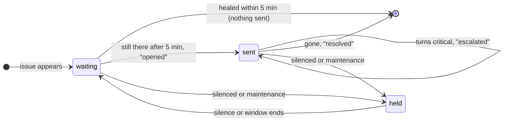

# Notifications

The app shows the state while it is open. For the rest of the time the agent sends messages itself, to channels you already run.

## When a message is sent

- **Opened**: an issue has lasted `NOTIFY_AFTER_SECONDS` (default 300). A rollout or a planned node reboot that heals within five minutes never reaches your phone.
- **Escalated**: an issue that was sent as a warning turns critical.
- **Resolved**: an issue that was sent is gone. An issue that was never sent produces no "resolved" either.



All changes of one run are one message per channel. Priority: 5 (urgent) when anything critical is in it, 3 for warnings, 2 for resolutions only.

```
homelab: 2 problems
🔴 default/social-importer: CrashLoopBackOff: back-off 5m0s restarting failed container. Last exit: Error (code 1). 14 restarts.
🟡 Last backup of default/shop-api-pg was 31 h ago: Expected at least every 26 h. Is the ScheduledBackup still running?
✅ resolved: Certificate translate.shop.example expires in 9 days
```

Messages are written in the agent's `LANGUAGE` (`en` by default, or `de`; Helm `language`), whatever language the app is set to: a message has no reader to ask. With `LANGUAGE=de` the same message reads `homelab: 2 Probleme`, `✅ behoben: Zertifikat translate.shop.example läuft in 9 Tagen ab`, and so on. Messages from the cluster itself (an alert's summary, a container's error) stay as they are.

If every channel fails, nothing is marked as sent and the next run tries again. Hints (e.g. a manual Argo CD app waiting for its sync) are never sent.

<p></p>

*Silencing an issue from the app.*

**Silenced issues** (in the app: "Silence" on an issue, for 1 hour, 8 hours, a day or a week) send nothing new while silenced: no "opened", no "escalated". Silencing never sends a "resolved" either; that only comes when the issue is really gone. Silences live in the ConfigMap `kubernanny-settings` and survive restarts; every silence is in the audit log with the device.

<p></p>

**Maintenance window** (in the app: cluster settings, for 1, 2, 4, 8 or 24 hours; `POST /api/maintenance`): planned work on the cluster without a phone that buzzes through it. The checks keep running and the app keeps showing the truth, with a banner until when; only messages wait. Whatever is still broken when the window ends is sent on the first run after it, and anything that broke and healed inside the window is never sent. It can be ended early, lives in `kubernanny-settings` like the silences and is in the audit log.

**Weekly report** (`notifications.weeklyDigest.enabled: true`, env `DIGEST=weekly`): every Monday at 9:00 (`weekday`, `hour`, in `timezone`), one message through the same channels:

```
homelab: weekly report
4 problems in the last 7 days, 1 of them critical. Open now: 1.
Longest:
🟡 Last backup of default/shop-api-pg was 31 h ago (28 h)
🔴 default/social-importer: CrashLoopBackOff (5 h, still open)
```

With `detail: minimal` only the first line. The agent keeps the week in memory: after a restart the report covers the time since then and says so, and it waits until the agent has watched for a day.

**Pausing everything**: cluster settings → "What is checked" → Notifications, or `checks.disabled: [notifications]` in the chart.

### What leaves the cluster

With the default `detail: full`: the cluster name, issue titles and causes, which contain namespaces, workload names and host names. With `notifications.detail: minimal` (`NOTIFY_DETAIL=minimal`) only this:

```
homelab: new problems
1 critical, 2 warnings. Details in Kubernanny.
```

Use `minimal` for public services like ntfy.sh, where anyone who guesses the topic reads along, or run ntfy inside the cluster. Notification URLs must be HTTPS (plain HTTP only to an in-cluster `*.svc` host) and redirects are refused.

## Channels

Set one or both of `NTFY_URL` and `WEBHOOK_URL`. The app's settings have a **test notification** button.

### ntfy

```yaml
notifications:
  ntfyUrl: https://ntfy.sh/homelab-7f3a9c1e2b   # long random topic on ntfy.sh, or your own server
```

Title (RFC 2047 encoded, so umlauts survive), priority and tags are set; with `PUBLIC_URL` a tap opens Kubernanny. For a protected topic put `NTFY_TOKEN` into `notifications.existingSecret`.

### Discord, Slack, Gotify, JSON

`WEBHOOK_URL` is recognised by its shape; `WEBHOOK_FORMAT` overrides:

| Format | Detected from | Body |
|---|---|---|
| `discord` | `discord.com/api/webhooks/…` | embed, coloured coral / amber / mint |
| `slack` | `hooks.slack.com/…` | `{ "text": "*title*\nbody" }` |
| `gotify` | path ending in `/message` | `{ title, message, priority }` (priority ×2: 10, 6, 4) |
| `json` | anything else | below |

```json
{
  "cluster": "homelab",
  "title": "homelab: 2 Probleme",
  "body": "🔴 …\n🟡 …",
  "priority": 5,
  "opened": [{ "id": "pods/default/Deployment/social-importer", "title": "…", "severity": "critical", "cause": "…" }],
  "escalated": [],
  "resolved": [{ "id": "certificates/weblate/weblate-tls", "title": "…" }]
}
```

The JSON form is meant for n8n, Home Assistant, Node-RED or your own scripts. Webhook URLs often are credentials: put them into `notifications.existingSecret` as `WEBHOOK_URL` instead of the values file.

## Native push (planned)

Push straight to the Kubernanny app, without ntfy, is planned on top of the end-to-end encrypted protocol described in the [roadmap](ROADMAP.md): the payload is encrypted for the device before it leaves the agent, so no push service can read it.

## Alerting on Kubernanny itself

With `serviceMonitor.enabled`, Prometheus scrapes `kubernanny_*`. Two rules worth having:

```yaml
- alert: KubernannyAgentStale
  expr: time() - kubernanny_last_run_timestamp_seconds > 300
  for: 5m
- alert: KubernannyCritical
  expr: kubernanny_issues{severity="critical"} > 0
  for: 10m
```
