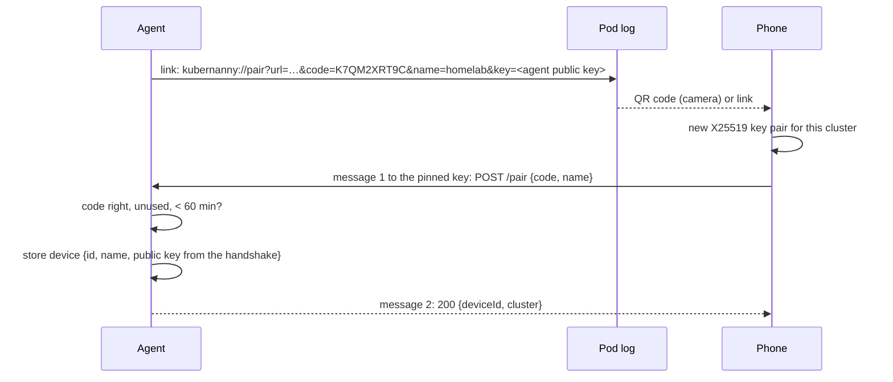

# The Kubernanny protocol (version 1)

How the app talks to an agent. Every API call is end-to-end encrypted and authenticated between the device and the agent, whatever carries it: an ingress with TLS, a plain-HTTP LAN, a VPN, and later a relay. Nothing in between can read a request or an answer, change one without it being rejected, or replay one.

The implementation is `protocol/` (TypeScript, about 650 lines with comments, shared by agent and app). This page is precise enough to write another one; the [test vectors](#test-vectors) check it byte for byte.

## In one paragraph

Each device has its own X25519 key pair; the private key never leaves the device. The agent has one key pair too, kept in the Secret `kubernanny-identity`, and every pairing link carries its public key, so the app knows exactly whom it talks to before the first byte. Each API call is one fresh [Noise](https://noiseprotocol.org/noise.html) `IK` handshake: the request rides in the first handshake message, the answer in the second plus transport messages. The handshake proves both keys, gives every call fresh keys (forward secrecy for answers) and needs no session state on either side.

## Building blocks

| | |
|---|---|
| Handshake | `Noise_IK_25519_ChaChaPoly_BLAKE2b`, Noise revision 34, no PSK |
| DH | X25519 (RFC 7748) |
| AEAD | ChaCha20-Poly1305 (RFC 8439), nonce = 4 zero bytes + 64-bit little-endian counter |
| Hash | BLAKE2b-512; HKDF with HMAC-BLAKE2b |
| Prologue | the ASCII bytes `kubernanny-e2e/1` |
| Libraries | `@noble/curves`, `@noble/ciphers`, `@noble/hashes` (audited, no native code); the Noise layer itself is `protocol/src/noise.ts` |
| Cross-check | the test suite runs it against [`noise-protocol`](https://github.com/emilbayes/noise-protocol) (libsodium) in both roles, 20 handshakes each |

Why IK, why one handshake per call, and why not TLS client certificates or a bearer token: [decisions/0001-noise-ik-per-request.md](decisions/0001-noise-ik-per-request.md).

## Keys

| Key | Where it lives | Who knows the public half |
|---|---|---|
| Agent static key | Secret `kubernanny-identity` (`secretKey`, base64url), created on first start | every paired device (pinned), anyone who sees a pairing link, `GET /api/identity` |
| Device static key | the app's storage, one per cluster | the agent's device list (Secret `kubernanny-devices`) |
| Ephemeral keys | memory, one per call and side | nobody after the call |

Public keys travel as unpadded base64url (43 characters). For humans the app and the agent's log show a **fingerprint**: the first 80 bits of BLAKE2b-256 over the public key, Crockford base32, in groups of four (`6CR3-RQZS-NBKK-9VND`). The protocol always pins the full key; the fingerprint is only for comparing by eye.

## One call

```
POST /api/e2e
Content-Type: application/octet-stream

request body  = 0x01 || message1
response body = 0x01 || u16(len(message2)) || message2 || ( u16(len(frame)) || frame )+
```

`u16` is big-endian. The HTTP status of the outer response is 200 whenever the handshake completed; the call's own status is inside.

### Message 1 (device to agent)

`-> e, es, s, ss` with the payload:

```json
{ "m": "GET", "p": "/history?hours=24", "t": 1795000000000, "b": { … } }
```

| Field | |
|---|---|
| `m` | `GET`, `POST` or `DELETE` |
| `p` | path below `/api`, with the query. Printable ASCII from `A-Za-z0-9-._~/%?=&:,+`, at most 2048 characters, starts with one `/`, no `.` or `..` segment and no encoded `.` `/` `\` in the path part. |
| `t` | the device's clock, ms since the epoch |
| `b` | optional JSON body |
| `l` | optional language for the texts in the answer: `en` or `de`. Without it the agent answers in its default (`LANGUAGE`, default `en`). Any other value is ignored, not refused, so an app that knows more languages still talks to an older agent; the sending side only sends the values it knows. Only texts change with it (titles, causes, summaries, labels, error messages); ids, codes and every other field stay the same. |

The payload is at most 65 439 bytes (a Noise message is at most 65 535, minus the two keys and tags).

### Message 2 (agent to device)

`<- e, ee, se` with the payload `{ "s": <status>, "t": <agent clock, ms> }`.

### Frames

After message 2 both sides `Split()`. The agent encrypts the answer body (usually JSON) with its sending CipherState, empty associated data, in chunks of at most 65 518 bytes. Each frame's plaintext is one flag byte and the chunk; flag bit 0 marks the **last** frame, other bits must be zero. There is always at least one frame (an empty body is one frame with just the flag). The device rejects:

- any frame that fails authentication (nonces count up, so frames cannot be reordered, dropped or repeated),
- data after the last frame,
- a response without a last frame (cut off),
- a response body over 32 MiB.

A response opens only once, and only with the state of the request it answers.

## What the agent checks, in order

1. **Size and version byte**: over 65 536 bytes is plain `413 E2E_TOO_LARGE`, a wrong version byte or a body too short for an ephemeral key plain `400 E2E_VERSION`. Free: nothing is computed yet.
2. **Replay cache**: the first 32 bytes after the version byte are the device's ephemeral key, unique per call. Seen before: plain `400 E2E_REPLAY`. Also free.
3. **Handshake ceilings**: opening message 1 costs two X25519 operations (answering, two more), so opening is limited in layers, all plain `429 E2E_RATE_LIMITED` when exceeded: direct and relayed calls have separate ceilings, so a flood on one path does not close the other; each direct source address has its own bucket (IPv6 per /64, at most 4 096 addresses, then one shared overflow bucket); and part of the direct ceiling is kept for addresses that made an authenticated call in the last 10 minutes. Behind an ingress every direct caller has the controller's address, so the per-address buckets do not separate callers there; the relay path stays usable.
4. **Message 1**: decrypts only for the holder of the agent's private key, and authenticates the device's static key inside it. Failure: plain `400 E2E_HANDSHAKE`.
5. **The caller's own budget**: each paired device has a bucket of its own (60, refilled at 20 per second); every unknown key, pairing attempts included, shares one small bucket (20, refilled at 2 per second). Over it: plain `429 E2E_RATE_LIMITED`. Strangers compete only with each other: however many junk calls arrive, a paired device's budget is untouched. (In DEMO mode, where every key is let in, that one demo device gets a device's budget.)
6. **Replay entry**: for a paired device, the ephemeral key is remembered now, **before** the clock check, until the request's own clock window has passed (at least 10 minutes). So a request refused because its time lies ahead cannot be replayed once that time comes. A pairing attempt from an unknown key is checked against the clock first and remembered only inside the window: dated ahead, it would only pair the key inside it with a single-use code, so it needs no entry, and strangers never hold one dated far ahead. Unknown keys sending anything but `POST /pair` are not remembered at all, so they cannot fill the cache. At 20 000 entries, or 1 000 dated far ahead (at most 50 per paired device), the agent answers `503 E2E_BUSY`.
7. **Clock**: a request dated before the agent process started (5 s margin) is refused, since the replay cache lives in memory and a restart empties it. Otherwise `|t - now|` over 5 minutes for a `GET`, over **60 seconds** for a `POST` or `DELETE` (a captured call that changes something is worth less the sooner it expires), is answered sealed with `401 E2E_CLOCK_SKEW`. The answer's `t` is the agent's clock, authenticated, so the app corrects its own and retries once.
8. **Device**: a known key acts as that device. An unknown key may only send `POST /pair`; anything else is answered sealed with `401 DEVICE_UNKNOWN`.
9. **Dispatch**: the request goes to the agent's internal API (a Unix socket, see [decisions/0003-internal-socket.md](decisions/0003-internal-socket.md)) as that device. Routes, validation and audit log are the same for every caller. If the internal call itself fails, the answer is sealed `502 E2E_INTERNAL`, so the device still gets an answer it can trust.

Plain answers (steps 1 to 5) are `{"code": "…"}` without detail: nothing is authenticated yet.

## Pairing



- The agent learns the device's public key **from the handshake**, not from the body: whoever paired holds the matching private key.
- The code is 10 characters from a 31-letter alphabet, single use, valid 60 minutes, compared in constant time, and a new one invalidates the old. The right code always pairs: it is compared **before** any throttle, and wrong attempts never burn it, so whoever knows the agent's key (directly or through the relay, [RELAY.md](RELAY.md)) cannot keep the owner from pairing. Past five wrong attempts (a blank code counts as one) in 10 minutes, a wrong one is answered sealed with `429 PAIRING_RATE_LIMITED` instead of `401 PAIRING_CODE_INVALID`, and the agent logs that someone may be guessing. What bounds guessing is the code's size against the strangers' shared budget (step 5 above: at most about 7200 attempts an hour, so under 10^-11 per code), not that counter.
- A new pairing is announced through the notification channels, like other security-relevant changes ([SECURITY.md](SECURITY.md)).
- The device pins `key` from the link. A link without a key (typing address and code by hand) makes the app fetch `GET /api/identity`, which it only does over `https://`, from `localhost` (a port-forward), or from the origin the web UI itself was served from. TLS or the local machine vouches for the key once; from then on it is pinned and the transport no longer matters.
- Pairing the same key again keeps its device entry and takes the new name.
- **The QR code as an image.** Log viewers that space their lines (Argo CD, many web consoles) tear the text QR code apart. Right under it the banner prints `https://kubernanny.app/qr#<the app link, URL-encoded>`; that page draws the same link as a large QR code in the browser (`website/src/app/pages/qr.page.ts`). Everything after `#` is the URL's fragment, which browsers never send to a server: kubernanny.app only gets the request for `/qr` itself (with `Referrer-Policy: no-referrer`, no cookies, no analytics) and never sees the code, the key or the address. Said plainly: the link does contain the pairing code, like the QR code and the `kubernanny://` link next to it. Whoever can read the log already has the code; the image link adds no one who learns it, as long as the link stays where the log is (it lands in the browser history of whoever opens it). The code works once and for 60 minutes, and a pairing it was used for shows up in the device list and as a notification. The page refuses anything but a `kubernanny://pair` link with an http(s) address and a well-formed key.
- New code without kubectl: any paired device (`POST /pair/code`). With kubectl: `kubectl -n kubernanny exec deploy/kubernanny -- node dist/cli.js pair`.

## Properties

| Property | Holds because |
|---|---|
| Only the pinned agent can read a request | message 1 is encrypted to its static key (`es`, `ss`) |
| Only the device that asked can read an answer | message 2 and frames are keyed with `ee` and `se` |
| Answers cannot be forged or changed | AEAD on every message, keys bound to both static keys and the transcript |
| A device proves itself on every call | `ss` in message 1; no bearer secret ever crosses the wire |
| Replays do nothing | replay cache on the ephemeral key, written before the clock check and kept until the request's window has passed, plus the clock window |
| Forward secrecy for answers | answers depend on both ephemeral keys; a later theft of either static key does not open recorded answers |
| Identity hiding | the device's static key travels encrypted; an observer cannot tell which device called |
| No session state | each call is a complete handshake; the agent keeps only the replay cache |

## Limits, stated plainly

- **Requests are not forward-secret against the agent's static key.** Message 1 depends on `es` and `ss`, both involving the agent's static key. Someone who records traffic and later steals `kubernanny-identity` can read recorded **requests** (paths like `/status`, action requests, pairing codes already used). Not answers. Requests carry no cluster data and no credential.
- **A stolen device key** is that device until revoked, exactly like a stolen phone. Revocation takes effect on the next call.
- **A stolen agent key** lets its holder impersonate the agent to devices that reach them (they would need to sit on the path too). Rotate: delete `kubernanny-identity`, restart, pair every device again.
- **Traffic analysis**: sizes and timing of calls stay visible to whoever carries them.
- **Clock**: the windows (5 minutes for reads, 60 seconds for writes) assume clocks within reach of each other; the sealed skew answer corrects the device automatically.
- **Single replica**: the replay cache lives in memory, so the agent runs with one replica. A restart clears the cache; a replay across a restart still has to pass the clock window. A rolling update is such a restart with a few seconds of overlap: only the pod holding the Lease runs writes (60 s window), the other refuses them with 503 `AGENT_HANDOVER`, so a write replayed to the new pod within the window after the handover is the same case as a replay across a restart.

## Test vectors

Fixed keys and fixed ephemeral keys, so the bytes are deterministic. All of them are in [`protocol/test/vectors.json`](../protocol/test/vectors.json); `npm test` in `protocol/` reproduces them and opens every message 1 with libsodium too. The first one:

| | hex |
|---|---|
| device static secret | `0102030405060708090a0b0c0d0e0f101112131415161718191a1b1c1d1e1f20` |
| device static public | `07a37cbc142093c8b755dc1b10e86cb426374ad16aa853ed0bdfc0b2b86d1c7c` |
| device ephemeral secret | `4142434445464748494a4b4c4d4e4f505152535455565758595a5b5c5d5e5f60` |
| agent static secret | `8182838485868788898a8b8c8d8e8f909192939495969798999a9b9c9d9e9fa0` |
| agent static public | `883186b800b41d5cf0429695da9b3cc4f328ebcd184a6e482fa578c103f06c77` |
| agent ephemeral secret | `c1c2c3c4c5c6c7c8c9cacbcccdcecfd0d1d2d3d4d5d6d7d8d9dadbdcdddedfe0` |

Request `{ method: GET, path: /status, time: 1795000000000 }`, 140 bytes:

```
0164b101b1d0be5a8704bd078f9895001fc03e8e9f9522f188dd128d9846d48466ea46fec0bee3ce
0e052ec0cfad8ea652235164c7c9730cd3671b131e60a74e005f47aeddc79ac0dae82a994adea884
8cfe69b3f2ca51e980a3c7b261fc6a00c342e880b32a9b12f59773727653b88bb19654ab4a6881a9
75b671e4550b30f0af2d24dee903a044025f05cd
```

Response `{ status: 200, time: 1795000000150, body: {"light":"green"} }`, 114 bytes:

```
01004b3a553d74792d727efa9b9a4cde3da1ad93f1a2d0c09cb639b1a3c0fda14cbe24de1b289258
5ab80b7bd1b2f3f5e39d73efe6ba4349ab8d05e63c8922d8cccfc4a1f41f6c844c91e74393830022
bebd6be62c44c8d5ea60235e3421dbe19cc8a00321773a80ebd1ffd0172ca95ccf13
```

The JSON payloads are serialised without spaces, keys in the order `m, p, t, b` and `s, t`. A different serialisation is still valid protocol, but will not reproduce the vectors.

## Push messages

Native push ([NOTIFICATIONS.md](NOTIFICATIONS.md#native-push), [decisions/0007](decisions/0007-native-push.md)) is one-way, from the agent to one device, and is opened by code that runs without the app (the iOS Notification Service Extension, the Android messaging service). It is not a Noise handshake: there is no answer and no round trip. The implementation is `protocol/src/push.ts`, with copies in Swift (`app/ios/App/KubernannyPushExtension/PushCrypto.swift`) and Java (`app/native/push/android/.../PushCrypto.java`).

| | |
|---|---|
| Construction | HPKE ([RFC 9180](https://www.rfc-editor.org/rfc/rfc9180)), `mode_auth`, single shot |
| Suite | DHKEM(X25519, HKDF-SHA256) `0x0020`, HKDF-SHA256 `0x0001`, ChaCha20-Poly1305 `0x0003` |
| Recipient key | the device's **push key** for this cluster: a separate X25519 pair the app makes when push is switched on; only its public half reaches the agent, in a sealed `POST /push/register` |
| Sender key | the agent's static key, pinned by the device at pairing |
| `info` | the ASCII bytes `kubernanny-push/1` (domain separation from the Noise prologue `kubernanny-e2e/1` and the relay label `kubernanny-relay/2`) |
| `aad` | empty |
| Message | `0x01` (version) ‖ `enc` (the ephemeral public key, 32 bytes) ‖ ciphertext and tag |
| Cross-check | both directions against [`@hpke/core`](https://github.com/dajiaji/hpke-js) in the test suite |

The plaintext is JSON, keys in this order, at most 2048 bytes (the agent shortens the body to fit): `{"t": title, "b": body, "p": priority, "s": agent clock in ms, "w": status}`, where `w` is optional ([Push status](#push-status)). Next to the message travels the **key id** `k`: the first 16 characters of `base64url(BLAKE2b-256(push public key))`, so the phone picks the right key without trying each.

Properties: only the holder of the push secret key opens a message (`DH(eph, push)`); it opens only if the agent made it (`mode_auth` mixes `DH(agent static, push)` in), so neither the relay nor Google nor anyone who learns the push public key can forge one; every message has a fresh ephemeral key. Not given: forward secrecy against a later theft of the push secret key (it opens every recorded push for that cluster, which is why it is a key of its own and not the device key), and replay protection in the construction itself. The phone adds it (**push replay**): it shows a message only if its `s` lies within an hour of the phone's clock and is later than the `s` of the last message it showed for that key id, which it keeps next to the push key (`pushFresh` in `app/src/app/core/push/push-content.ts`, mirrored by `PushFreshness.java` and `PushKeys.isFresh`). A replayed or stale message opens but is not shown (iOS shows its generic text instead, without the marker). Using the agent's static key in a second construction is safe here: HPKE feeds both DH results through its own labelled HKDF (`HPKE-v1` ‖ suite ‖ label), apart from Noise's HKDF over BLAKE2b, and the agent only ever computes `DH(agent static, push public)` for push keys that paired devices registered.

### Push status

Every push the agent sends after its first run also carries the cluster's state, `w`, for the phone's home-screen widget: the widget then is as fresh as the last push, not only as the last time the app was open. Keys in this order: `{"l": light, "c": outages, "n": warnings, "a": the agent's last check in ms or null, "i": [{"s": "c" | "w", "t": title}]}`. Counted like the app's headline (silenced issues and hints left out); `i` holds the three worst problems, outages first, each title at most 120 characters, in the agent's `LANGUAGE`, and is left out with `detail: minimal`, like the text of the message itself. It is inside the sealed plaintext, so the relay and Google see only that the message grew by a few hundred bytes.

Compatible both ways, with no new version byte: phones before it read `t`, `b`, `p` and `s` and ignore `w`; a push without `w` (older agents, the test and security alerts before the first run) changes nothing on the phone. When the title and body leave no room, `w` is dropped rather than the message. The phone (the iOS Notification Service Extension, the Android messaging service) applies `w` only to a message that opened, comes from the pinned agent and is fresh by the rules above; only to the entry its cluster already has in the widget storage (a cluster switched off for the widget gets none), and only when `a` is later than the check stored there, so a late push never covers what the app wrote since. A malformed `w` is ignored as a whole (`decodePushStatus` in `protocol/src/push.ts`, `WidgetPushStatus.swift`, `WidgetPushStatus.java`).

### Status pushes

A push with priority `p: 0`, an empty title and body and a `w` is a **status push**: the hourly state for the home-screen widget ([NOTIFICATIONS.md](NOTIFICATIONS.md#the-home-screen-widget)), `{"t": "", "b": "", "p": 0, "s": …, "w": {…}}` (`statusPushContent` in `protocol/src/push.ts`). Sealed like every push, with the same keys, so only the agent can make one and only the phone opens it. The phone never shows it: it applies `w` by the rules above and stops (iOS: the app's `AppDelegate`, which receives it as a background push, `StatusPush.swift`; Android: the messaging service, `PushFreshness.isStatusOnly`). Its freshness rule is simpler, because it is never shown: sealed within an hour of the phone's clock (`statusPushFresh`, `PushFreshness.statusFresh`, `PushKeys.isStatusFresh`). It is not compared with, and does not move, the time of the last push shown, so a delayed alert sealed before it still shows; a replayed one changes nothing, as the widget only takes a check newer than its own. Should a status push reach the iOS Notification Service Extension as an alert, the widget takes its state and the generic text is shown.

On the relay socket a status push is a `Push` frame with `"q": 1` ([RELAY.md](RELAY.md#native-push)), which the relay turns into a silent FCM message. The agent sends one only to a relay whose `Ready` said `"statusPush": true`. Phones before status pushes never get one: the agent sends them only to devices that registered with `"widget": true` (`POST /push/register`), which only apps that handle them do.

### Dead man's switch

A push with a descriptor `d` is a **dead man's switch message** ([NOTIFICATIONS.md](NOTIFICATIONS.md#when-the-agent-goes-silent)): the agent seals it in advance and deposits it with the relay, which sends it when the agent's connection stays away longer than the phone's grace. `{"t": title, "b": body, "p": 3, "s": …, "d": {"u": valid until (agent clock, ms), "g": grace in minutes}}` (`deadmanPushContent` in `protocol/src/push.ts`); `g` is one of 10, 15, 30, 60, and `u - s` is at most 27 hours (three hours, plus a maintenance window the relay waits out). It carries no `w`: the state it was sealed with is not the state when it is sent. A message whose `d` does not parse is refused as a whole (`decodePushContent` throws), so it is never shown under the ordinary rule.

It was sealed before pushes the phone may have shown since, so the ordinary replay rule (later than the last push shown) would drop it, and the hour would too. The phone applies a rule of its own instead (`deadmanFresh` in `app/src/app/core/push/push-content.ts`, `PushFreshness.deadmanFresh`, `PushKeys.isDeadmanFresh`):

- the phone's clock is at most `u`, `s` is not more than an hour ahead of it, and `u - s` is within the 27 hours;
- `s` is later than the `s` of the last dead man's switch message shown for that key id: a **replay marker of its own**, kept next to the push key apart from the one of ordinary pushes, so the relay cannot show the same message twice, nor an older one after a newer;
- no push of that key opened within the grace: the phone keeps the newest `s` of any push it opened and accepted for the key (status pushes included), and drops the message when that lies less than `g` minutes before now. An agent heard from that recently was not silent, and a message that arrives after the "reachable again" push is dropped.

A message that passes is shown like any push, with the person's sign, does not move the ordinary replay marker, and marks the cluster's widget entry `unreachableSince` (the phone's time), which the widgets draw as "Agent not answering" while it is later than the entry's last check. What the relay can do with it: send it early, late (within `u`) or not at all; never change it, never make one that opens, never turn it into an "all fine".

### Push test vector

All of them in [`protocol/test/push-vectors.json`](../protocol/test/push-vectors.json), the third (`widget-status`) with a status, the fourth (`status-only`) a status push, the fifth (`deadman`) a dead man's switch message. The first: agent static secret `8182838485868788898a8b8c8d8e8f909192939495969798999a9b9c9d9e9fa0` (the same agent key as the call vectors), push secret `2122232425262728292a2b2c2d2e2f303132333435363738393a3b3c3d3e3f40`, push public `5869aff450549732cbaaed5e5df9b30a6da31cb0e5742bad5ad4a1a768f1a67b`, ephemeral secret `6162636465666768696a6b6c6d6e6f707172737475767778797a7b7c7d7e7f80`, key id `LbUGLxX9BNGEjdbP`, plaintext `{"t":"homelab: 2 problems","b":"🔴 default/api: CrashLoopBackOff","p":5,"s":1795000000000}`, message (141 bytes):

```
01244fe3b963e899dd295baffce248d3530f3a9a7479ba063002680ebfe7adad4927773b1cba3e12
01b3634c526a0f09d99222c2d5dcea3c0cb0bd989084dcfec79585c9cbee88f1a455032dde3c51c5
1cf226cf23ba91837341053214d97f1b3f4463695b0e5ca40942a35a878bcc136021b04f586b5938
aa9c471e69fec6b33756624a2ba4d517df6f45bac9
```

## Relay registration

When an agent dials a relay ([RELAY.md](RELAY.md)), it proves it holds the private key behind the agent id it registers. Relay protocol version 2 (`RELAY_PROTOCOL_VERSION`, label `kubernanny-relay/2`; version 1 was never released) binds that proof to the relay: the relay sends a 32-byte nonce and a fresh X25519 public key `E`, and the agent answers with its static public key `A` and

```
origin = relayOrigin(the URL the agent dialled)      e.g. "https://relay.example" for wss://relay.example
K      = BLAKE2b-256("kubernanny-relay/2" ‖ u16be(len(origin)) ‖ origin ‖ X25519(a, E) ‖ E ‖ A)
MAC    = first 32 bytes of HMAC-BLAKE2b(K, "kubernanny-relay/2" ‖ nonce)
```

`relayOrigin` is `http(s)://host[:port]` in lowercase, `ws` read as `http` and `wss` as `https`, the default port left out, no path. The relay recomputes `K` with its ephemeral secret and its own configured public origin, and checks that `A` hashes to the id. A relay that forwards another relay's challenge to an agent connected to it gets a proof for its own origin, which the other relay refuses. The test vector (agent key as above, nonce `07…07`, relay ephemeral secret `09…09`, dialled `wss://relay.example`, relay origin `https://relay.example`) is in [`protocol/test/relay-vectors.json`](../protocol/test/relay-vectors.json); Proof frame:

```
1100000000883186b800b41d5cf0429695da9b3cc4f328ebcd184a6e482fa578c103f06c7783d6c0
7c864fb357ff0a70116f62f7a88dda187f798ca1c8a30c1d17d0009e5e
```

## Versioning

The first byte of both bodies is the version, and the prologue names it. A future version gets a new byte and prologue; an agent may accept several, the app uses the highest the pinned agent accepts. Never reuse a version for different bytes.
