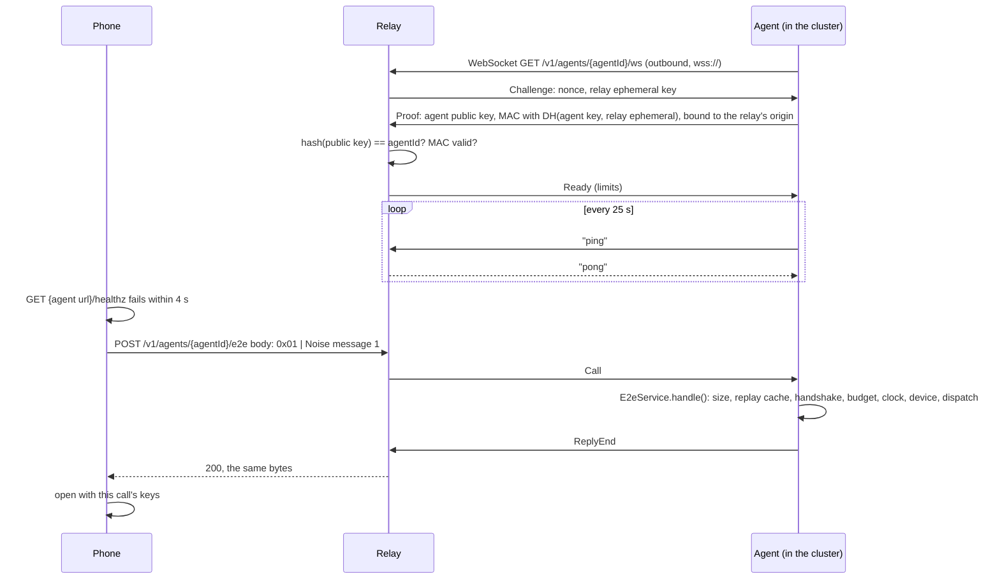

# The relay

Status on the go without opening a port: the agent dials out to a relay and keeps that one connection open; when the phone cannot reach the agent directly (no VPN, mobile network), the app sends its call to the relay, which hands it down the agent's connection. The relay carries the same end-to-end encrypted bytes the app would send to the agent itself. It can read none of them.

Optional and off by default. Why it is built this way: [decisions/0004](decisions/0004-direct-and-relay.md) (direct first, relay as fallback) and [decisions/0005](decisions/0005-relay-protocol.md) (the relay protocol).

## How a call travels



- **The agent id** is a hash of the agent's public key; the app derives it from the key it pinned at pairing and needs nothing else. **The proof at registration** keeps anyone from taking an agent's place on the relay: only the holder of the private key can compute it, and it is made for the relay the agent dialled. Frames, refusal codes and the proof byte for byte: [PROTOCOL.md, The relay](PROTOCOL.md#the-relay).
- **Newest connection wins.** A restarted agent replaces its stale connection at once instead of waiting for it to time out. Two agents with the same key (a copied Secret, two replicas) would push each other out; the one that gets "replaced" waits at least 30 s before trying again. During a rolling update of the agent only the pod holding its Lease connects: the old one closes its connection (1001) on SIGTERM, the new one connects once it takes over.
- **Everything the agent checks still happens in the agent**, in the same order as for `POST /api/e2e`: size, replay cache, handshake ceiling, handshake, the caller's own budget, replay entry, clock, device, dispatch ([PROTOCOL.md](PROTOCOL.md)). The relay adds limits of its own in front, never instead.

## Native push

Optional on the relay too: on only with a Firebase service account (`FCM_SERVICE_ACCOUNT`), and `RELAY_PUSH=off` keeps it off even then. The agent hands each push, sealed for one phone, over the WebSocket it already holds; the relay passes it to Firebase Cloud Messaging (FCM HTTP v1), which reaches iPhones through APNs. Status pushes for home-screen widgets go out silently, in a shape that cannot show anything. What it is for: [NOTIFICATIONS.md](NOTIFICATIONS.md#native-push); the frames and the FCM messages: [PROTOCOL.md](PROTOCOL.md#push-and-pushresult); why: [decisions/0007](decisions/0007-native-push.md).

| Limit | Default | |
|---|---|---|
| per agent id | `RELAY_PUSHES_PER_HOUR` 60, `RELAY_PUSH_BURST` 20, 4 waiting for FCM | token bucket kept by agent id, not by connection: a reconnect within the hour continues where it stopped (Node: in memory; Worker: in the object's storage) |
| distinct tokens per agent id | `RELAY_PUSH_TOKENS_PER_DAY` 32 | an agent pushes to its own phones; more tokens in a day are `rate_limited` |
| refused tokens | 1 hour | a token FCM answered `unregistered` or `invalid` for is blocked for that agent id for an hour, and the answer costs 5 pushes of its bucket |
| status pushes per FCM token | `RELAY_STATUS_PUSHES_PER_TOKEN_PER_HOUR` 2 (burst 1) | a budget of its own, apart from the one below: status pushes never use up a phone's alerts, and alerts never travel on it. Node: a second token table; Worker: a second object per token (`status:` and the digest). Status pushes count against every other limit here like any push (per agent id, distinct tokens, per address, whole relay) |
| per FCM token | `RELAY_PUSHES_PER_TOKEN_PER_HOUR` 30 | across every agent of the relay. Node: 20 000 tokens tracked by digest; when full, only an entry whose bucket has refilled is dropped, else a new token waits. Worker: one small Durable Object per token digest (`TokenLimiter`), one request and one storage write per push |
| per agent address | `RELAY_PUSHES_PER_ADDRESS_PER_HOUR` 240 | all agents of one client address together (Node only) |
| whole relay | `RELAY_PUSHES_TOTAL_PER_HOUR` 20 000 | what the relay hands to FCM at most, however many ids and addresses are used (Node only) |
| per push | the sealed message at most 2048 bytes of plaintext (about 2.8 KiB on the wire), the frame at most 8 KiB | anything malformed is `invalid` |

Why so many: registering an agent id is free, so the per-agent limit alone would make the relay a sender of Kubernanny's generic alert to any FCM token someone knows. The per-token limit bounds what one phone can get, the per-address and relay-wide budgets bound the total (on the Node relay), and the distinct-token and refused-token rules make probing tokens slow and costly. A 401 for the relay's own access token gets a fresh token and one more try; if that one is refused too, the push is `fcm_auth`.

**What the relay learns from push**: each registered device's FCM token and platform, a push key id, when and how large each push is, and whether it is a status push (so which phones have a widget). Not a word of the message: it is sealed for the device's push key. The relay logs no token and no key id ([Logs](#logs)); metrics count pushes by outcome only (`kubernanny_relay_pushes_total{outcome}`). A relay with push needs outbound HTTPS to `oauth2.googleapis.com` and `fcm.googleapis.com`. What its operator could do with the service account: [SECURITY.md](SECURITY.md#threats).

### Your own Firebase project

Only for a relay of your own with a build of the app of your own; the store apps and the public relay need nothing. The relay's service account and the app's config files must belong to the same Firebase project: FCM tokens are only valid within their project.

1. **A Firebase project** (console.firebase.google.com) with an Android app `app.kubernanny` and an iOS app `app.kubernanny`. For iOS, upload an APNs authentication key (Apple Developer, Keys, "Apple Push Notifications service") under Project settings, Cloud Messaging; FCM uses it to reach iPhones.
2. **The app's config files** (`google-services.json`, `GoogleService-Info.plist`) and the iOS Notification Service Extension and App Group, as in [RELEASING.md](RELEASING.md). Without the config files the app builds and runs, without push.
3. **A service account for the relay**: Google Cloud console of the same project, IAM, Service accounts, one allowed to send FCM messages (the role "Firebase Cloud Messaging API Admin" is enough), with a JSON key. Give it to the relay as `FCM_SERVICE_ACCOUNT` (Node: the variable or `FCM_SERVICE_ACCOUNT_FILE`; Worker: `wrangler secret put FCM_SERVICE_ACCOUNT`). Keep it in a Secret: it can push to every install of that app. The relay logs `native push on (FCM project …)` at start.

## Dead man's switch

When the agent, or the whole cluster, goes silent, nothing in the cluster can say so. The relay can: it notices that the agent's connection is gone. For each phone that asked for it ([NOTIFICATIONS.md](NOTIFICATIONS.md#when-the-agent-goes-silent)) the agent deposits an "agent silent" message, sealed in advance for that phone like every push, and the relay sends it when no connection of that agent id comes back within the phone's grace (counted from the last heartbeat it heard). On wherever native push is on; `RELAY_DEADMAN=off` turns it off. How deposits are renewed, armed, fired and disarmed: [PROTOCOL.md](PROTOCOL.md#deposit-and-depositresult).

The Node relay keeps deposits in memory, with a timer per absent agent: a restart of the relay forgets them (agents renew within 30 minutes of reconnecting), and an agent that went away while the relay was restarting is not reported. All agents together hold at most `RELAY_DEADMAN_MAX_TOTAL_BYTES`. The Worker stores the deposit in the agent's Durable Object (key `deadman`) and uses the object's alarm: every 5 minutes while the agent is connected, to notice a socket whose peer vanished without a close (the runtime answers heartbeats without waking the object, so the object reads the time of the last one), and once per message due while it is away. That is one alarm every 5 minutes per agent with a deposit, about 8 600 a month each, plus one storage write per deposit (every 30 minutes); check them against your plan.

| Limit | Default | |
|---|---|---|
| messages per agent | `RELAY_DEADMAN_MAX_DEPOSITS` 8 | one per phone; more is `invalid` |
| one sealed message | `RELAY_DEADMAN_MAX_BYTES` 1024 | base64url characters; the agent's are about 300 |
| deposits per agent | `RELAY_DEADMAN_DEPOSITS_PER_HOUR` 30 (burst 10) | kept with the deposit, so a reconnect does not refill it; past it the previous deposit stays (`rate_limited`) |
| whole relay | `RELAY_DEADMAN_MAX_TOTAL_BYTES` 16 MiB | tokens and messages held for all agents (Node only); past it `full` |

**What it holds**: per agent id, for each phone with the switch on, its FCM token, platform, push key id, grace and the sealed message, until the deposit is replaced or its validity ends (at most 27 hours), plus, after it fired, the key ids it sent to until the agent registers again. It cannot read or change a message; what a hostile relay can do with it is in [SECURITY.md](SECURITY.md#a-hostile-relay).

## What the relay sees, and what it does not

| The relay sees | The relay never sees |
|---|---|
| the agent id (a hash of the agent's public key) and that the agent is online; with the dead man's switch, the phones' push tokens and sealed messages it holds for that ([Dead man's switch](#dead-mans-switch)) | anything inside a call: paths, cluster data, logs, actions, pairing codes |
| the agent's IP address (its outbound connection) | which device calls: the device's key travels encrypted inside the handshake |
| when calls happen, how long they take, and their sizes | any key that could open a call or an answer |
| the IP address of the phone or browser that calls | the agent's address in your network |

- Whoever knows an agent's public key (anyone who saw a pairing link or QR code) can compute its id and send calls to it through the relay. They get what they would get at the agent's own address: `DEVICE_UNKNOWN`, or `PAIRING_CODE_INVALID` / `PAIRING_RATE_LIMITED` for wrong codes. The relay adds a rate limit per agent in front, and in front of that one per calling address: one address (IPv6: one /64, which one host usually owns whole) can use only a share (`RELAY_CALLER_SHARE`, 1/4) of the agent's calls and bytes, and junk is charged only when it fits, never on credit. That does not make the agent's buckets unemptiable: someone with four addresses or more can still use them up, and the owner's app then gets `RELAY_RATE_LIMITED` through the relay (directly, in the VPN, it is unaffected). On the Worker the per-address share is kept in the agent's object while it is awake and starts over when it hibernates.
- The Node relay keeps running whatever a single request contains: every handler that reads from the network catches its own errors. Should a programming error still escape, the process logs it with its stack and exits, and the orchestrator restarts it (agents reconnect within seconds); carrying on in an unknown state would hide the bug.
- The Node relay logs only the first 8 characters of an agent id, sizes and durations (per call only at `LOG_LEVEL=debug`), never a payload or an IP address. Metrics carry no agent ids. What the reverse proxy or the cloud provider in front logs is up to them.

## Limits against abuse

Anyone can register agent ids of their own, so the relay protects itself, not only the agents. What a hostile relay can do to agents and phones is in [SECURITY.md](SECURITY.md#a-hostile-relay).

- **Keep others' agents off the relay, within limits.** Registration needs the agent's private key, so nobody can take an agent's place. A flood of connections that never prove a key is bounded per client address (`RELAY_MAX_PENDING_PER_IP`) and in total (`RELAY_MAX_PENDING_REGISTRATIONS`, the oldest goes when it is full); a real agent proves its key in one round trip and gets in. Registered agents (anyone can make ids of their own) are capped per address (`RELAY_MAX_AGENTS_PER_IP`), and when the relay is full the address holding the most gives one up for a newcomer from elsewhere. Filling the relay therefore takes about `RELAY_MAX_AGENTS / RELAY_MAX_AGENTS_PER_IP` addresses (500 with the defaults), and even then each new address displaces one of theirs. A flood from many addresses faster than one proof round trip can still delay registrations, and agents behind the same address as a flooder (one NAT) share its limits. Behind a proxy, set `TRUST_PROXY` so the limits see client addresses, not the proxy's.
- **Hold memory, within limits.** Anyone can register agent ids of their own and answer calls to them slowly or hugely, or not read them at all. Requests count too: a call's request bytes are held in the budgets below until it is answered or times out, and its frame until the socket has actually sent it; an agent whose socket holds more than `RELAY_MAX_SOCKET_BUFFER_BYTES` (1 MiB) unread gets no more calls (`RELAY_BUSY`), and call ids are random, so an "agent" cannot answer calls it never read by guessing their ids. Measured with the second review's attack (an agent that stops reading, 1200 calls of 64 KiB answered blindly): before, the relay's memory grew by about 100 MiB in 5 s and kept growing; after, the first 80 calls time out, every later one gets `RELAY_BUSY` at once, and memory stays flat. The relay holds at most `RELAY_MAX_INFLIGHT_BYTES` of requests and answers across all agents (64 MiB by default); one agent id, and all agents of one address together, hold at most a quarter of it (`RELAY_INFLIGHT_SHARE`). Every part is checked against the answer size, the agent's hourly bytes, its share, its address' share and the total before it is kept (`RELAY_BUSY` past any of them). An answer that has started must keep moving (a part at least every 3 s) and be complete within 15 s, or it is cancelled and its bytes go back. So taking the whole budget needs four addresses or more, and holds it for at most 15 s per round, while each agent's hourly bytes run down; legitimate answers are small (a status is a few KiB) and get through in the remaining room most of the time. Measured with the re-review's attack (two self-registered ids streaming without end, re-armed every 25 s): before the shares every other call on the relay got `RELAY_BUSY`; with them a legitimate agent's call succeeds while the attack runs. Answers are not streamed to the caller: the status arrives last (in `ReplyEnd`), and a call is all or nothing, so a cut-off answer can never reach the app as a complete one.

## Turning it on

Helm:

```yaml
relay:
  enabled: true
  url: wss://relay.kubernanny.app   # the public relay, or your own
```

This sets `RELAY_URL` on the agent. Without it the agent opens no outbound connection at all. With `networkPolicy.egress.enabled`, the chart allows the relay's port (`relay.egressPort`, 443); a NetworkPolicy cannot name a host.

Pairing links and the QR code then carry `relay=<https url>`, and the agent's `/info` names it, so already paired devices learn it on the next look at the cluster settings. In the app:

- The cluster's settings show the relay's address, whether the agent is connected to it, and a switch to never use it for that cluster.
- The cluster header says "über Relay", small, while calls go that way.
- Pairing through the relay uses only the key from the link. Without a key (address and code typed by hand) the app fetches the key directly from the agent, over HTTPS or localhost, never through a relay.

How the app picks the path: before calling, it checks `GET {agent url}/healthz` with a 4 s timeout. Answered: direct, and it stays direct for 10 minutes or until a call fails. Not answered: the relay, for 2 minutes, then it tries direct again (back in the VPN, back to direct). A read (`GET`) whose direct call is lost is sent again through the relay, freshly sealed; an action (`POST`, `DELETE`) never is, so nothing runs twice.

## Running your own

A relay belongs **outside** the clusters it serves: one inside the cluster it monitors fails together with it, exactly when you want to look.

- **Container**: `docker build -f relay/Dockerfile -t kubernanny-relay .` from the repository root, then `docker run --read-only --user 1000 -p 8080:8080 -e RELAY_PUBLIC_URL=https://relay.example.com kubernanny-relay`. Put TLS in front (Caddy, Traefik, an ingress); agents connect with `wss://`, the app with `https://`. The proxy must pass WebSockets and keep idle connections open longer than 25 s.
- **Kubernetes**: [`deploy/relay/relay.yaml`](../deploy/relay/relay.yaml): Deployment, Service, Ingress, NetworkPolicy. Its image tag is a placeholder (`RELAY_VERSION`) that the release replaces with the version it publishes; never run `:latest`. One replica: an agent's connection lives on one pod, and its calls must reach that pod.
- **Cloudflare Worker**: [`relay/cloudflare/`](../relay/cloudflare/README.md). One Durable Object per agent holds its WebSocket with the Hibernation API; same API, same proof and the same per-agent limits (request and answer size, calls in flight, calls per minute, bytes per hour, the timeouts, the push allowance), from the same code (`relay/src/core`). The object keeps the state of the per-agent token buckets in the socket's attachment, so hibernating between calls does not refill them, and the push allowance also in its storage, so a reconnect does not either. The per-token push limit holds across all agents through a second, tiny Durable Object per token digest. What differs, because no object sees the others: there is no relay-wide answer budget, no per-address limit on connections or agents, and no per-address or relay-wide push budget (`RELAY_MAX_AGENTS`, the `_PER_IP` settings, the address share of `RELAY_INFLIGHT_SHARE`, `RELAY_PUSHES_PER_ADDRESS_PER_HOUR` and `RELAY_PUSHES_TOTAL_PER_HOUR` do not apply; each agent may hold its own share of `RELAY_MAX_INFLIGHT_BYTES`); unproven connections are capped at 4 per agent id instead of per address, and time out by an in-memory timer (no storage write for a connection that never proves a key); the calling address' share of an agent's buckets (`CF-Connecting-IP`) lives in memory and starts over after a hibernation; the platform does not report a socket's unread bytes, so `RELAY_MAX_SOCKET_BUFFER_BYTES` does not apply there. Cloudflare's own platform limits stand in for the relay-wide ones. **Add a Cloudflare rate limiting rule** for your relay's host on `/v1/agents/*/ws` (for example 30 requests per minute per IP) and a looser one on `/v1/agents/*/e2e`: every connect wakes an object, and the Worker has no per-address limit of its own. Check Cloudflare's documentation and pricing for what your plan offers.

The call buckets belong to the agent's connection on both relays: a reconnect, which needs the agent's key, starts them full. Whoever holds an agent's key can register any number of ids anyway, so per-connection call buckets cost nothing an attacker could not get otherwise. The push allowance is different: it is kept by agent id for an hour (Node) or in the object's storage (Worker), because native push reaches third parties' phones.

Settings (environment variables of the Node relay, `[vars]` of the Worker):

| Variable | Default | |
|---|---|---|
| `PORT` | 8080 | HTTP API and agent WebSockets |
| `RELAY_PUBLIC_URL` | unset | the URL agents dial, e.g. `https://relay.example.com` (or `wss://…`; only scheme, host and port count). Registration proofs must be made for it. **Set it on every relay that agents reach from elsewhere**: unset, the Node relay takes only agents that dial a loopback address (local runs, tests) and refuses the rest, since the `Host` header is the connecting side's choice. The Worker falls back to the host Cloudflare routed the request by, which is one of its own routes |
| `METRICS_PORT` | 9100 | Prometheus; 0 turns it off (Node only) |
| `RELAY_MAX_AGENTS` | 10000 | connected agents (Node only; a Worker has one object per agent) |
| `RELAY_MAX_PENDING_REGISTRATIONS` | 1000 | connections that have not proven their key yet; when full the oldest is dropped (Node only; a Worker keeps 4 per agent id) |
| `RELAY_MAX_PENDING_PER_IP` | 8 | unproven connections per client address (Node only) |
| `RELAY_MAX_AGENTS_PER_IP` | 20 | registered agents per client address (Node only). A soft limit for agents behind one NAT; raise it for a relay of your own that serves many agents from one address |
| `TRUST_PROXY` | unset | `cf-connecting-ip`, `x-real-ip` or `x-forwarded-for` (last entry): where the client address comes from behind a proxy you trust. Unset: the socket address; the headers are ignored, since anyone can send them. See the warning below |
| `RELAY_MAX_REQUEST_BYTES` | 65536 | never more: one Noise message plus the version byte |
| `RELAY_MAX_RESPONSE_BYTES` | 9437184 | 9 MiB; the agent's own answers stay below 8 MiB plus the sealing |
| `RELAY_MAX_INFLIGHT_BYTES` | 67108864 | 64 MiB of answers held at once across all agents; the main memory knob (see Sizing) |
| `RELAY_INFLIGHT_SHARE` | 0.25 | the part of it one agent id, and all agents of one client address together, may hold; an answer larger than this share is refused |
| `RELAY_PROGRESS_TIMEOUT_MS` | 3000 | once an answer has started, a longer gap between its parts cancels it |
| `RELAY_STREAM_TIMEOUT_MS` | 15000 | once an answer has started, it must be complete within this (9 MiB at about 5 Mbit/s) |
| `RELAY_MAX_CONCURRENT` | 4 | calls in flight per agent |
| `RELAY_MAX_SOCKET_BUFFER_BYTES` | 1048576 | bytes queued for an agent that it has not read yet; past it new calls get `RELAY_BUSY` (Node only) |
| `RELAY_CALLER_SHARE` | 0.25 | the part of one agent's call and byte buckets one calling address (IPv6: one /64) may use |
| `RELAY_CALL_BURST`, `RELAY_CALLS_PER_MINUTE` | 30, 120 | token bucket per agent |
| `RELAY_BYTES_PER_HOUR` | 268435456 | 256 MiB of requests and answers per agent and hour |
| `RELAY_CALL_TIMEOUT_MS` | 25000 | then 504 |
| `RELAY_REGISTER_TIMEOUT_MS` | 3000 | time to prove the key (one round trip is enough) |
| `RELAY_IDLE_TIMEOUT_MS` | 90000 | no message, not even a ping, for this long: closed |
| `CORS_ORIGINS` | `*` | comma-separated, to restrict browsers |
| `LOG_LEVEL` | `log` | `debug` adds one line per call (id prefix, status, sizes, ms) |
| `FCM_SERVICE_ACCOUNT` | unset | the JSON key of a Firebase service account: turns native push on ([Native push](#native-push)). On the Worker a secret. Node also reads `FCM_SERVICE_ACCOUNT_FILE` (a mounted Secret) |
| `RELAY_PUSH` | on | `off` keeps native push off even with a service account |
| `RELAY_PUSHES_PER_HOUR`, `RELAY_PUSH_BURST` | 60, 20 | pushes per agent |
| `RELAY_PUSHES_PER_TOKEN_PER_HOUR` | 30 | pushes per FCM token |
| `RELAY_STATUS_PUSHES_PER_TOKEN_PER_HOUR` | 2 | silent status pushes per FCM token, a budget of its own |
| `RELAY_PUSH_TOKENS_PER_DAY` | 32 | distinct FCM tokens one agent id may push to in a day |
| `RELAY_PUSHES_PER_ADDRESS_PER_HOUR` | 240 | pushes of all agents of one client address (Node only) |
| `RELAY_PUSHES_TOTAL_PER_HOUR` | 20000 | pushes of the whole relay (Node only) |
| `RELAY_DEADMAN` | on | `off` keeps the dead man's switch off; it is only ever on with native push |
| `RELAY_DEADMAN_MAX_DEPOSITS`, `RELAY_DEADMAN_MAX_BYTES` | 8, 1024 | messages per agent, characters per sealed message |
| `RELAY_DEADMAN_DEPOSITS_PER_HOUR` | 30 | deposits per agent |
| `RELAY_DEADMAN_MAX_TOTAL_BYTES` | 16777216 | deposits held for all agents (Node only) |

**`TRUST_PROXY` only helps if the proxy owns the header.** The per-address limits (unproven connections, registered agents, the share of the answer budget) are only as good as the address they read. The proxy in front must set the header itself from the connecting address, overwriting anything the client sent (`cf-connecting-ip` behind Cloudflare, `x-real-ip` behind most reverse proxies), or append to `x-forwarded-for`. A proxy that passes a client's own `x-forwarded-for` through unchanged lets every client pick its address, and with it a fresh set of limits. Prefer `cf-connecting-ip` or `x-real-ip` where the proxy sets them; check with a request carrying a made-up header that the relay does not see it.

### Logs

The Node relay writes one line per event to stdout (`LOG_LEVEL`, default `log`); the Worker writes to its Workers logs (`wrangler tail`). Neither logs a token, a push key id, a message or anything about a device; agents appear by the first characters of their id.

Every refusal from Google is logged, so a relay whose pushes fail says why: each answer of FCM that is not 2xx, and each failed request for an OAuth access token. One line per kind of answer (endpoint, HTTP status, error code) and minute; when the same answer came again within that minute, the next line says how many times (`and 41 more like it since the last line`). A line names the HTTP status, Google's `error.status` and `errorCode`, the service account's project and a shortened `error.message` (anything as long as a token cut out), and the outcome the agent got:

```
WARN [relay] FCM refused a push: HTTP 403, status PERMISSION_DENIED, errorCode -, project my-project: Firebase Cloud Messaging API has not been used in project 123456789 before or it is disabled. Enable it by visiting https://console.developers.google.com/apis/api/fcm.googleapis.com/overview?project=123456789 then retry. … -> fcm_permission
WARN [relay] Google OAuth refused the service account relay@my-project.iam.gserviceaccount.com: HTTP 400, error invalid_grant: Invalid JWT Signature. -> fcm_auth
WARN [relay] FCM refused a push: HTTP 401, status UNAUTHENTICATED, errorCode THIRD_PARTY_AUTH_ERROR, project my-project: … -> apns_auth
WARN [relay] FCM refused a push: HTTP 404, status NOT_FOUND, errorCode UNREGISTERED, project my-project: Requested entity was not found. -> unregistered
```

What each outcome means and how to fix it: [NOTIFICATIONS.md, Test push fails](NOTIFICATIONS.md#test-push-fails). `unregistered` lines are normal now and then: a phone that uninstalled the app leaves its token behind until the agent forgets it.

Metrics of the Node relay: `kubernanny_relay_agents`, `kubernanny_relay_deadman_deposits`, `kubernanny_relay_deadman_total{event}`, `kubernanny_relay_pending_registrations`, `kubernanny_relay_calls_total{outcome}`, `kubernanny_relay_pushes_total{outcome}`, `kubernanny_relay_registrations_total{outcome}`, `kubernanny_relay_bytes_total{direction}`, `kubernanny_relay_call_duration_seconds`, `process_resident_memory_bytes`.

## Sizing

Measured with `relay/scripts/measure-memory.mjs` (`npm run measure` in `relay/`): real WebSocket clients that each prove a real key, then 2 000 calls of 400 bytes answered with 8 KiB (about one `/status`). Resident memory of the relay process, Node 22.23 on Linux x64, three runs each; the image runs Node 24, where numbers can differ.

| | idle | 1 000 agents connected | after 2 000 calls |
|---|---|---|---|
| NestJS relay (`dist/main.js`) | 87 to 102 MB | 96 to 122 MB | 140 to 152 MB |
| plain `ws` baseline (`scripts/plain-ws-relay.mjs`), same core code | 62 to 65 MB | 70 to 100 MB | 87 to 127 MB |

The lower numbers in each range come from `--max-semi-space-size=1` (a smaller young generation). Nest and express cost about 25 to 35 MB on top of the baseline; a connected agent costs roughly 8 to 25 KB. Both carried 1 300 to 2 400 calls per second, with the simulated agents and the client on the same machine; the relay is not the bottleneck for this use. Worst case, the relay needs about

    memory ≈ 100 MB (process) + agents × 25 KB + 2 × RELAY_MAX_INFLIGHT_BYTES

(twice, because a finished answer is joined into one buffer before it is sent). `RELAY_MAX_INFLIGHT_BYTES` covers requests as well as answers: a call's request bytes until it ends, and its frame until the socket has sent it. What the kernel buffers for each socket comes on top and is not the relay's to count. With the defaults and 1 000 agents that is about 100 + 25 + 128 = 253 MB, inside the 256 MiB limit of the Kubernetes example; for more agents raise the limit or lower `RELAY_MAX_INFLIGHT_BYTES`. One agent id, and all agents of one address together, can hold at most `RELAY_MAX_INFLIGHT_BYTES × RELAY_INFLIGHT_SHARE` (16 MiB) of it; `RELAY_MAX_CONCURRENT × RELAY_MAX_RESPONSE_BYTES` (36 MiB) is larger and so not the binding cap. Measured with the reviewer's attack (three self-registered agents answering 8 calls each with 16 MiB that never end): before the global cap the relay grew from 98 MB to 525 MB; with it, from 98 MB to 123 MB.

**Push volume.** Alerts come with changes, a few a day on a calm cluster. Status pushes add at most one per hour per phone with a widget, fewer when alerts went out: about 24 a day, some 720 a month, each about 300 to 700 bytes to FCM (the sealed state, base64url, in the FCM request). For a relay serving 1 000 such phones that is about 24 000 FCM requests a day, well under one a second on average. FCM itself charges nothing for messages; on the Worker each push is one request to the agent's object and one to the token limiter object, with one storage write each, so check those against your Cloudflare plan. The relay-wide push budget (`RELAY_PUSHES_TOTAL_PER_HOUR`, Node) counts status pushes too.

## The public relay, fair use

`wss://relay.kubernanny.app` is run by the maintainer, free, outside any cluster it serves. Fair use means the defaults above: up to 120 calls a minute (bursts of 30), 4 at once and 256 MiB an hour per agent, which is far more than a person looking at a few clusters needs. There is no account, no log of content (there is none to log), and no guarantee: if it is down, the app still reaches the agent directly in the VPN. Anything heavier, a whole team or a company: run your own, it is one container.

## Turning it off

- For a cluster, in the app: its settings, "Relay nutzen" off. The app then never calls the relay for it.
- For the agent: `relay.enabled: false` (the default), or remove `RELAY_URL`. The agent then has no outbound connection. Paired devices drop the relay address the next time they open the cluster's settings (the agent's `/info` no longer names one); until then a call through the relay gets `RELAY_AGENT_OFFLINE`. With the dead man's switch on for any phone, the relay then sends those phones their message once after the grace, since the agent is gone from its point of view: switch it off in the app first (or pause notifications, which clears the deposit), then the relay.
