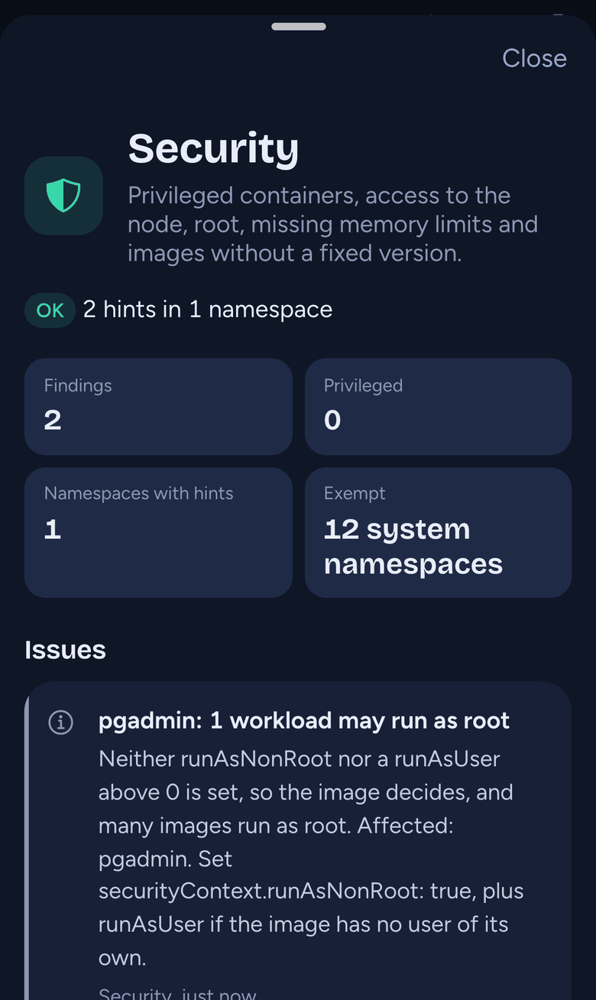
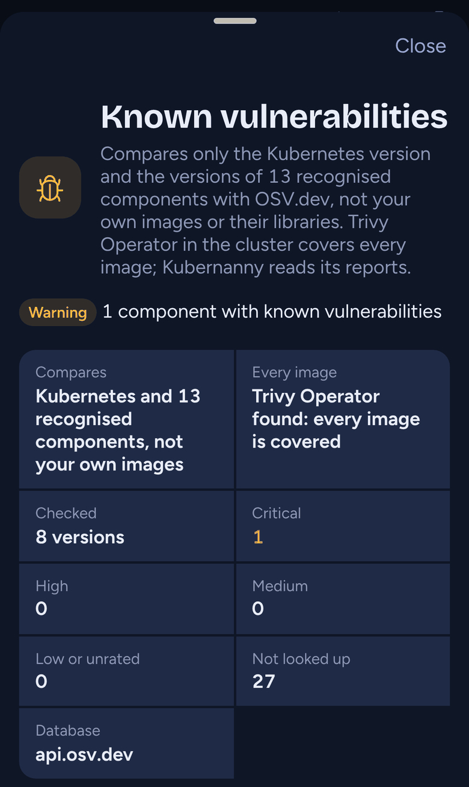

# Security checks

> **What the built-in lookup can and cannot see**
>
> The built-in `vulnerabilities` module compares **version numbers only**: the Kubernetes version and the image tags of 13 recognised components (the [table below](#mapped-components)) against OSV.dev.
>
> - It does **not** look at your own images (`ghcr.io/you/app`), at any image of a component outside that table, at the libraries inside an image, or at its base layer (Alpine, Debian, distroless). A clean result there says nothing about them.
> - It cannot tell a patched rebuild from the original when both carry the same tag.
>
> **For every image, including your own: install [Trivy Operator](#trivy-operator-trivy) in the cluster.** It scans the images that actually run, packages and base layer included, and Kubernanny reads its reports (read only, nothing leaves the cluster). The app says the same on the module's sheet: without Trivy it shows "For every image, including your own: install Trivy Operator; Kubernanny reads its reports", with Trivy "Trivy Operator found: every image is covered".

Four modules look at the security and freshness of what runs in the cluster, not at its health:

| Module | Default | Reads | Sends out of the cluster |
|---|---|---|---|
| Security posture (`security`) | on | the pod specs the run already lists | nothing |
| Known vulnerabilities (`vulnerabilities`) | **off** | `/version` and the detected components (already read) | component package names and versions to api.osv.dev, or your mirror |
| Trivy Operator (`trivy`) | on when Trivy Operator runs | its `VulnerabilityReport`s | nothing |
| Available updates (`image-updates`) | **off** | the detected components (already read) | repository names of their images to the registry each comes from ([below](#available-updates-image-updates)) |

 

*The security posture check and the vulnerability lookup in the app.*

Only the Trivy integration needs permissions of its own (read Trivy Operator's report resources, see [PERMISSIONS.md](PERMISSIONS.md)); none offers an action: they say what to change, you change it in your manifests or charts.

## Security posture (`security`)

Purely from the inventory: every pod's spec, grouped by the workload that owns it (Deployment, StatefulSet, DaemonSet, CronJob, an operator's resource such as a CNPG `Cluster`, or the bare pod).

| Finding | Severity | When | Fix in the text |
|---|---|---|---|
| `security/<ns>/privileged` | **warning** | a container (or init container) sets `securityContext.privileged: true` | remove it; grant only the capabilities needed |
| `security/<ns>/host-access` | hint | `hostNetwork`, `hostPID`, `hostIPC` or a `hostPath` volume | remove where possible; PersistentVolume instead of hostPath |
| `security/<ns>/root` | hint | a container has neither `runAsNonRoot: true` nor a non-zero `runAsUser` (container setting over pod setting), or sets `runAsUser: 0` | `securityContext.runAsNonRoot: true` (and `runAsUser` if the image has no user) |
| `security/<ns>/no-memory-limit` | hint | a container has no `resources.limits.memory` | set a memory limit |
| `security/<ns>/mutable-image` | hint | an image with the tag `latest` or no tag at all, and no digest | a fixed version or a digest |

- **One issue per finding type and namespace**, not per pod: ten replicas, or a namespace of twenty charts without limits, are one line that lists up to five workloads ("und 3 weitere"). A homelab does not drown in hints.
- **Hints never colour the light**, never cost score and are never sent. The one warning is a privileged container outside the system namespaces: whoever takes over that container has the node.
- **Left alone**: the system namespaces `kube-system`, `kube-public`, `kube-node-lease`, `calico-system`, `tigera-operator`, `cattle-system`, `cattle-fleet-system`, `longhorn-system`, `metallb-system`, `rook-ceph`, `openebs`, `system-upgrade`, plus `checks.systemNamespaces` (`SECURITY_SYSTEM_NAMESPACES`). Their pods need host access by design and are not yours to fix.
- **Host-level components**: workloads of recognised components that need privileges, host access or root wherever they are installed (Longhorn, Rook Ceph, OpenEBS, NFS provisioner, Local Path Provisioner, Node Exporter, Promtail, Grafana Alloy, kured, System Upgrade Controller, Cilium, Calico, Flannel, MetalLB, kube-vip, CrowdSec) are left out of the first three findings in any namespace. Missing limits and mutable tags still count for them.
- **Only memory limits.** CPU limits are debated (they throttle a container even when the node is idle); a missing memory limit is what lets one container push the node into evicting others.
- **Not checked**: Secrets exposed as environment variables. A pod spec only shows `secretKeyRef` and `envFrom`, not whether the value is sensitive or whether the program logs its environment, so any finding would be a guess.

Stats: findings, namespaces with privileged containers, namespaces with findings, how many namespaces are exempt.

## Known vulnerabilities (`vulnerabilities`)

### What it does

Once per run (every minute) the module collects the versions Kubernanny already knows:

- **Kubernetes**: `/version`'s `gitVersion` with the distribution suffix cut (`v1.33.4+rke2r1` becomes `1.33.4`), looked up as the Go module `k8s.io/kubernetes`, under which OSV lists the advisories of the control plane components.
- **Recognised components** whose catalog entry names an OSV package (`osv` in `agent/src/discovery/catalog.ts`), at the version of their image tag (`v1.12.0-build20250218` becomes `1.12.0`, `8.1-alpine` becomes `8.1.0`). A tag that is not a version (`latest`, a date, a digest only) is not looked up; the module's stats count those as "Ohne Abgleich".

It asks OSV which advisories affect each version (`POST /v1/querybatch`), fetches each advisory (`GET /v1/vulns/{id}`), and keeps both in memory for 12 hours, so each version is asked about at most twice a day. Records that are aliases of each other (`GO-2026-5106` and `GHSA-423p-g724-fr39` for the same CVE) count once, shown under the GHSA id.

### Mapped components

Only packages where real queries (November 2026) showed that OSV has advisories under release versions matching the image tags:

| Component | OSV package |
|---|---|
| Argo CD | Go `github.com/argoproj/argo-cd` (`/v2`, `/v3` by major version) |
| cert-manager | Go `github.com/cert-manager/cert-manager` |
| CloudNativePG | Go `github.com/cloudnative-pg/cloudnative-pg` |
| External Secrets | Go `github.com/external-secrets/external-secrets` |
| Flux | Go `github.com/fluxcd/source-controller` (only when the version came from the source-controller image) |
| Kyverno | Go `github.com/kyverno/kyverno` |
| Traefik | Go `github.com/traefik/traefik/v2`, `/v3` (v1 lived under another path: not looked up) |
| Cilium | Go `github.com/cilium/cilium` |
| Velero | Go `github.com/vmware-tanzu/velero` |
| Gitea | Go `code.gitea.io/gitea` (only the `gitea/gitea` image; Forgejo shares the catalog entry but not the version numbers) |
| Vaultwarden | crates.io `vaultwarden` |
| Weblate | PyPI `weblate` |
| n8n | npm `n8n` |

Left out on purpose, after checking:

- **Grafana**: its Go module is not versioned like its releases. OSV lists fixes as pseudo-versions (`1.9.2-0.2026…`), and advisories from 2020 without a fixed version would show up on Grafana 12.
- **Prometheus**: the Go module versions (`v0.305.0`) do not match the release tags (`3.5.0`).
- **Harbor**: fixes as pseudo-versions and `+incompatible` tags; the same false positives as Grafana.
- **Longhorn, Nextcloud, authentik, Immich, Paperless-ngx, kured, MetalLB**: OSV returned no advisories under the package names we tried, old versions included, so we could not confirm that it covers them. A clean result would only suggest safety.
- **Rancher, Portainer, ingress-nginx, Vault, Keycloak**: many advisories without any fixed version for current releases; we could not tell real unfixed issues from incomplete ranges, and did not want to guess.

Adding one: set `osv` on the catalog entry, check a few versions with real queries first (an old version with known advisories must return them, a current one should not return advisories from years ago), and add it to the table above.

### Severity

The severity of an advisory comes from its CVSS v3 vector (scored with the formula of the specification), else from the database's own label (GitHub's `CRITICAL`, `HIGH`, `MODERATE`, `LOW`; CVSS v4 vectors are not scored). Bands: critical from 9.0, high from 7.0, medium from 4.0.

One issue per affected component, `vulnerabilities/<component id>` (`vulnerabilities/kubernetes` for the cluster itself):

| Issue severity | When |
|---|---|
| critical | a critical advisory with a released fix, on a component reachable through an ingress (Ingress, HTTPRoute or Traefik IngressRoute) |
| warning | a critical advisory with a released fix on a component without one, or a high advisory with a released fix |
| hint | everything else: medium and low advisories, and advisories no release fixes yet |

A warning nobody can act on teaches people to ignore the light, so advisories without a fix stay hints. The cluster itself is never "reachable through an ingress" in this sense: a Kubernetes advisory is at most a warning.

Title and cause: `Argo CD 2.11.3: 3 bekannte Schwachstellen`, then the worst ids with their level and score, and the first release that fixes all fixable ones ("Behoben in 2.11.7"), or that no update is known yet. The app links every id to `https://osv.dev/vulnerability/<id>`, opened in the system browser; it builds that URL itself from ids that look like advisory ids, so neither the agent nor the database can make it open another site. The issue is shown on the module and on the component's own sheet. It never offers an action.

Stats: what it compares ("Kubernetes and 13 recognised components, not your own images"), whether every image is covered (the Trivy hint above), versions checked, components left to Trivy Operator, advisories per level, components without a lookup, the database host.

### "Does not apply here": accepting one advisory

Some advisories do not affect a given install: the vulnerable feature is not used, or the component is not reachable the way the advisory needs. In the app, every advisory id on a vulnerability issue has a "Not applicable" button. It asks for 30 days, 90 days or a year, and for an optional short reason, then marks that **one advisory on that one component** (`POST /api/vulnerabilities/accept`, [API.md](API.md)):

- it no longer counts for the component's issue, its severity or the module's stats; when nothing else remains, the issue disappears;
- it stays listed on the module's sheet under "Marked as not applicable", with the component, the end date, the device that marked it and the reason, with a button to let it count again;
- it expires by itself after the chosen time (a year at most), and counts again;
- the same advisory on another component, or another advisory on the same component, still counts;
- only an advisory the agent reports right now can be marked.

Hiding a real advisory is what someone with a stolen device would do, so every acceptance is announced through the notification channels before it takes effect (even with notifications paused in the app or during a maintenance window) and written to the audit log with the device. Acceptances are stored under the key `accepted` of the ConfigMap `kubernanny-settings`.

To make it impossible: Helm `vulnerabilities.allowAccept: false` (env `VULN_ACCEPT=off`). The agent then refuses accept and unaccept with 403 `ACCEPT_LOCKED` before reading or writing anything, ignores acceptances stored earlier (every advisory counts again), and the app shows no button. The default is `true`: accepting changes nothing in the cluster, it is per advisory, expires, and is announced; without it, people who know an advisory does not apply tend to silence the whole issue or switch the module off, which hides more. With `checks.disabled: [vulnerabilities]` the routes refuse too (`MODULE_OFF`).

### When the database cannot be reached

- With answers from the last 7 days in memory: the module shows them and says so ("Stand vor 3 h, api.osv.dev gerade nicht erreichbar").
- Without (first run, or the agent restarted while offline): the module shows "not checkable" with the reason. Like any module that cannot run, that keeps the light from being green (yellow, never red) and sends nothing.

### What leaves the cluster

Only while the module is switched on: OSV ecosystem names, package names and versions (`Go`, `github.com/argoproj/argo-cd/v3`, `3.1.2`), and advisory ids. No cluster name, namespace, workload name, host name, address or anything from a pod spec. api.osv.dev is run by Google; its terms and privacy policy apply to those requests. Your IP address is visible to it, as to any server.

That is why the module is **off by default**, unlike every other check. The app shows the sentence "Schickt Namen und Versionen der Komponenten an api.osv.dev (Google). Keine Clusterdaten, keine Namen von Workloads." next to its switch (with your mirror's host instead, when one is set).

### Switching it on and off

| Where | Effect |
|---|---|
| App, cluster settings → "What is checked" → "Known vulnerabilities" | on or off for this agent, stored in the ConfigMap `kubernanny-settings` |
| Helm `vulnerabilities.enabled: true` (env `ENABLED_MODULES=vulnerabilities`) | on by default for this install; the app can still switch it off, and that choice is kept |
| Helm `checks.disabled: [vulnerabilities]` (env `DISABLED_MODULES`) | locked off; the app cannot switch it on |
| `DEMO=…` | on, with a built-in database (below) |

With `networkPolicy.egress.enabled`, the chart adds egress for the database while the module is enabled in Helm: HTTPS to anywhere (a NetworkPolicy cannot name a host), unless `networkPolicy.egress.internetHttps` already allows it or `vulnerabilities.dbNamespace` names the namespace of your mirror. Switched on only in the app, the module needs that egress too.

### A self-hosted database

`vulnerabilities.dbUrl` (env `VULN_DB_URL`) replaces `https://api.osv.dev`. It must be HTTPS, or plain HTTP to an in-cluster `*.svc` host. Any server that answers `POST /v1/querybatch` and `GET /v1/vulns/{id}` the way api.osv.dev does ([API docs](https://google.github.io/osv.dev/api/)) works. Building blocks:

- The OSV project publishes its complete data set, one zip per ecosystem (for example `https://osv-vulnerabilities.storage.googleapis.com/Go/all.zip`, see [data dumps](https://google.github.io/osv.dev/data/)).
- The code of osv.dev itself is open source (`github.com/google/osv.dev`).

We have not tested a particular mirror; if you run one, a note in an issue or a pull request for this page is welcome. The links in the app keep pointing at osv.dev: opening one sends that advisory id from your phone to osv.dev, nothing else.

### Demo and tests

The demo cluster never calls the internet: `DemoVulnDb` (`agent/src/demo/demo-vulns.ts`) answers like OSV from two real records, fetched once and trimmed. In the broken scenario the CloudNativePG operator runs 1.26.1, affected by GHSA-423p-g724-fr39 (critical, CVSS 9.9, fixed in 1.28.3, no ingress: a warning); the other scenarios run 1.28.3 and stay clean. The tests use a fake `fetch` for the OSV client.

## Trivy Operator (`trivy`)

[Trivy Operator](https://github.com/aquasecurity/trivy-operator) (Aqua Security, Apache-2.0) runs in your cluster, scans the image of every workload with Trivy and stores the result as a `VulnerabilityReport` per container. When Kubernanny recognises it (its image `aquasec/trivy-operator`, also under `mirror.gcr.io` or `ghcr.io/aquasecurity/trivy-operator`), the `trivy` integration reads those reports. This is the way to cover your own images and everything the built-in lookup cannot see. Code: `agent/src/modules/integrations/trivy*.ts`.

### What it reads, and what it does not do

- `vulnerabilityreports.aquasecurity.github.io` (namespaced, listed across all namespaces) and, where the resource exists, `clustervulnerabilityreports.aquasecurity.github.io`. Get and list, nothing else: no write, no other resource, **no connection out of the cluster** (Trivy Operator itself downloads its database; that is its traffic, not Kubernanny's).
- Lists are read in pages of 100 (`limit`/`continue`), at most 5,000 reports per run. Each report is reduced at once to its counts (`report.summary`) and the worst advisories (the worst 10, plus the worst 10 with a fix, which decide the severity); the rest of the report is dropped. A cluster with thousands of reports costs a few advisories per workload in memory.
- Fields used, as in Trivy Operator's v1alpha1 CRD (checked against its CRD definition and label constants, November 2026): labels `trivy-operator.resource.kind`, `.resource.name`, `.resource.namespace`, `trivy-operator.container.name`; `report.updateTimestamp`, `report.artifact.repository/tag/digest`, `report.summary.*Count`, `report.vulnerabilities[].vulnerabilityID`, `severity`, `score`, `fixedVersion`, `installedVersion`, `resource`. `primaryLink` is not used: the app builds the osv.dev link from the id itself (osv.dev also has pages for CVE ids).
- A report belongs to a Deployment (Trivy scans it through its ReplicaSet, `<deployment>-<hash>`), StatefulSet, DaemonSet or CronJob that still exists. Reports of bare pods, Jobs and cluster-scoped resources are counted ("Reports without a workload"), not shown.
- **Stale reports are ignored**: older than 14 days (Trivy Operator rescans every 24 hours by default), or of an image the container no longer runs (repository and tag, or the digest where both sides have one, compared with the workload's spec). Counted as "Old reports skipped".

### Severity

Exactly the rules of the built-in lookup ([above](#severity)), one issue per workload, `trivy/<namespace>/<kind>/<name>`:

| Issue severity | When |
|---|---|
| critical | a critical advisory with a `fixedVersion`, on a workload reachable through an ingress (a Service of its pods behind an Ingress, HTTPRoute or Traefik IngressRoute) |
| warning | a critical advisory with a fix on a workload without one, or a high advisory with a fix |
| hint | everything else: no fix yet, medium, low, unknown |

The level is Trivy's own `severity`; only where it says `UNKNOWN` and a `score` is given, the score's CVSS band. Title and cause like the built-in issue: `social-importer (default): 1 known vulnerability`, the worst ids with level and score, the package versions that fix them ("Fixed in newer package versions: cross-spawn 7.0.5. Rebuild the image or use a newer one."), and which image was scanned how long ago. The issue is shown on the Trivy module and on the sheet of the recognised component the workload belongs to (Valkey's report on the Redis / Valkey sheet). It never offers an action.

### Built-in lookup and Trivy together

When both run, a component whose **every** workload has a fresh Trivy report is left to Trivy: the built-in lookup does not look it up (so it is not even sent to OSV) and shows no issue for it; its stats count it as "Left to Trivy Operator". Trivy scanned the actual image, packages and base layer included, so its findings are the better ones, and the same advisories would otherwise show twice. Components without a fresh report for every workload, and Kubernetes itself, stay with the built-in lookup. Tested in `agent/src/modules/integrations/trivy.spec.ts`.

### "Does not apply here"

Works for Trivy findings exactly as [for the built-in lookup](#does-not-apply-here-accepting-one-advisory): same button, same routes and storage, same announcement and audit log. The component is the workload, `trivy:<namespace>:<kind>:<name>` in lower case (`trivy:default:deployment:social-importer`), so accepting an advisory on one workload leaves it counting on every other. `vulnerabilities.allowAccept: false` locks it for both. Accepting works while the built-in lookup or the Trivy integration runs; with both in `checks.disabled` the routes refuse (`MODULE_OFF`).

### Switching it off

| Where | Effect |
|---|---|
| App, cluster settings → "What is checked" → "Trivy Operator" | off for this agent, like any recognised component |
| Helm `checks.disabled: [trivy]` (env `DISABLED_MODULES`) | locked off: never runs, the app cannot switch it on, and the chart grants no permission on the report resources |

### Suggested Trivy Operator settings

Suggestions only, for a small cluster where the light should mean something; check them against the documentation of your Trivy Operator version. The keys below are those of its Helm chart's `values.yaml` on the main branch in November 2026 (chart 0.38.1).

- **Only fixable findings**: `trivy.ignoreUnfixed: true`. Kubernanny shows unfixed advisories only as hints anyway; without them the reports are smaller and the list shorter.
- **Only what can turn the light**: `trivy.severity: HIGH,CRITICAL`. Medium and low never colour the light here.
- **One database instead of one per scan job**: client-server mode, `operator.builtInTrivyServer: true` (or `trivy.mode: ClientServer` with your own `trivy.serverURL`). Scan jobs then do not each download the vulnerability database.
- **Leave out what you do not run yourself**: `excludeNamespaces` (comma-separated, globs allowed), for example `kube-system`.
- **Memory of the scan jobs**: `trivy.resources.limits.memory`. The chart's default (500M at the time of writing) can be too little for large images; scan jobs killed for memory leave no report, so those workloads keep the built-in lookup.
- Leave `operator.vulnerabilityScannerScanOnlyCurrentRevisions` at its default `true`: reports of old ReplicaSets would be skipped as stale anyway.

### Demo and tests

The broken demo cluster runs Trivy Operator with reports for two workloads: `social-importer` (an own image, a fixable high: a warning) and `shop-api-valkey` (an unfixed medium: a hint, shown on the Redis / Valkey sheet), plus one report of an image `social-importer` no longer runs (skipped). The advisory records are trimmed illustrations. The healthy and warning scenarios have no Trivy Operator. `new-checks-switches.spec.ts` proves that `checks.disabled: [trivy]` runs nothing, lists nothing and generates no RBAC rule.

## Available updates (`image-updates`)

Hints that a recognised component has a newer release: newest patch of the running minor, newest minor of the running major, newest major. Never a warning: an upgrade is a decision, and a newer tag says nothing about whether the running one is broken. Off by default, because it contacts public registries. Code: `agent/src/modules/image-updates/`.

### What it looks up

- Recognised components only (the catalog, not `customComponents`), and only when their image tag is a plain release: `1.2.3` or `v1.2.3`. Tags with a suffix (`-alpine`, `-build20250218`, `-rc.1`), two-part tags, date tags, `latest` and digest-only images are counted as "not checkable", because the newer equivalent of a flavour or a build cannot be told from a tag list.
- Candidates must be written like the running tag (with or without `v`), have no suffix, and be at most three majors ahead (a stray tag like `99.0.0` is not a release).
- Only images from these registries; an image from any other host is counted, never contacted:

| Registry in the image name | Hosts contacted |
|---|---|
| `docker.io` (also no host, `index.docker.io`) | `registry-1.docker.io` (tags), `auth.docker.io` (anonymous token) |
| `ghcr.io` | `ghcr.io` (tags and anonymous token) |
| `quay.io` | `quay.io` (tags and, if asked for, anonymous token) |
| `registry.k8s.io` | `registry.k8s.io`, and the Google Artifact Registry host it redirects to (`<region>-docker.pkg.dev`); no token |

### What leaves the cluster

Per image, at most every 12 hours: `GET https://<registry>/v2/<repository>/tags/list?n=1000` (and the `Link` pages after it, up to 10, only as paths on the same host), and where the registry answers 401, one `GET` to its token endpoint with `scope=repository:<repository>:pull`. That is the repository name (`library/traefik`, `cloudnative-pg/cloudnative-pg`), a fixed `User-Agent: kubernanny-agent` and nothing else: **not the running tag**, no cluster name, namespace, workload or host name, no credentials. The registries see your IP address, as any server does, and their terms apply.

Guards: a token is only fetched from the realm host listed above for that registry (a 401 naming another host fails the lookup), the token is never sent to a redirect target, redirects are followed only for `registry.k8s.io` and only to `*.pkg.dev` over HTTPS, at most three. Answers are trimmed to well-formed tag strings (at most 20,000).

### When a registry cannot be reached

Answers up to 7 days old are used; that registry is then left alone for 15 minutes (the check runs every minute). When no registry answers at all and nothing is cached, the module shows "not checkable" (yellow, never red), like `vulnerabilities`.

### Switching it on and off

| Where | Effect |
|---|---|
| App, cluster settings → "What is checked" → "Newer versions" | on or off for this agent, stored in the ConfigMap `kubernanny-settings` |
| Helm `imageUpdates.enabled: true` (env `ENABLED_MODULES=image-updates`, comma-separated with `vulnerabilities`) | on by default for this install; the app can still switch it off |
| Helm `checks.disabled: [image-updates]` (env `DISABLED_MODULES`) | locked off: it never runs, so no registry is contacted, the app cannot switch it on, and the chart adds no egress rule for it |
| `DEMO=…` | on, with canned tag lists (below) |

With `networkPolicy.egress.enabled` and `networkPolicy.egress.internetHttps: false`, the chart adds HTTPS egress to anywhere (a NetworkPolicy cannot name a host) only while `imageUpdates.enabled` is set and `checks.disabled` does not name the module. Switched on only in the app, it needs that egress too.

### Demo and tests

`DemoRegistry` (`agent/src/demo/demo-registry.ts`) answers with fixed tag lists, so neither the demo nor the tests contact a registry: in the broken scenario Traefik 3.3.6 has a newer patch and minor and the CloudNativePG operator 1.26.1 a newer patch and minor; the other scenarios see nothing newer. The registry client is tested with a fake `fetch` (token flow, refused realms and redirects, cache and backoff), and `new-checks-switches.spec.ts` proves that with the module off or locked no `fetch` happens.
